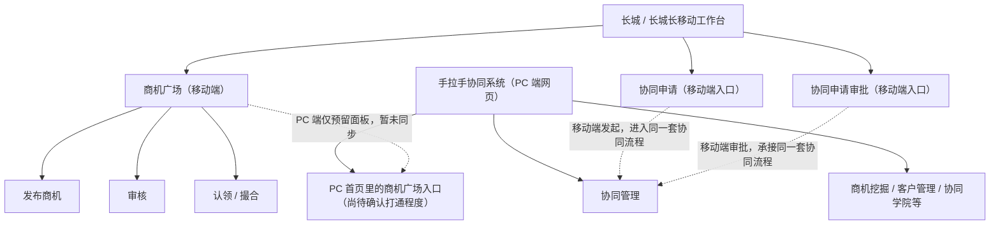

# 协同平台与商机广场产品研究 · 起点

> 状态：Codex 版起点，替代 Work Buddy 同步过来的旧草案；2026-07-17 根据新截图和用户补充再次纠偏。
> 原则：先尊重当前内部认知，不把公开新闻里的平台强行当竞品；竞品必须有网址、截图、演示页或可信材料支撑。

## 1. 当前更正后的产品关系

我现在先按这个关系理解：

- **手拉手协同系统**：PC 端网页系统，核心是业务协作。典型场景是客户经理有投行、研究等公司服务需求时，发起协同申请，请总部相关人员协作。
- **商机广场**：移动端产品，核心是对接双方商机，包括并购等商机的发布、审核、认领与撮合。商机可以在商机广场内闭环，不必然进入协同流程。
- **长城 / 长城长移动工作台**：承载移动端入口。新截图显示，在「手拉手」分组里已经出现商机广场、协同申请、协同申请审批的 test / uat 入口。
- **当前观察**：协同管理和商机广场现阶段是两条业务板块 / 功能入口，起点和业务对象不同。协同申请在移动端提交后会进入 PC 端同一套协同流程；商机广场目前主要在移动端闭环，PC 首页只是预留面板，尚未同步移动端数据，也不能发布商机。长期目标可能是统一进「手拉手」系统。

## 2. 这份报告应该研究什么

报告主问题不是「商机广场是不是协同平台里的一个模块」，而是：

> 长城证券为什么需要在手拉手体系里同时建设协同管理和商机广场？这两类能力分别解决什么业务问题，又为什么会在 PC 首页和移动工作台上互相出现入口？

这个问题比旧草案更贴近你最近的工作：你不是泛泛研究金融科技，而是在研究「手拉手统一系统」下，协同管理和商机广场两类能力各自的业务边界，以及它们为什么会在同一个工作台体系里并排出现。

## 3. 先用内部证据，不急着硬找竞品

目前仓库里可用的内部证据比外部竞品更可靠：

- [[材料/PRD_商机广场|PRD_商机广场]]：商机广场的功能定义、角色、状态、脱敏、有效期。
- [[工作产出/2026-07-09/手拉手协同系统-新人教学文档|手拉手协同系统-新人教学文档]]：协同平台 7 个板块与 PC 端功能结构。
- `images/` 截图：商机广场首页、工作台入口、发布页、我的页，以及 PC 端商机挖掘 / 协同管理等界面。
- `images/长城工作台-手拉手入口.png`：移动端工作台里「手拉手」分组同时出现商机广场、协同申请、协同申请审批入口。
- `images/协同申请审批记录-PC端.jpg`：PC 端协同申请审批链路，显示提交、本部负责人审核、投行综合部审核、投行部门负责人审核、完成等节点。
- 7.14-7.16 两份操作文档和补强版 PPT：你已经跑通过发布、审核、认领、撮合等实际流程。

竞品先不下结论。外部资料如果没有可打开的产品页面、截图或演示，不足以证明它和商机广场是同类产品。下一步应该把竞品调查拆成「待核验对象清单」，每个对象必须补：官网 / 应用入口 / 截图 / 功能范围 / 是否内部平台 / 是否有商机撮合和分润。

## 4. 建议报告框架

### 第一章：产品关系与研究范围

- 手拉手协同系统、商机广场、长城 / 长城长工作台分别是什么。
- 明确现阶段的两类能力边界：一个偏业务协作流程，一个偏商机撮合；长期目标可能是进入同一套手拉手系统。
- 说明它们现在在入口层互相出现，但业务链路不能简单合并：协同是投行 / 研究等服务协作，商机是并购、撮合等机会对接。

### 第二章：为什么需要两个入口

- PC 端适合复杂协同流程、审批、执行和财务确认。
- 移动端适合在外快速提报商机、认领商机、处理轻量协同申请 / 审批。
- 协同申请需要 PC 端完整流程 + 移动端高频入口；商机广场则可以在移动端独立完成发布、审核、认领和撮合。

### 第三章：入口并置与流程边界

- 移动端商机广场：发布、审核、认领、撮合。
- PC 端手拉手：申请协同、确认协同、执行跟进、财务确认。
- 移动端新增协同申请 / 协同审批入口，说明 PC 协同流程正在移动化，且移动端提交后会进入同一套协同流程。
- PC 首页出现商机广场，目前只能说明预留了商机板块；数据未与移动端同步，也不能发布商机。

### 第四章：角色为什么这样设计

- 商机提报人：把线索放进平台，换取留痕和激励保障。
- 商机认领人：寻找自己能承接的项目机会。
- 商机审核员：控制信息质量、敏感信息披露与合规风险。
- 运营 / 管理角色：维护商机质量、状态和平台秩序。

### 第五章：竞品调查方法

- 不直接把华泰、申万、金证等公开新闻当作「同类竞品」。
- 先确认它们到底是机构客户服务平台、投行项目管理平台、办公协同平台，还是商机撮合平台。
- 每个竞品必须补截图或入口，否则只作为行业背景，不作为功能对标。

### 第六章：初步产品判断

- 商机广场的价值不是替协同平台做移动入口，而是在移动端承接并购、撮合等商机对接，让商机在平台内完成发布、审核、认领与撮合。
- 协同系统的价值则是把投行、研究等公司服务需求变成可审核、可分派、可跟进的协同流程。两者可以在入口层逐渐统一到手拉手系统，但业务逻辑不必然前后相连。

## 5. 下一步调查清单

- 补 PC 端首页里商机广场预留面板的截图，记录它目前不能发布商机、也未同步移动端数据。
- 补移动端「协同申请 uat」的关键步骤截图，确认移动端字段是否覆盖 PC 端完整申请字段。
- 继续补移动端「协同申请审批 uat」截图，确认不同业务大类是否路由到不同业务部门。
- 对照 PRD 和你跑过的流程，分别画出「商机广场闭环」和「协同申请审批流」，不要强行画成一条前后链路。
- 竞品只先列候选，不写结论；每个候选补链接或截图后再判断。

## 关联笔记

- 日期：[[日期索引/2026-07-17|2026-07-17]]
- 产品研究：[[产品研究]]
