# 手拉手协同平台 · 流程记录

把"申请协同"整个流程走了一遍，边走边记，截图都贴在对应的步骤下面。

先说这平台干嘛的：它是公司内部"接活儿+分钱"的中介。营业部（叫分支机构）碰到自己搞不定的企业需求，比如客户想上市、想被并购、想发债融资，就在平台上发申请，让总部专业部门（投行/研究）来接，干成了按规则分润。它只管"对接需求+分账"，真正干活（上市、做并购、写研报）不在这里。

提醒自己：是三段接力——申请协同 / 协同确认 / 财务确认。申请协同是我（分支机构）说"我有个需求谁接"，协同确认是两边谈这单怎么干、钱怎么分，财务确认是对账调考核。
**进度说明（先记一笔，免得误以为这是全部）**：到目前为止这份记录走完了**投行业务和研究业务的两段**——申请协同+ 协同确认。最后的"财务确认"平台并未开放这个功能。

## 目录

**板块一 · 操作手册**
- [[#(a) 协同管理：投行条线与研究条线]]
  - [[#角色总览：走之前先认几个人（协同申请阶段的各审批人）]]
  - [[#审批路由总览：不同条线不一样]]
  - [[#投行业务 · 申请协同（4 步）]]
  - [[#投行业务 · 协同确认（3 步）]]
  - [[#研究业务 · 申请协同（6 步）]]
  - [[#研究业务 · 协同确认（5 步）]]
  - [[#两线整体差异对比]]
  - [[#(b) 手拉手协同平台的其他附属功能]]
    - [[#(b1) 商机挖掘：协同的"上游来源"]]
      - [[#关注的企业：从关注列表直接发起协同]]
      - [[#拜访记录：每一次见客户都能挂上协同]]
      - [[#联系人：协同申请里要填的对接人都在这里]]
    - [[#(b2) 客户管理：已建档的客户池]]
      - [[#我能签的客户]]
      - [[#潜在客户（来源逻辑待问导师）]]
    - [[#(b3) 协同学院：知识库 + AI 答疑]]

**板块二 · 客户经理视角使用手拉手协同平台**
- [[#一、客户经理到底在干什么]]
- [[#二、客户经理怎么帮客户做"投行"服务（企业客户要上市 / 发债 / 被并购）]]
- [[#三、客户经理怎么帮客户做"研究"服务（企业客户要研报 / 调研 / 路演）]]
- [[#四、为什么需要"协同"]]
- [[#五、客户经理发起协同之后还干什么（全周期角色）]]
- [[#六、把各模块串起来：客户经理的一天（怎么用得顺、真正提效）]]

- [[#待补（基本收尾）]]

## 板块一：操作手册

### (a) 协同管理：投行条线与研究条线

#### 角色总览：走之前先认几个人（协同申请阶段的各审批人）

- **提交人 / 客户经理**：营业部的业务人员，天天跑客户挖需求。他不一定懂怎么上市，但知道客户想上市。需求从他这出来，所以由他发起。
- **产品经理 / 业务对接人**：⚠️ 他不是审批的人！是申请表上由提交人"建议指派"的一个字段，将来真接单干活的人
- **客户联络人**：⚠️ 是公司**内部**的人（另一个同事），不是客户方的人！字段只能选公司内部员工。和客户经理的区别：客户经理是这单的发起人（提交人），客户联络人是系统里登记"日常谁跟这家客户对接"的内部同事——同一家客户可能多个同事都接触过，这里填那个具体的对接同事。别和"客户方的人"搞混。（有可能客户联络人是某领导，但安排下属去发对接）
- **分支机构本部合规经理**：营业部里管"这事违不违规"的人，不做业务。本地先卡一道合规，过了才往总部送。
- **分公司负责人**：本地老大，抄送知会一下，不实际批。
- **投行条线管理员**：总部投行业务里管"接需求、分活"的人。营业部不知道总部谁具体能干这活，得他这个"派单员"把需求转到对的人。
- **合规部投行条线**：总部合规里专门盯投行的。投行涉上市发债保荐，强监管，本地合规管不了这么深，总部得再卡一道。
- **投行二级部门负责人**：投行业务部管一个组的老大，最终拍板接不接。抄送投行一级部门负责人（更大老大，知会）。

#### 审批路由总览：不同条线不一样

我翻了下审批列表，里面 38 条，当前节点五花八门。投行业务走"投行条线管理员→合规部投行条线→投行二级部门负责人"；研究院业务走另一套（研究条线管理员→研究合规→研究中心主任）。业务性质决定合规点，所以审批链不同。

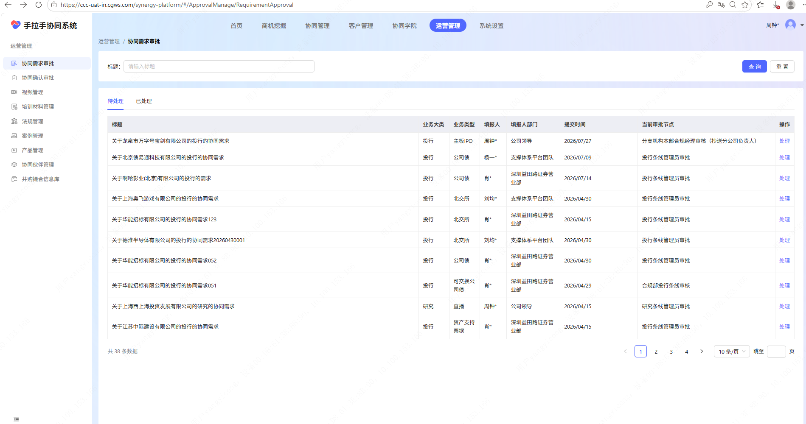

#### 投行业务 · 申请协同（4 步）

我发起的这个单子：龙泉市万字号宝剑有限公司，主板 IPO，提交人是我（周钟\*，公司领导）。

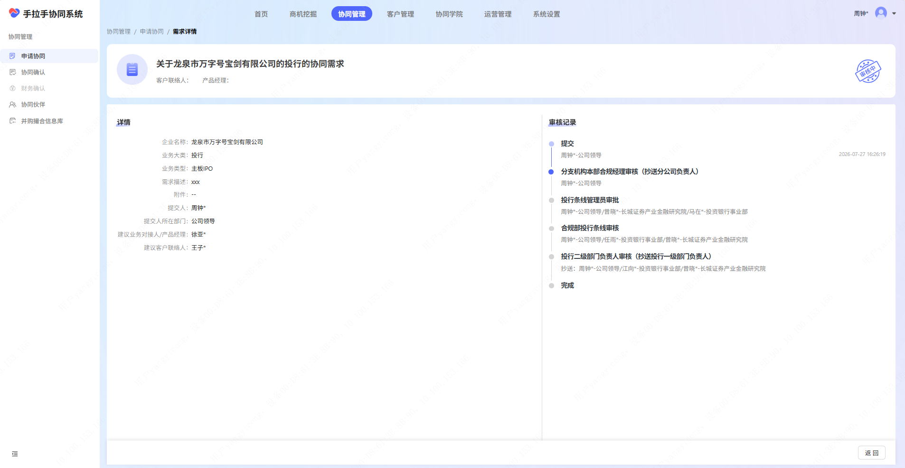

表左边"业务信息"那栏有几个字段：业务大类（投行）、业务类型（主板IPO）、企业名称、需求描述，还有**建议业务对接人/产品经理：徐亚\***、**建议客户/接单人：王子\***。
顺带记一个走的时候纠结的点：**客户联络人到底是谁？** 表单里既要填客户经理（就是我，这单发起人），又要单独填客户联络人，他俩不是一个人吗？——可以是一个人，也可以不是。关键纠正：**客户联络人必须是公司内部的人（另一个同事）**，不是客户方的人！我之前误以为客户联络人是客户公司的董秘/财务总监，实测字段只能选公司内部员工。所以这里填的是"公司内部、日常负责跟这家客户对接的同事"——比如这家客户平时是另一个同事在维护，就填他。客户经理是发起人，客户联络人是系统里登记客户关系归属的内部同事，两个字段分开是为了厘清"这单谁发起"和"这家客户平时谁跟"。

（一聪哥点破根因：之所以单独分"客户联络人"，是因为**填表发起协同的人，未必就是日常跟客户对接的人**——比如客户其实是跟你的领导在对接、领导派你填表，那你只是发起人、客户联络人该填实际对接客户的领导/同事。两个字段分开，正是为了厘清"这单谁发起"和"这家客户平时谁在跟"。）

右边是审核记录时间线，真实的审批链就这 4 步：

**① 分支机构本部合规经理 审核**（抄送分公司负责人）

本地合规先过。这步截图：

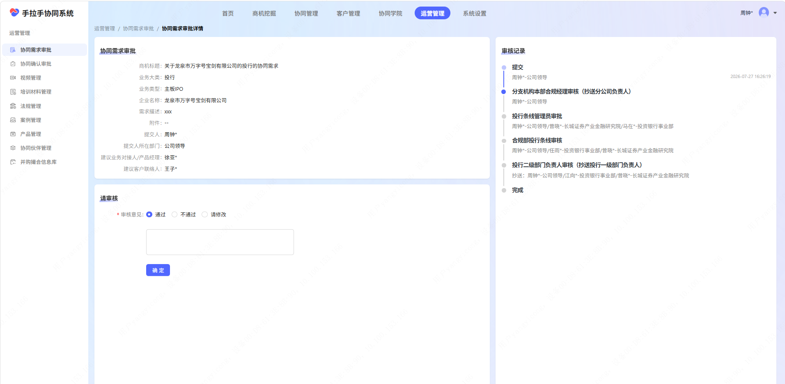

**② 投行条线管理员 审批**

总部派单员确认业务归属、指派对接人。

**③ 合规部投行条线 审核**

总部投行合规卡承销保荐那摊风险。

**④ 投行二级部门负责人 审核**（抄送投行一级部门负责人）

总部业务老大批。

全部过完，状态变"完成"，进入协同确认阶段——这时候徐亚*作为对接人才开始接单谈分润。

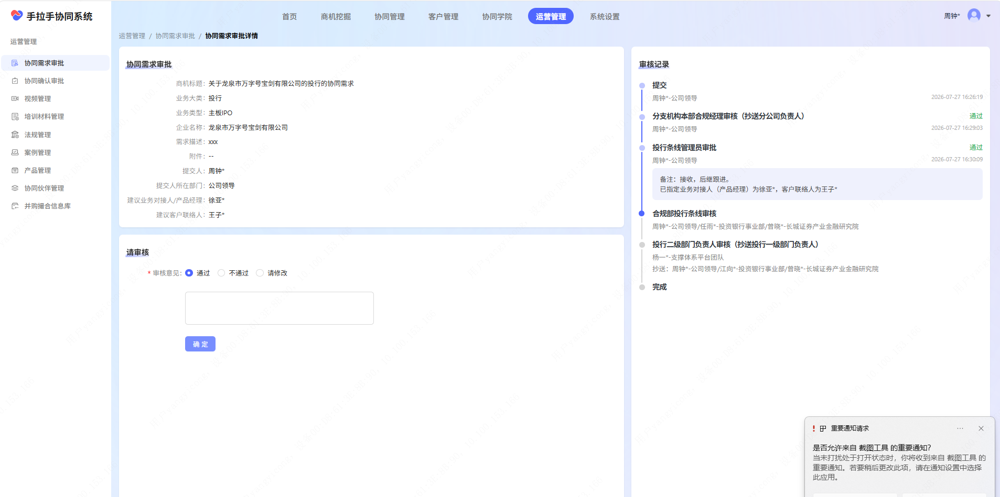

#### 投行业务 · 协同确认（3 步）

申请协同跑通才轮到这一段。两段之间的接口是：申请协同只说"营业部有什么需求、想请谁接"；协同确认要把"接了单之后怎么分钱、谁来承担"这摊事落地。先讲个走的时候碰到的小插曲，不然后面两单的截图混在一起会看晕。

##### 一个插曲：换公司和切换账号

我用自己账号发起的第一单（万字号宝剑，主板 IPO，编号 TH20260727001）所有审批都跑完了，但有两个审批节点我登不上相关领导的账号——按规矩必须以"相关审核人"身份签批才能放行节点。生产里这种情况就是"等领导上线"，我做测试没办法只能换路线：另用了一单（**成都和鼎科技，北交所**，编号 TH202511211005），切到杨一\*的账号，从支撑体系平台团队身份继续把审批推完，完成了协同确认最后几步的截图。

所以下面两单的截图会一起出现——
- 万字号宝剑（TH20260727001）是"已经填好的协同确认长什么样"的样例；
- 成都和鼎（TH202511211005）才是"审批节点一步一步推进"的全过程。

右上角的用户名看到杨一\*就是切过去之后那个身份。
可以看到协同申请审批走完的右边会多一个协同确认选项，可以点击进入协同确认环节
![[images/Pasted image 20260728093905.png]]

##### 协同确认的表单：分润方案 + 考核归属

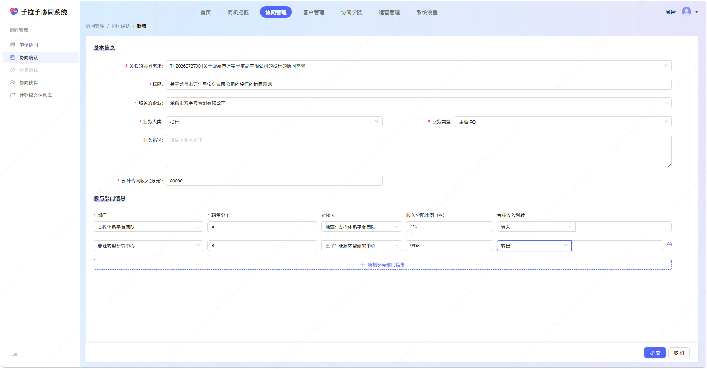

万字号这单的编制页。录入的时候有几个字段先后要交代一下我的理解：

- **关联的协同需求**：必填，下拉里只列"申请协同已通过"那批单子（编号 TH20260727001 这种），从那边把对应的需求带过来。
- **服务的企业 / 业务大类 / 业务类型**：从关联的需求带出来，不用重填。
- **预计合同收入（万元）**：将来这单预计签下来的总盘子。
- **参与部门信息**：这一段是协同确认的核心，要按部门拆开，每部门一行：
  - **部门**：参与这单的具体部门（投行下分好多业务部门，比如业务八部、资金中心团队；也有总部层面的支撑体系平台团队、能源转型研究中心这种）。
  - **职能分工**：我编造A、B 这种代号，实际情况填真实分工
  - **对接人**：每个部门的接单人——和申请协同里"建议业务对接人"那个字段不一定要一致。
  - **收入分配比例（%）**：两部门之间分润的比例
  - **考核收入划转**：并入 / 转出——这一栏决定了将来考核指标算到哪个部门头上。简单说就是"钱按比例走，但成绩单归属另一个口径"。

##### 协同确认的审批流（4 步走通）

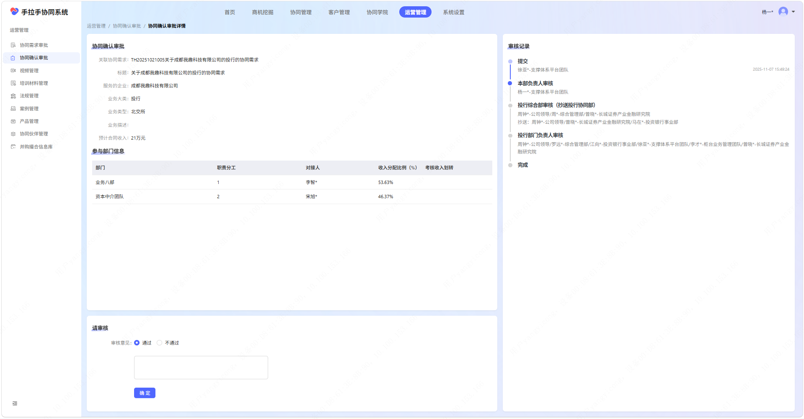
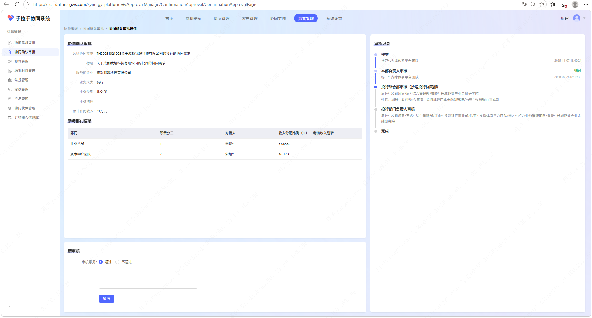
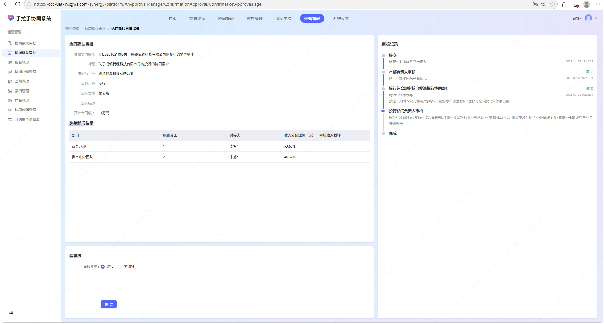
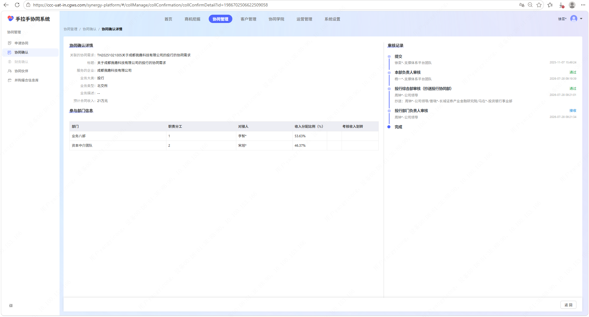

对比 PDF 汇报材料 P11–P14 那张流程图，现实里走下来跟图基本一致。==*我好奇生产环境中，技术上如何实现不同的协同都能准确的分配到正确的审批人？*==

##### 这次多认识了几个角色（协同确认审批人）

- **投行综合部**：投行业务内部做"跨部门协调"的中枢。一单如果除了两个接单部门（A、B）之外还要它确认"两个部门接这单符合规划、合规和资源安排"，相当于一道"内部分工复审"。
- **投行部门负责人**：比申请协同里的"投行二级部门负责人"高一层，是投行业务条线一级的最终拍板人。协同确认涉及钱怎么分，要这一层把关。
- **本部负责人（协同确认阶段的）**：申请协同里那个"分公司负责人"在分支，这步是**接单部门内部**的本部负责人——支撑体系平台团队里管这一摊的人。生产中作为接单部门"我要接这单、确认归属"的内部签字。

##### 一个测试上的经验：账号切换

我这次为了把流程跑通必须切至少三个不同身份——自己发起的、提供"接单部门本部负责人"身份的（杨一\*），还有一步节点的"投行综合部"和"投行部门负责人"。生产环境里这些都是同一个"协同确认流程"自动转给相关人去办，相关人员按节点接力即可，不用自己登多个账号。但我做内部测试得记住这个切换规则——不然跑到一半卡住不知道该登谁的账号。

##### 这段用到的截图

- `shot_confirm_form_wanyu.png`：万字号这单协同确认编制页（首次填分润方案）。
- `shot_confirm_detail_wanyu.png`：万字号协同确认完成后。
- `shot_confirm_approval_chengdu_bumen.png`：成都和鼎协同确认停在"本部负责人审核"节点。
- `shot_confirm_approval_zonghebu.png`：成都和鼎推到"投行综合部审核"且通过。
- `shot_confirm_approval_bumen_fzr.png`：成都和鼎推到"投行部门负责人审核"且通过。
- `shot_confirm_detail_chengdu.png`：成都和鼎最终协同确认完成。

#### 研究业务 · 申请协同（6 步）

研究条线也完整走了一遍。这次跑了两个单子：

- **比亚迪**（Y20250723001，关于比亚迪汽车研究特斯拉的协同需求）——申请协同 + 协同确认全跑完

两单截图交叉看，能清楚看出研究条线跟投行条线在审批路由上的差别。

##### 表单字段怎么填

用比亚迪（研究特斯拉）做例子。下面这张图是填好的样子：

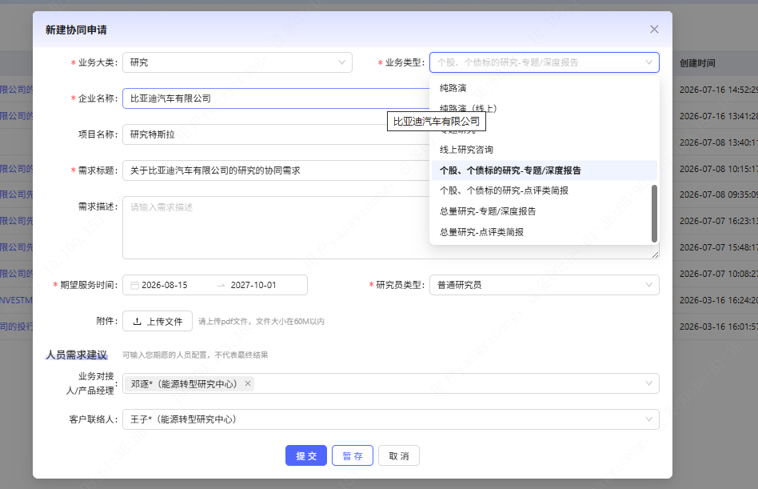

- **业务大类**：研究
- **业务类型**：下拉选项很多——个股/个股的研究-专题/深度报告、个股/个股的研究-点评类报告、总量研究-专题/深度报告、总量研究-点评类报告、线路演（线上）、线上研究咨询、其它。这次填的是「个股、个股的研究-专题/深度报告」
- **企业名称**：
- **项目名称**：具体研究主题。研究特斯拉
- **需求标题**：一句话概括。关于比亚迪汽车有限公司的研究的协同需求
- **期望服务时间**：研究服务起止。2026-08-15 至 2027-10-01（覆盖整个研究周期）
- **研究员类型**：普通研究员 / 首席研究员 / 资深研究员。这次填普通研究员
- **附件**：可上传研究底稿、客户原始材料等（限 60MB 内 pdf）
- **建议业务对接人/产品经理**：填邓波\*（能源转型研究中心）
- **建议客户/接单人**：填王子\*（能源转型研究中心）
- **客户联络人**：同投行条线规则，是公司内部负责日常对接这家客户的同事

##### 审批流（6 步）

下面这张是申请协同审批详情页，能看到完整的 6 步审批链：

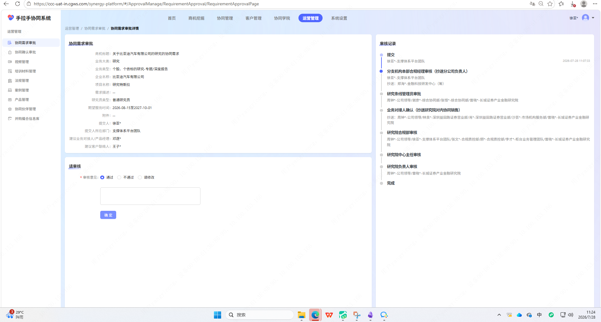

每一步都对号入座。比投行条线多 2 步（6 vs 4），而且其中一步是研究条线独有的：

| # | 节点 | 谁 | 说明 |
|---|---|---|---|
| 1 | 分支机构本部合规经理审核（苏达分公司负责人） | 分支机构 | 本地合规 + 分公司负责人抄送 |
| 2 | 研究条线管理员审核 | 总部研究条线 | 类比投行的「投行条线管理员」——派单员 |
| 3 | **业务对接人确认** | 业务对接人（接单人，如王子\*） | ⚠️ **研究条线独有，投行条线没有这关** |
| 4 | 研究合规部审核 | 总部研究合规 | 合规部卡研究业务风险 |
| 5 | 研究中心主任审核 | 研究条线 | 研究中心层级拍板 |
| 6 | 研究负责人审核 | 研究条线 | 研究条线最终拍板人 |

各节点推进的截图：

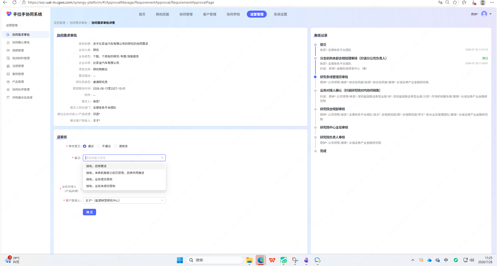
（节点 2/3 视角——审批意见下拉，可以看到「业务对接人」字段）

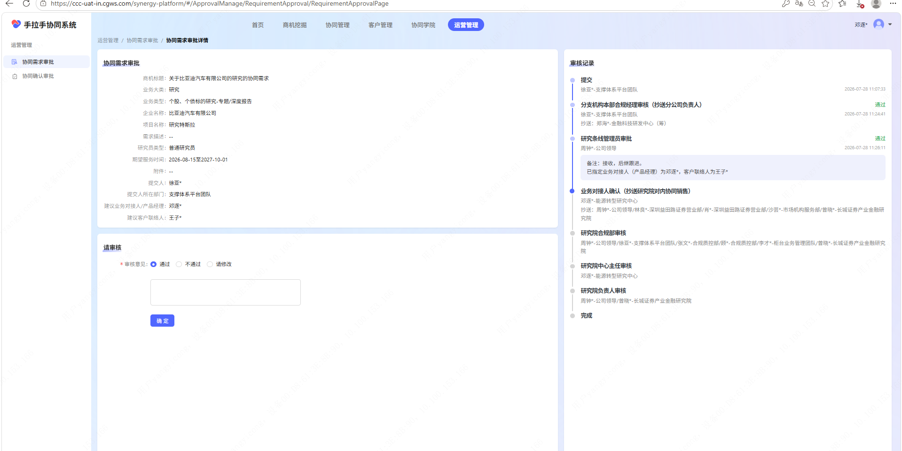
（节点 3「业务对接人确认」已通过——这是研究条线独有的一步）

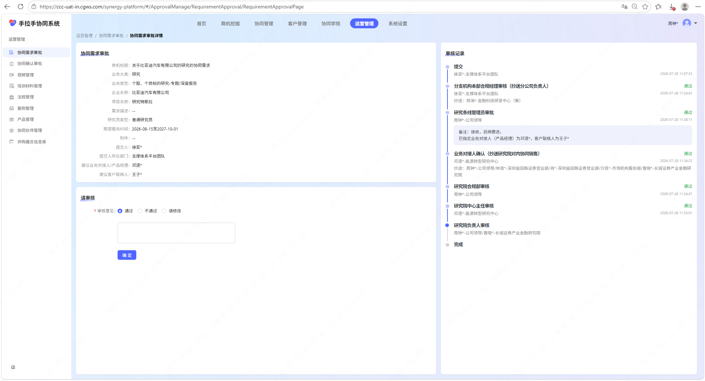
（全部 6 步完成，进入协同确认阶段）

##### 关键发现：研究条线连「申请协同」阶段就要对接方确认（投行没有）

- 投行条线（之前做的万字号宝剑/成都和鼎）：申请协同的 4 步审批里**全程没有**让对接人确认过——审批是单边审核。
- 研究条线（这次的比亚迪）：申请协同走到第 3 步**必须**让「业务对接人确认」——也就是接单方（邓逐）

具体为什么？——一聪哥解答：**投行是"部门对部门"的协同**：申请协同审批走完部门负责人那一层拍板后，负责人内部再把活分派给具体职员，不需要那个对接职员本人同意。而**研究是"对接到具体研究员"**：协同得落到某个研究员头上，得研究员本人安排时间 / 点头才推进得下去，所以申请协同阶段就多一道"业务对接人确认"（即研究员本人确认接单）。

#### 研究业务 · 协同确认（5 步）

跟投行条线的协同确认结构基本一致，也是「接单方发起 + 分账方案 + 审批流」，但审批节点不一样。

##### 表单字段

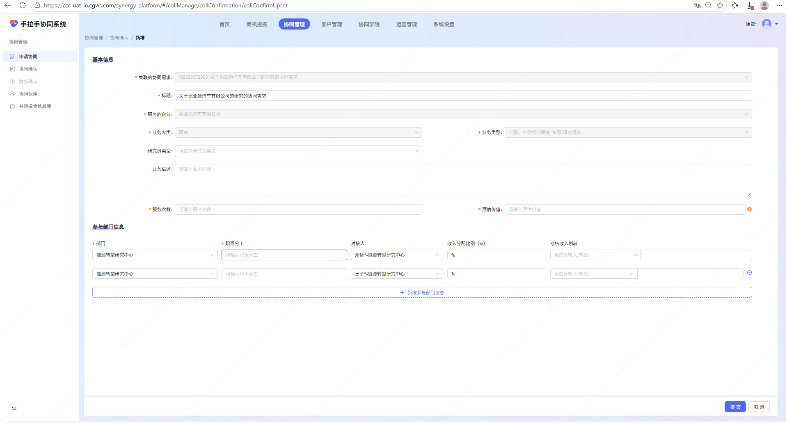

- **关联的协同需求**：下拉选已通过的申请协同单（Y20250723001 这种）
- **标题 / 服务的企业 / 业务大类 / 业务类型**：从关联需求带过来
- **研究员类型**：选择本次研究的具体研究员类型
- **业务承诺 / 服务次数**：
- **预计价值**：本次研究服务的预计金额（万元）
- **参与部门信息**：跟投行一样按部门拆行
  - **部门**：能源转型研究中心
  - **职能分工**：
  - **对接人**：本次研究的具体负责人（如邓波\*、王子\*）
  - **收入分配比例**：两部门之间分润比例
  - **考核收入划转**：并入 / 转出——成绩单归属

##### 审批流（比亚迪单最终详情）

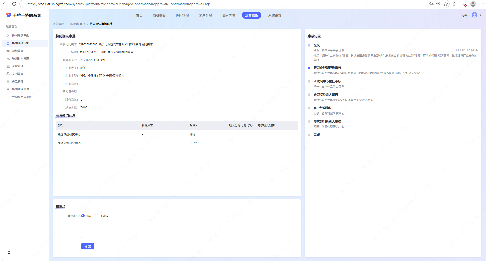

比亚迪这单协同确认最终的详情页。审批流**与申请协同阶段不一样**——协同确认是 5 个节点（研究条线管理员 / 研究中心主任 / 研究负责人 / **客户经理确认** / **需求部门负责人审核**），其中后两步是研究条线独有。对比投行条线的协同确认只有 3 步（本部负责人 / 投行综合部管理员 / 投行部门负责人），研究条线的协同确认多 2 步。

##### 关键发现：协同确认**所有人**都可以发起，不只是对接方

这是这次走研究条线的第二个重要发现。我之前写过"协同确认是接单部门（总部投行/研究）发起的，不是客户经理"——**这句话错了**。

实际跑下来发现：申请协同一旦走完，**任何相关方都可以发起协同确认**——客户经理可以、对接人（业务对接人）可以。系统没有限制发起人必须是谁。所以"对接方发起协同确认"只是最常见的一种，但不是唯一。

这一点和投行条线是一致的（投行那单我也是切换到杨一\*的账号才完成的协同确认，但理论上我——客户经理——应该也能发起）。

为什么系统不限定发起人？——一聪哥解答：因为协同确认本质是**分润**环节——两边（或两边部门里的人）谁积极、谁就发起，系统不限制。最常见是对接方 / 接单部门本部负责人发起，但客户经理、协同申请发起方都允许发起。

#### 两线整体差异对比

| 维度        | 投行条线                      | 研究条线               |
| --------- | ------------------------- | ------------------ |
| 申请协同审批节点数 | 4 步                       | 6 步（多 2 步）         |
| 申请协同独有节点  | —                         | **业务对接人确认**（节点 3）  |
| 协同确认审批节点数 | 3 步                       | 5 步（多 2 步）         |
| 协同确认独有节点   | —                         | **客户经理确认 + 需求部门负责人审核** |
| 协同确认发起方   | 任何相关方（实测多为对接方/接单部门本部负责人）  | 同投行——任何相关方         |
| 需求方       | 企业客户（想上市/被并购/发债）          | 企业客户（要研报/路演/覆盖，比亚迪即此例） |

#### 截图清单

**投行业务**
- `shot_apply_detail.png`：万字号申请协同填好的详情页
- `shot_apply_node_compliance.png`：分支机构合规经理审核节点
- `shot_apply_node_admin.png`：投行二级部门负责人审核节点
- `shot_confirm_form_wanyu.png`：万字号协同确认编制页（分润方案）
- `shot_confirm_detail_wanyu.png`：万字号协同确认完成后
- `shot_confirm_approval_chengdu_bumen.png`：成都和鼎协同确认停在"本部负责人审核"
- `shot_confirm_approval_zonghebu.png`：成都和鼎推到"投行综合部审核"且通过
- `shot_confirm_approval_bumen_fzr.png`：成都和鼎推到"投行部门负责人审核"且通过
- `shot_confirm_detail_chengdu.png`：成都和鼎最终协同确认完成

**研究业务**
- `shot_research_apply_form_blank.png`：新建协同申请空表（研究条线）
- `shot_research_apply_form_filled.png`：填好的比亚迪研究协同申请
- `shot_research_apply_node1_initial.png`：申请协同审批详情初始页（看得到 6 步全名单）
- `shot_research_apply_node2.png`：节点 2 研究条线管理员视角
- `shot_research_apply_node3_approval_dialog.png`：节点 3「业务对接人确认」审批界面
- `shot_research_apply_node4_passed.png`：业务对接人确认已通过
- `shot_research_apply_node6_passed.png`：研究合规部通过
- `shot_research_apply_node7_passed.png`：研究中心主任通过
- `shot_research_apply_all_completed.png`：申请协同全 6 步完成
- `shot_research_confirm_form_blank.png`：协同确认编制页（研究条线）
- `shot_research_confirm_detail_byd_final.png`：比亚迪协同确认最终详情

### (b) 手拉手协同平台的其他附属功能

> 本节讲「(a) 协同管理」周围那一圈辅助模块。**一句话先说清它们和协同的关系**：商机挖掘是协同的"上游来源"（先找到标的/客户，才发协同）；客户管理是协同的"客户池"（已建档的客户，发起协同时直接调）；协同学院是协同的"知识+答疑后盾"（流程怎么走、合规怎么卡、产品怎么讲，问它就对）。下面按页面逐个讲，没截到的子模块（工具箱/企业360/产业图谱/视频专区等）大家都好理解，暂不展开。

#### (b1) 商机挖掘：协同的"上游来源"

入口：左侧菜单「商机挖掘」下面有「我的 / 关注的企业 / 拜访记录 / 联系人 / 工具箱 / 企业360 / 产业图谱 / 新闻舆情 / AI助理」。下面是三个最常用、也是离协同最近的功能。

##### 关注的企业：从关注列表直接发起协同

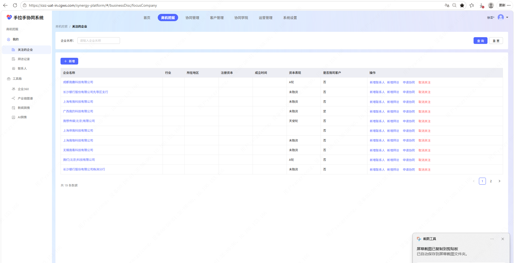

##### 拜访记录：

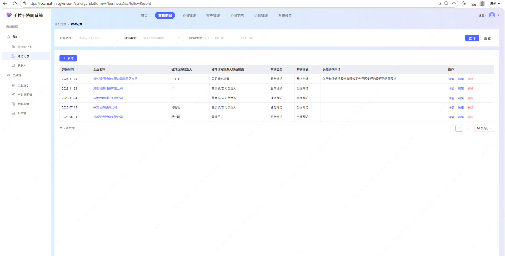

##### 联系人：协同申请里要填的对接人都在这里

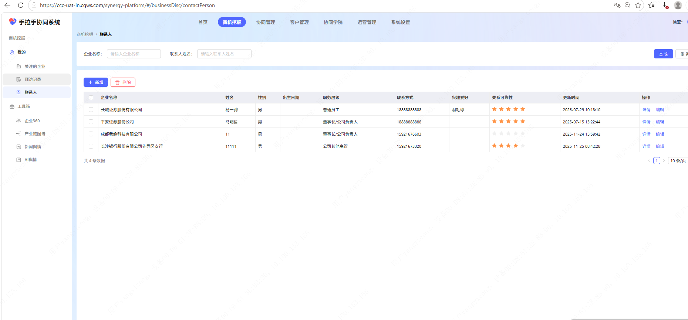

#### (b2) 客户管理：已建档的客户池

入口：左侧菜单「客户管理」下面有「我能签的客户 / 潜在客户」。客户管理偏"内部已建档的客户档案"。

##### 我能签的客户

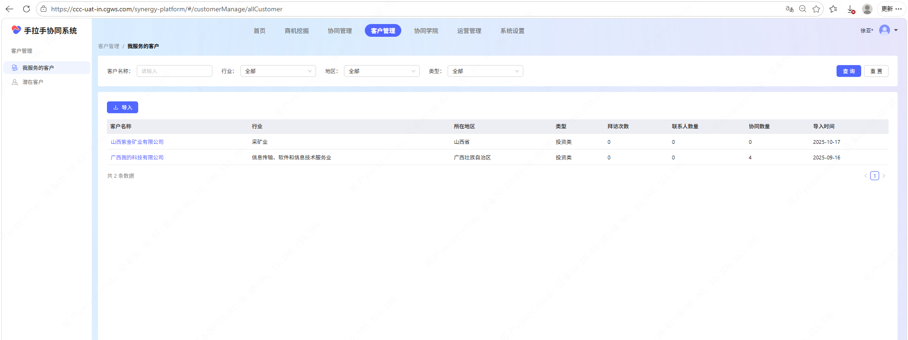

##### 潜在客户（来源逻辑待问）

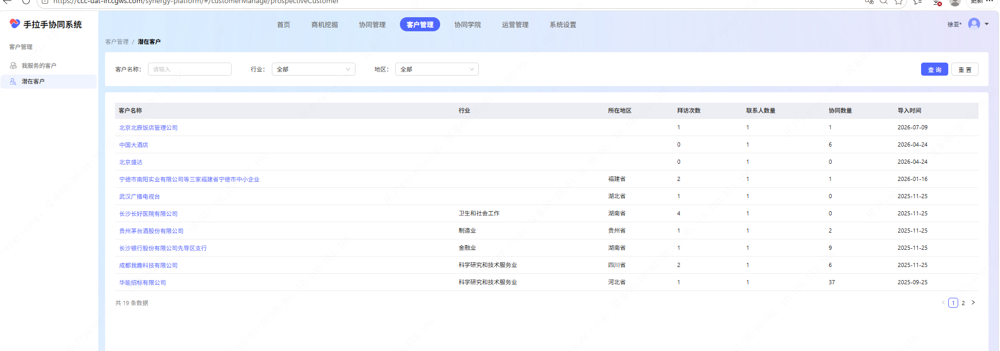

> ⏳ **待问：潜在客户是怎么"进到这个页面"的？**
>
> 亚琴姐回答：目前的逻辑是有拜访记录的就会算做潜在客户
#### (b3) 协同学院：知识库 + AI 答疑

入口：左侧菜单「协同学院」下面有「AI协同助手 / 视频专区 / 培训材料 / 公司产品库 / 法务库 / 案例库」。

##### AI 协同助手

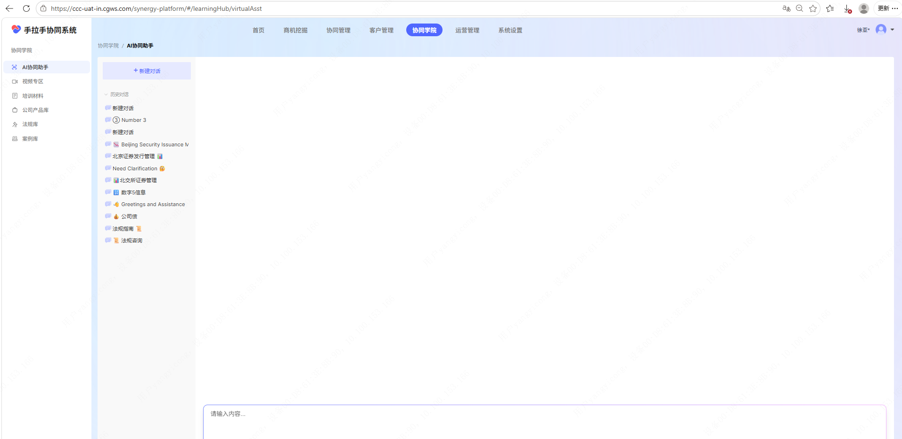

**与协同的连接点**：发起协同前不确定流程怎么走、合规怎么卡、某类产品怎么讲，先来这问一句——它把各条线的流程口径、法务要点、产品知识都攒在背后，等于一个"随叫随到的协同参谋"，帮你在发单前把事做对、少返工。
但是我个人认为，这部分对于智能体的搭建，其知识库的协同在技术上我不知现在是如何实现的（好像是一骢哥在做？），就我的认知来说，肯定涉及到 RAG ，skill以及 Agent 的一些思想。

## 板块二：客户经理视角使用手拉手协同平台

之前大纲太抽象，自己看完还是没懂——这板块按"客户经理到底干啥、表单每个字段怎么填、怎么帮客户做这两个服务"三问一一讲透。

### 一、客户经理到底在干什么

**先定个位**：客户经理不是"做业务"的人，是"把客户带到业务面前的人"。投行业务（IPO/并购/发债）的活儿他干不了，研究业务（写研报/做调研）的活儿他也干不了——他只负责"客户有需求 → 我找到公司内部谁能干 → 撮合起来 → 全程跟进"。

**他的一天真实在干什么**（不是平台按钮，是活儿本身）：

- 上午打电话 / 微信联系客户方（董秘、财务总监、老板），听他们最近在忙什么、有没有新需求
- 维护客户关系——不是单笔交易，是长期的。今天这客户想上市，过两年他可能想发债、再过两年可能被并购——我得一直跟他保持联系
- 下午在公司内部写材料、录入系统（商机广场、申请协同）、跟领导汇报、把客户需求"翻译"成总部能听懂的话
- 跟进审批进度、催一催还没批的领导
- 跟投行老师 / 研究员开会、协助对接客户资源
- 备考：研究服务和投行一样，服务的都是营业部的**企业客户**——区别在"服务内容"（投行做 IPO/并购/发债，研究做研报/路演/覆盖），不在"客户类型"。所以客户经理手上**不是两拨客户**：同一家企业客户既可能用投行、也可能用研究，甚至两线一起用（比如比亚迪：既可能被研究覆盖，也可能发债融资）

**一个核心比喻**：客户经理是"客户和公司之间的翻译"。客户说"我们想上市"——他得翻译成"申请协同 → 投行接单 → 主板IPO"，让公司能接得住。

### 二、客户经理怎么帮客户做"投行"服务（企业客户要上市 / 发债 / 被并购）

**走一个具体例子**：龙泉市万字号宝剑有限公司想上市——客户经理怎么帮它把"想上市"变成"正在上市"。

**整个动作链**：

1. 客户公司（万字号）老板跟客户经理说"我们想上市，你帮我看看怎么搞"——客户经理判断：这是**投行的事**（不是研究、不是资管）
2. 客户经理先去了解这家公司——主营业务（宝剑制造）、股权结构、有没有历史合规问题、老板上市决心强不强。这些是"判断能不能干"的前置信息
3. 客户经理把这个项目录到内部系统，做长期跟进
4. 客户经理写**申请协同**，在平台里把需求正式发出去——下面详说字段怎么填
5. 等审批（4 步）：本地合规 → 投行条线管理员 → 总部合规 → 投行部门负责人
6. 审批全过，进入**协同确认**——投行那边指派的产品经理（就是我填的"建议业务对接人：徐亚*"）开始跟客户（万字号那边的董秘 / 财务总监）对接，谈具体方案。注意：谈业务的对象仍是客户方的人，但系统里的"客户联络人"字段填的是公司内部同事
7. 客户经理的角色：把客户需求"交底"给投行产品经理，但**具体业务**（尽调、写招股书、跟证监会沟通）由投行做。客户经理主要起**桥梁**作用——投行老师需要什么客户资料、约什么会，客户经理负责约

**申请协同表单到底怎么填**（按字段讲）：![[images/Pasted image 20260728143301.png]]

- **企业名称**：客户公司全称——比如"龙泉市万字号宝剑有限公司"，不能写简称
- **业务大类**：投行
- **业务类型**：看客户要在哪上 / 做什么。常见选项有：主板IPO、创业板IPO、科创板IPO、北交所IPO、上市公司再融资、并购重组（买方顾问 / 卖方顾问）、发债融资（公司债 / 企业债 / ABS）、财务顾问（FA）——这次我填的是"主板IPO"
- **需求描述**：用一句话写清楚"客户想干嘛"——比如"龙泉市万字号宝剑有限公司拟申报主板IPO，目前处于辅导备案前期"
- **时长**：预计项目周期——IPO 一般 2-3 年（辅导 + 申报 + 审核 + 发行），并购重组几个月到一年，发债几个月。这次我留空了（不知道怎么填合适）
- **提交人**：默认 = 我（客户经理自己），不能改
- **提交人所在部门**：我所在的营业部
- **建议业务对接人 / 产品经理**：⚠️ 不是审批人！是申请通过后**真正接单干活**的人——客户经理按"我了解这位投行老师擅长消费品 / 制造业 / 宝剑行业"来指派。指派的逻辑不是随便选，是基于平时的接触了解，知道谁能干

- **客户联络人**：⚠️ 公司内部的人（另一个同事），不是客户方的人！字段只能选公司内部员工。这里填"公司内部、日常负责跟这家客户对接的同事"——比如这家客户平时是另一个同事在维护，就填他。和客户经理的区别：客户经理是这单发起人，客户联络人是系统里登记"这家客户平时谁跟"的内部同事。两栏分开是为了厘清"这单谁发起"和"这家客户平时谁对接"

### 三、客户经理怎么帮客户做"研究"服务（企业客户要研报 / 调研 / 路演）

**走一个具体例子**：比亚迪汽车有限公司（营业部服务的企业客户）想让总部研究部门给自己做研究服务——比如写深度报告、安排路演见机构投资者、做行业 / 竞品分析（这单的项目名就叫"研究特斯拉"，是比亚迪想摸清特斯拉这个对标对手）。客户经理帮比亚迪发起研究协同。

**注意**：研究服务和投行一样，服务的都是营业部的**企业客户**
**整个动作链**：

1. 比亚迪（客户）的董秘 / 投资者关系（IR）跟客户经理说"我们想让你们的分析师覆盖我们、写个深度报告，再安排几场路演见机构投资者"，客户经理判断：这是**研究的事**
2. 客户经理内部协调：跟比亚迪的董秘 / IR 敲定研究主题（这单是"研究特斯拉"，即对标竞品分析）、时间、要见哪些投资者
3. 客户经理写**申请协同**——这次选"研究"线
4. 等审批（研究线 6 步）：分支机构本部合规经理 → 研究条线管理员 → **业务对接人确认**（研究独有，投行没有这步，研究员本人确认接单）→ 研究合规部 → 研究中心主任 → 研究负责人 → 完成
5. **"业务对接人确认"这步解释**：研究协同得落到某个具体研究员头上，得研究员本人安排时间 / 点头才推进——所以申请协同阶段就多这一关（投行是"部门对部门"，负责人拍板后内部分派，不需对接职员本人同意）。这是研究线在申请协同阶段比投行多的唯一节点。

6. 审批全过，进入**协同确认**——研究员开始安排调研、后续写报告
7. 客户经理角色：把比亚迪的需求告诉研究员、安排研究员上门调研 / 路演、反馈比亚迪

**研究协同确认表单到底怎么填**（按字段讲）：

![[images/Pasted image 20260728142634.png]] **关联的协同需求**：从申请协同那边带过来（编号 V20250113001 这种）
- **服务的企业**：比亚迪汽车有限公司——本次的客户（也是研究的委托方）
- **业务大类**：研究
- **业务类型**：比亚迪这单实际填的是「个股、个股的研究-专题/深度报告」（专题/深度报告类）；系统里还有点评类报告、总量研究、线路演（线上）、线上研究咨询、其它等选项
- 对接人
**客户经理到底帮客户做了什么**：把比亚迪的资本市场需求（要覆盖、要路演、要见投资者）告诉研究员。

### 四、为什么需要"协同"

**客户经理的角色转变**：从"两套独立的活儿"变成"一套完整的方案"给客户。客户对客户经理说"我要做这事"，客户经理能一次性调动公司所有相关能力——这就是"协同"二字的含义。

### 五、客户经理发起协同之后还干什么（全周期角色）

前面只讲了"怎么发起协同"。但发起 ≠ 结束。这节把"审批通过之后"到"一单彻底做完"客户经理还在干嘛

**阶段 1：审批通过 → 进入协同确认（任何相关方都可发起）**

申请协同一走完，**任何相关方都可以发起协同确认**——客户经理可以、对接人（业务对接人）可以。系统不限制发起人。我之前写"接单部门发起、不是客户经理"，**这句话错了**。那客户经理还有关系吗？

- **研究线：有，而且必须由「业务对接人」亲自操作审核**。
- **投行线：没有「业务对接人确认」节点，但人没退出**。协同确认由接单部门内部走（本部负责人 → 投行综合部 → 投行部门负责人），客户经理不在审批链上。但产品经理要跟客户谈细节，得客户经理牵线、提供客户资料、约会议——他仍是"桥梁"。协同确认表单里如果"客户联络人"填的是客户经理本人，他还要配合提供材料。

**阶段 2：协同确认完成 → 真正的业务交付开始**

- **投行**：进入 IPO / 并购 / 发债的实际执行（尽调、写招股书、跟监管沟通）。这些客户经理都不做，但他要：持续维护客户关系、向客户汇报进展、协调客户配合（要客户盖章、提供财务数据、安排股东访谈）。客户不配合，项目就卡住——所以客户经理是"催客户配合"的关键人。
- **研究**：研究员写报告、安排路演（比亚迪作为客户，路演要见的是机构投资者）。客户经理要陪着见比亚迪、把路演反馈带回来同步给比亚迪、并协助比亚迪对接来参会的机构投资者。

**阶段 3：财务确认（系统未开放，待补）**

对账 + 分润结算 + 考核归属。客户经理的奖金 / 考核跟这单挂钩，所以他特别关心协同确认里填的那两个字段——"收入分配比例"（钱怎么走）和"考核收入划转"（成绩单归谁）。这一关系统还没开放，走完再补。

**阶段 4：长期——一单做完，关系还在**

IPO 完了，这家客户可能要研究覆盖（再发起一个研究协同）、过两年要发债、要并购——客户经理是这家客户的"长期关系 owner"，不是"发一单就走人"。交叉销售（投行做完推研究、研究做完推投行）正是协同平台最大的价值，而客户经理是这条链的发动者。

**一句话总结客户经理的全周期角色**：发起协同（找需求）→ 跟进审批（推流程）→ 协同确认时做桥梁 / 回签（研究线）→ 交付期维护客户关系、催客户配合 → 财务确认关心分润 → 长期交叉销售。他从头到尾都在，只是不同阶段干不同的活。

### 六、把各模块串起来：客户经理的一天（怎么用得顺、真正提效）（这一块还没有找一骢哥确认过，还不确定是否正确（一骢哥在最初做这个产品的时候，跑过很多次业务部门，他是懂业务部门真正在做什么。））

前面 (a) 讲了协同管理本身怎么走，(b) 讲了周围一圈辅助模块。这一节把它们在「客户经理」这一个角色身上串成一天——目的不是列功能，而是让客户经理知道：**这套系统怎么帮我少切页面、少重复录、少返工，真正把时间花在客户身上**。

**一个具体的工作日流（模块按顺序用）：**

1. **先刷「商机挖掘 → 拜访记录」（或商机广场？）**：回看昨天见了谁、谁提了新需求。看到某家企业老板说"我们想上市"，或者其他类似于截图中的投行或者研究的业务类型。![[images/Pasted image 20260729152347.png|273]]![[images/Pasted image 20260729152451.png|274]]
 ![[images/Pasted image 20260729152528.png]]

2. **去点「申请协办」**：直接从关注列表或手动拉起协同申请
3. **协同申请要填对接人 → 从「协同伙伴」库选**：关系可靠性★高的优先
4. **审批走到一半不确定合规怎么卡 → 去「协同学院 → AI 协同助手」问一句**：流程口径、法务要点直接问，把单子做对，少被打回。
5. **客户签进来 → 进「客户管理 → 我能签的客户」**：看「协同数量」知道它历史发过几单，想接着做直接发起，档案都在库里。

**这套设计对客户经理的三个提效点（交付重点）：**

- **少切系统**：从商机挖掘直接「申请协办」，企业信息连带带过去，不用在"发现机会"和"发协同"两个模块间来回倒腾、重复录入。
- **一次维护、多次复用**：联系人库、客户档案维护一次，每次发协同直接调，越用越省事。
- **降低犯错、减少返工**：协同学院把流程/合规/产品知识前置到发单之前，AI 助手随问随答，避免"填错被合规打回、又得重走一遍"。

**总结上面这套工作流程**：**先挖（商机挖掘找标的）→ 再发（申请协办起协同）→ 填人（联系人库选对接人）→ 卡不住问（协同学院 AI 助手）→ 沉淀（客户管理养客户）**。一圈走下来，协同不再是"另起炉灶填一张空表"，而是顺着你已经有的客户和拜访记录自然长出来的下一动作。

> 备注：上面这套"一天流"是我按页面入口和字段推导的使用逻辑，用来帮客户经理理解"模块之间怎么连"。具体哪一步在营业部的实际工作里最常用、哪里还卡，我能获取的信息还远远不够。

## 待补（基本收尾）

- [x] 研究线差异：原「研究条线差异」稀疏段已重写为「研究条线（7/28 跑完，2 单）」全流程段（2026-07-28 13:33），含申请协同 + 协同确认表单字段、6 步审批流（含研究独有「业务对接人确认」节点）、与投行对比表、12 张新截图归档
- [ ] 财务确认：系统未开放，等开
- [x] 客户经理视角业务理解：原大纲太抽象，2026-07-28 按 3 个问题（岗位本质 / 表单字段 / 两个服务案例）重写为详版，等用户审改
- [x] 客户联络人定义修正：实为**公司内部同事**（字段只能选内部员工），非客户方的人——2026-07-28 用户重走研究线发现并指正，已改 3 处 + 新增"全周期角色"段
- [x] 公司名/人名 OCR 纠错：用户正字早写在文档前部，2026-07-28 全局替换 万宇琴→万字号、徐宝→徐亚、陈一→杨一，grep 0 命中
- [x] 「全周期角色」阶段 1 勘误：协同确认发起权限改为"任何相关方都可发起"（原"接单部门发起"错）；「客户经理确认」改为系统准确节点名「业务对接人确认」（2026-07-28 研究条线跑完后回改）
- [x] 研究条线申请协同阶段为何要「业务对接人确认」（投行没有）：2026-07-29 一聪哥已解答——投行是"部门对部门"（负责人拍板内部分派，不需对接职员本人同意），研究是"对接到具体研究员"（需研究员本人安排时间/点头），故申请协同阶段多此关。已填入 L198 占位，并同步进 L323-324 动作链、L224 协同确认段、L240-244 对比表
- [x] 目录重构（2026-07-29）：按用户给的两大板块重排——板块一「操作手册」含 (a) 协同管理（投行/研究两条线）与 (b) 其他附属功能（待补）；板块二「客户经理视角使用手拉手协同平台」。原平铺 19 项目录收敛为两级骨架，重生成 HTML/Word。
- [x] (b) 其他附属功能填充 + 板块二第六节（2026-07-29）：基于 7 张截图写商机挖掘（关注的企业/拜访记录/联系人）、客户管理（我能签的客户/潜在客户）、协同学院（AI 协同助手）；潜在客户"怎么进池"留 ⏳ 待问导师。板块二加第六节"客户经理的一天"串起所有模块、落到"用得顺、真正提效"。HTML 内嵌图 19→25。
- [x] 图片归位修正（2026-07-29）：新截图最初误放仓库根/images/协同流程，已移至正确目录 产品研究/images/协同流程/；HTML 重跑后 25 张图全部内嵌。
