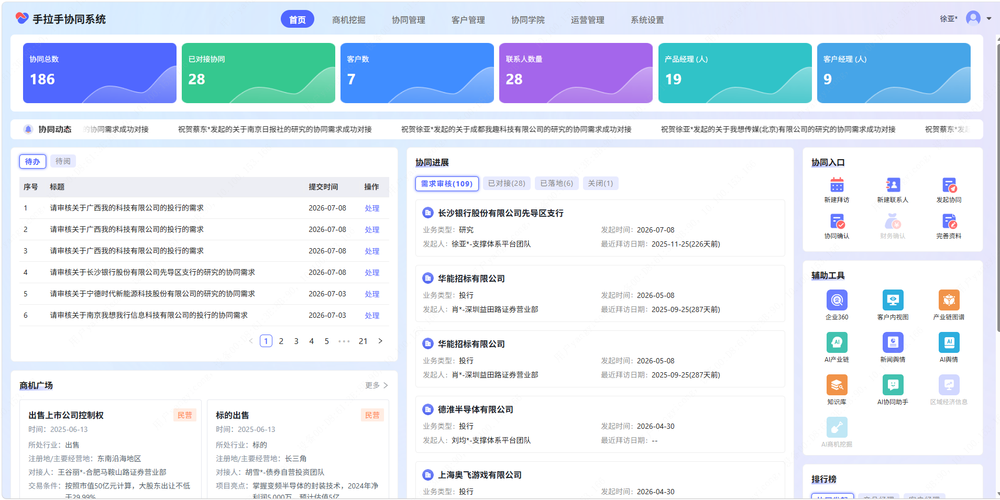
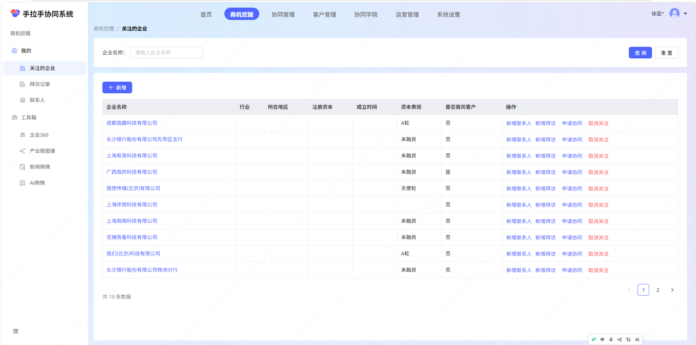
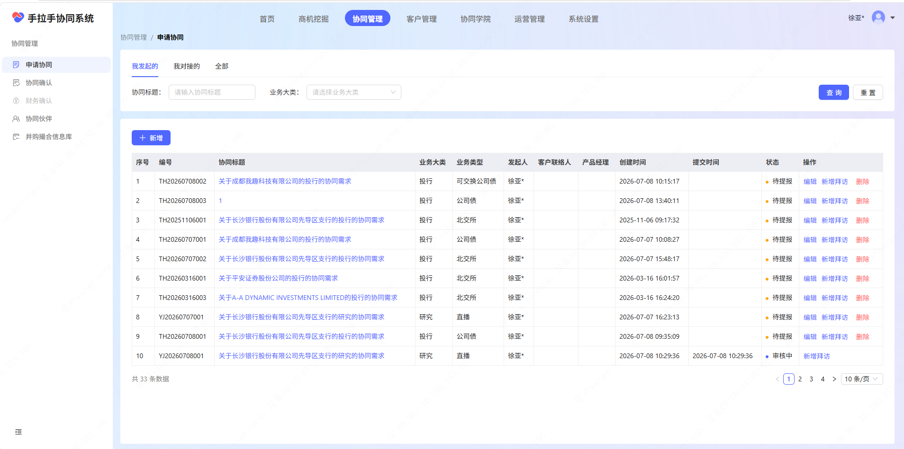
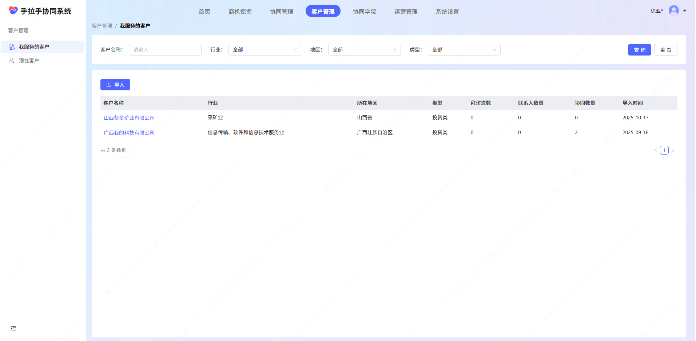
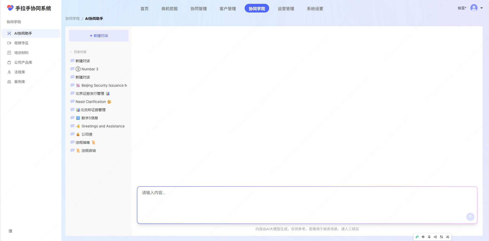

# 手拉手协同系统新人教学文档

> **适用对象**：首次使用「手拉手协同系统」的分支机构员工（客户经理）、总部条线人员（投行/研究/资管等）  
> **系统版本**：内测版（UAT 环境）  
> **部署底座**：企业微信私有版 · 长城长数字化体系

---

## 一、系统是什么？30 秒看懂

**手拉手协同系统**是长城证券内部用的**跨部门业务协同平台**。

它的核心解决一个问题：**分支机构的客户经理手里有企业客户，但很多专业需求（上市辅导、发债、并购重组、行业研究）自己干不了；而总部的投行、研究院有能力，但离客户太远、缺项目来源。**

手拉手把这两端"拉到一起"——客户经理在系统里发现商机 → 发起协同申请 → 总部专业条线接单 → 共同服务客户 → 最后**分润结算**。全程线上留痕，把过去靠"私下打电话、人情对接"变成制度化的流程。

**一句话：让有客户的分支机构和有能力的总部条线在线上高效协同、合理分钱。**

---

## 二、系统整体结构

系统顶部导航栏共有 **7 个一级板块**：

| 板块       | 用途                 | 主要使用角色                |
| -------- | ------------------ | --------------------- |
| **首页**   | 数据概览面板 + 快捷入口      | 所有人                   |
| **商机挖掘** | 发现和跟踪目标企业          | 客户经理                  |
| **协同管理** | 发起 / 跟进 / 确认协同申请   | 客户经理 + 总部条线 + 合规 + 财务 |
| **客户管理** | 维护自己负责的客户档案        | 客户经理                  |
| **协同学院** | AI 助手 + 培训材料 + 法规库 | 所有人                   |
| 运营管理     | 系统运营配置（管理员）        | *管理员*                 |
| 系统设置     | 系统参数配置（管理员）        | *管理员*                 |

其中 **运营管理** 和 **系统设置** 是管理员专用模块，普通用户无需关注。下面逐一讲解前 5 个板块。

---

## 三、首页 —— 你的工作台



登录后进入的第一个页面就是**首页**，它是整个系统的信息中枢，让你一眼看到全局状态。

### 3.1 核心数据卡片（顶部 6 个）

页面最上方是 6 个数据卡片，从左到右依次是：

| 指标          | 含义                  |
| ----------- | ------------------- |
| **协同总数**    | 系统中累计创建的协同申请总数      |
| **已对接协同**   | 已被总部条线认领并进入执行阶段的协同数 |
| **客户数**     | 你所服务的客户总量           |
| **参与人数**    | 参与过协同流程的人员总数        |
| **产品经理(人)** | 系统中登记的产品经理数量        |
| **客户经理(人)** | 系统中的客户经理数量          |

> 这些数据帮你快速判断：团队整体的协同活跃度如何？有多少客户已经被纳入体系？

### 3.2 协同待办展示（左侧中部）

这里显示**待你处理的任务列表**，有两个标签页：

- **待办**：需要你操作的事项（比如"请审核关于XX公司的投行的协同需求"）
- **待评**：需要你评价的事项

每条记录显示协同标题和处理时间，右侧有「处理」按钮可以直接跳转操作。

### 3.3 协同跟进（右侧中部）

展示你关注的企业的协同进展，分为 4 个维度：

- **查看全部**：所有协同记录
- **已对接**：已被总部认领的
- **已落储**：已完成并归档的
- **关闭**：已关闭的

### 3.4 协同入口 & 辅助工具（右侧栏）

这是**最高频使用的快捷区域**：

**协同入口（6 个快捷按钮）：**

| 按钮    | 功能                          |
| ----- | --------------------------- |
| 新建拜访  | 记录一次对客户的线下/线上拜访             |
| 新建联系人 | 为某家企业添加联系人档案                |
| 发起协同  | 🎯 **核心动作**——为某个商机发起跨部门协同申请 |
| 协同确认  | 总部条线确认是否接单                  |
| 财务确认  | 分润金额的财务确认                   |
| 完善资料  | 补充客户或商机的详细信息                |

**辅助工具（9 个外部能力入口）：**

| 工具              | 功能                |
| --------------- | ----------------- |
| 企业360           | 查询企业的全方位工商信息      |
| 客户内视图           | 客户关系分析工具          |
| 产业链图谱           | 某行业上下游产业链可视化      |
| AI产业链           | AI帮助分析产业链         |
| 新闻舆情            | 企业相关新闻监控          |
| AI舆情            | AI 驱动的智能舆情分析      |
| 知识库             | 内部知识检索            |
| AI协同助手          | 💬 AI 对话助手，回答业务问题 |
| 政策法规查询 / AI政策查询 | 金融监管政策检索          |

### 3.5 商机广场（底部）

展示公开的商机线索，例如：

- **出售上市公司控制权**（附带行业、标的类型、地区、项目亮点等详情）
- **标的出售**（附带对赌方、目标客户等）

点击「更多」可以浏览完整列表。这是发现新商机的重要入口之一。

---

## 四、商机挖掘 —— 发现与跟踪目标企业



**商机挖掘**是客户经理日常使用频率最高的板块之一。它的核心使命是：**帮你发现值得跟进的企业，并把它们纳入你的商机漏斗。**

### 4.1 左侧菜单（6 个子功能）

| 子功能         | 说明             |
| ----------- | -------------- |
| **我的**      | 个人工作台概览        |
| **关注的企业** ⭐ | 你手动添加关注的重点企业列表 |
| **拜访记录**    | 你对所有客户的拜访历史    |
| **联系人**     | 所有客户的联系人通讯录    |
| **工具箱**     | 商机分析辅助工具集合     |
| **企业360**   | 工商信息全景查询       |
| **产业链图谱**   | 行业上下游可视化       |
| **新闻舆情**    | 企业相关新闻报道       |
| **AI舆情**    | AI 分析后的智能舆情报告  |

### 4.2 关注的企业（核心界面）

这是商机挖掘的主界面，展示你**已经关注的全部目标企业**。

**筛选条件：**

- 企业名称（模糊搜索）
- 查询 / 重置

**列表字段说明：**

| 字段         | 说明                      |
| ---------- | ----------------------- |
| **企业名称**   | 目标公司名（可点击查看详情）          |
| **行业**     | 所属行业分类                  |
| **所在地区**   | 注册地或经营地                 |
| **注册资本**   | 公司注册资本额                 |
| **成立时间**   | 公司注册日期                  |
| **资本表现**   | 如"A轮"、"未融资"、"天使轮"等融资阶段  |
| **是否营销客户** | 是否已被标记为营销目标客户           |
| **操作**     | 包含：新增联系人、新增拜访、申请协同、取消关注 |

**典型工作流：**

1. 通过企业360 / 产业链图谱 / 商机广场 发现一家目标企业
2. 点击「+新增」将其加入"关注的企业"
3. 定期查看其新闻舆情和AI舆情
4. 有意向时，直接在操作列点击「申请协同」→ 进入协同管理流程

---

## 五、协同管理 —— 核心业务流程



**协同管理是整个系统的灵魂**。所有跨部门协作——从"我发现了一个商机"到"总部来帮忙"再到"事情办完了分钱"——都在这个板块完成。

### 5.1 左侧菜单（5 个子功能）

| 子功能         | 角色    | 说明               |
| ----------- | ----- | ---------------- |
| **申请协同** ⭐  | 客户经理  | 发起一个新的协同请求（核心入口） |
| **协同确认**    | 总部条线  | 收到协同后确认是否接单      |
| **财务确认**    | 财务人员  | 确认分润金额           |
| **协同伙伴**    | 管理员   | 管理协作用户关系         |
| **并网稽查信息库** | 合规/风控 | 存储合规稽查相关信息       |

### 5.2 申请协同列表（主界面）

**三个视图标签：**

- **我发起的**：你自己作为发起人的所有协同（客户经理主要用这个）
- **我对接的**：分配给你去执行的协同（总部条线主要用这个）
- **全部**：所有协同记录（管理层视角）

**筛选条件：**

- 协同标题（模糊搜索）
- 业务大类（下拉选择：投行 / 研究 / 资管 等）

**列表字段详解：**

| 字段         | 说明                                  |
| ---------- | ----------------------------------- |
| **序号**     | 行号                                  |
| **编号**     | 系统自动生成的唯一编号（如 `TH20260708002`）      |
| **协同标题**   | 对这次协同的简短描述（如"关于成都我服科技有限公司的投行的协同需求"） |
| **业务大类**   | 投行 / 研究 / 资管 等                      |
| **业务类型**   | 具体细分（可交换公司债、公司债、北交所、直播 等）           |
| **发起人**    | 谁发起的这个协同                            |
| **客户/联系人** | 关联的客户企业或联系人                         |
| **产品经理**   | 负责该协同的产品经理                          |
| **创建时间**   | 协同创建日期时间                            |
| **提交时间**   | 提交审批的时间                             |
| **状态**     | 当前所处阶段（见下方状态说明）                     |
| **操作**     | 可执行的操作按钮                            |

### 5.3 协同状态流转

从截图中可以看到以下几种状态：

```
新建 → 待填报 → 待确认 → 已确认 → 审批中 → 执行中 → 完成
         ↓
        删除（发起人可在特定阶段撤销）
```

| 状态           | 含义             | 可执行的操作     |
| ------------ | -------------- | ---------- |
| **待填报**      | 刚创建，需补充详细信息    | 编辑、删除      |
| **待确认**      | 已提交，等待总部条线确认接单 | 编辑、新增拜访、删除 |
| **已确认**      | 总部已接单，准备开始执行   | 新增拜访、删除    |
| **审批中**      | 进入合规/管理层审批环节   | 查看         |
| **完成 / 已落储** | 流程结束，已归档       | 查看         |

### 5.4 操作按钮说明

| 按钮       | 何时出现        | 功能            |
| -------- | ----------- | ------------- |
| **编辑**   | 待填报 / 待确认阶段 | 修改协同的详细信息     |
| **新增拜访** | 待确认及之后      | 为此次协同记录一次客户拜访 |
| **删除**   | 待填报 / 待确认阶段 | 撤销本次协同申请      |
| **处理**   | 在首页"待办"中出现时 | 跳转执行当前需要的操作   |

---

## 六、客户管理 —— 维护你的客户档案



**客户管理**是你维护"我负责哪些客户"的地方。它和协同管理的区别是：**客户管理管"人/企业"，协同管理管"事/项目"。**

### 6.1 左侧菜单（2 个子功能）

| 子功能          | 说明              |
| ------------ | --------------- |
| **我服务的客户** ⭐ | 你名下正在服务的正式客户列表  |
| **潜在客户**     | 还在跟进中、尚未转正的潜客列表 |

### 6.2 我服务的客户（主界面）

**筛选条件（4 个维度）：**

- 客户名称（模糊搜索）
- 行业（下拉：采矿业 / 信息传输软件 / ...）
- 地区（下拉：山西省 / 广西 / ...）
- 类型（下拉：投资类 / ...）

**批量操作：**

- **导入**：批量导入客户数据（Excel 模板）
- **重置**：清空筛选条件

**列表字段：**

| 字段        | 说明               |
| --------- | ---------------- |
| **客户名称**  | 企业全称（可点击查看详情）    |
| **行业**    | 所属行业             |
| **所在地区**  | 所在省份/城市          |
| **类型**    | 客户分类（如"投资类"）     |
| **拜访次数**  | 累计拜访次数（来自拜访记录汇总） |
| **联系人数量** | 该客户下已录入的联系人数     |
| **协同数量**  | 该客户关联的协同申请数      |
| **导入时间**  | 录入系统的时间          |

---

## 七、协同学院 —— AI 助手 & 学习中心



**协同学院**是你的"业务知识加油站"+ "AI 随身顾问"。当你不知道某种业务该怎么操作、或者想查法规的时候，来这里。

### 7.1 左侧菜单（6 个子功能）

| 子功能          | 说明              |
| ------------ | --------------- |
| **AI协同助手** ⭐ | AI 对话机器人，回答业务问题 |
| 视频专区         | 教学视频库           |
| 培训材料         | PDF / PPT 等培训文档 |
| 公司产品库        | 公司金融产品目录        |
| 法规库          | 金融监管法律法规查询      |
| 案例库          | 历史协同成功案例        |

### 7.2 AI 协同助手（核心界面）

这是一个**类似 ChatGPT 的对话式 AI 助手**，专门为手拉手的业务场景训练。

**界面组成：**

- **顶部「+ 新建对话」**：开启一轮新的对话
- **对话历史列表**：之前的对话记录（如"Number 3"、"Beijing Security Issuance"、"北京证券发行管理"、"Need Clarification"、"北交所证券管理"等）
- **底部输入框**："请输入内容..."——输入你的问题即可
- **免责声明**："内容由 AI 大模型生成，仅供参考，若用于商业决策，请人工核实"

**典型用法举例：**

- "北交所上市的条件是什么？"
- "可交换公司债和普通公司债有什么区别？"
- "我的客户想发债，需要准备什么材料？"
- "协同申请被驳回了怎么办？"

> ⚠️ **重要提示**：AI 回答仅供参考，涉及具体业务的决策一定要以官方文件和导师/合规的意见为准。这也是为什么界面底部始终显示免责声明。

---

## 八、完整工作流 —— 一个协同从 0 到 1 的全过程

下面用一个完整的例子，串联以上所有板块：

### 场景：你是一家矿业公司的客户经理，客户提到想发债

```
第 1 步【商机挖掘】
  ↓ 在"关注的企业"中发现该公司，或通过"企业360"搜索到它
  ↓ 点击"新闻舆情"/"AI舆情"了解近期动态
  ↓ 判断：这家公司有发债需求 ✅

第 2 步【首页 → 发起协同】
  ↓ 点击右侧「协同入口」区的「发起协同」按钮
  ↓ 或进入【协同管理】→ 点击「+ 新增」
  ↓ 填写表单：选业务大类="投行"、业务类型="公司债"、填写协同标题
  ↓ 关联客户和联系人 → 提交

第 3 步【协同管理 → 我发起的】
  ↓ 状态变为"待确认"
  ↓ 等待总部投行条线的同事确认接单
  ↓ 可以随时点"编辑"补充信息，或点"新增拜访"记录沟通情况

第 4 步【对方视角：协同管理 → 我对接的】
  ↓ 总部投行同事收到通知
  ↓ 在"我对接的"标签页看到这条协同
  ↓ 点"协同确认"接单 → 状态变为"已确认"

第 5 步【执行阶段】
  ↓ 双方通过系统内的"拜访记录"保持沟通
  ↓ 必要时可调用"AI协同助手"咨询业务问题
  ↓ 进展更新在协同详情页

第 6 步【收尾】
  ↓ 项目完成后进入"财务确认"环节
  ↓ 分润金额经财务确认 → 状态变为"已落储"
  ↓ 全程结束 ✅
```

---

## 九、常见问题 FAQ

**Q：我和同事可以同时编辑同一个协同吗？**  
A：可以同时查看，但同一字段建议不要同时修改。系统的状态锁机制会在关键节点（如提交、确认）防止冲突。

**Q：发起协同后可以撤回吗？**  
A：在"待填报"和"待确认"状态下，你可以直接点「删除」撤回。一旦进入"审批中"及之后的阶段，就不能自行撤回了，需要联系管理员或走驳回流程。

**Q：AI 协同助手的回答能直接给客户看吗？**  
A：不建议。界面底部明确标注了"内容由 AI 大模型生成，仅供参考"。AI 回答可以作为你理解业务的起点，但给客户的任何承诺都要经过内部确认。

**Q：「商机广场」里的线索是谁发布的？**  
A：商机广场的线索通常由总部产品经理或营业部负责人发布，包含出售上市公司控制权、标的出售等公开市场信息。你也可以根据这些线索发起协同。

**Q：拜访记录在哪里看？**  
A：两个地方能看到：① 商机挖掘 → 拜访记录（按时间线的完整列表）；② 协同管理 → 某个协同的「新增拜访」（仅关联该协同的拜访）。

---

> 📌 **本文档基于系统内测版（UAT）截图编写，功能可能随版本迭代调整。**  
> 如发现界面与文档不一致，以实际系统为准，并向产品团队反馈。

---

## 关联笔记
- 日期：[[日期索引/2026-07-09|2026-07-09]]
- 系统研究：[[手拉手协同系统-学习与思考]]
- 同批产出：[[手拉手协同系统-视频口播稿]]、[[商机广场-微信公众号推文-成稿]]
