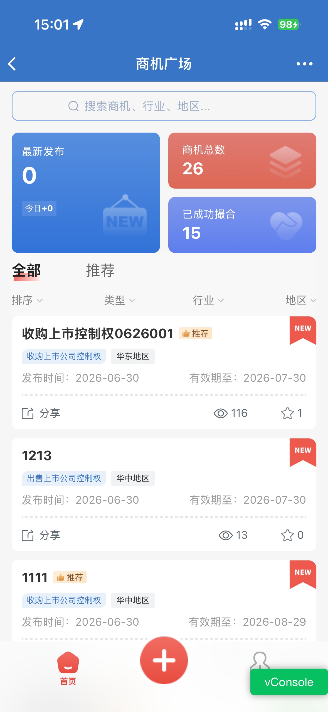
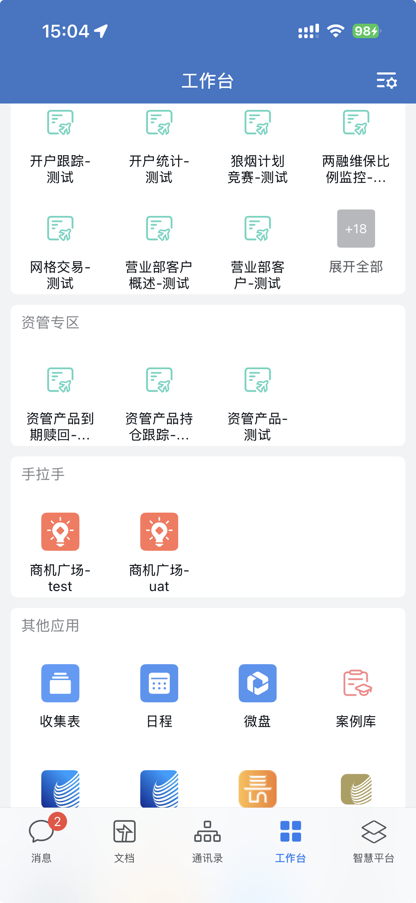
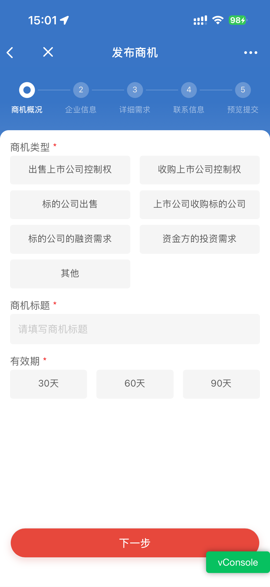
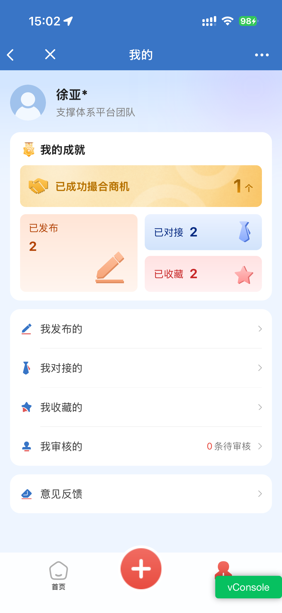

# 手里的客户需求，除了发微信群，还能发到「商机广场」

> 适用：长城长 / 手拉手内部同事，尤其是一线客户经理、分支机构业务、投行 / 研究 / 资管条线  
> 渠道：手拉手账号公众号推文

---

## 一个我们都经历过的场面

你陪客户吃饭，客户随口说："我们手头有个标的想出售，你们有没有合适买家？"

回来路上你想找人对接，一翻手机——这条需求只躺在你的微信聊天记录里。部门群消息刷过去了，过两天连你自己都忘了。

这种"需求散在微信和便签里"的情况，就是商机广场要解决的。

*图：商机广场首页——数据看板 + 商机列表*

## 商机广场是什么

它嵌在「长城长」移动端里，入口在：**企业微信 → 工作台 → 手拉手 → 商机广场**。

它只干一件事：让**有需求的人发布商机，有资源的人认领商机**。它不是另一个微信，是让一条商机在公司内部被看见、被接走的地方。

*图：从工作台进入商机广场的入口*

## 怎么用，就三步

**1. 发布**  
你手里有客户需求，点右下角红色「+」，填企业、需求类型、备注，一分钟就能发出去。发出去，这条商机就进了公司的池子，不用再怕换手机就丢、怕刷屏就忘。

*图：发布商机——填写概况*

**2. 认领**  
如果你是投行、研究、资管的同事，手里有资源、正好能接别人发的壳需求，在广场上看到合适的，点一下「认领」、填个理由，就归你跟了。

**3. 跟进**  
在底部「我的」页面，你能看到自己发布和认领的所有商机——谁认领了、到哪步了，一眼看清，不用盯着群消息等回复。

*图：「我的」页面——个人商机管理*

## 为什么不用微信群，要用它

散在私人微信里的商机，两个老问题：容易漏，容易被跳单。

进了广场就不一样：谁发现的、谁接的、成了怎么分，系统都帮你记着。同一条商机，发现的人提报、专业同事认领，两个人一起服务同一个客户，分润机制保障原发现者的利益。

## 发布、认领之后，去哪

商机广场只做撮合前半段：发布、审核、认领。

双方确认对接后，要回到 **PC 端「手拉手协同系统」→「协同管理」**，正式发起协同申请，走审批、执行、财务确认、分润。完整链路是：

手机端商机广场发布 / 认领 → 双方确认 → PC 端协同平台发起协同 → 接单 → 拜访 → 分润

所以商机广场可以是协同平台的**前置动作**：手机端解决"在外面快速发布、认领"，PC 端解决"回办公室把协作落地"。协同平台具体怎么用，可以看配套的【手拉手协同系统教学视频】。

## 现在就能试

下次客户再提需求，别只存在聊天记录里——打开企业微信 → 工作台 → 手拉手 → 商机广场，把那条压着的客户需求发出去。

属于投行、研究、资管条线的同事，也可以上去看看有没有能认领的项目。

*功能截图均来自测试环境（UAT），最终界面以正式版本为准。*

---

> 以下为仓库内部导航，对外发布时删除
>
> - 日期：[[日期索引/2026-07-13|2026-07-13]]
> - 推文脚本（本成稿来源）：[[商机广场-微信公众号推文-脚本]]
> - 配套视频口播稿：[[手拉手协同系统-视频口播稿]]
> - 产品 PRD：[[PRD_商机广场]]
