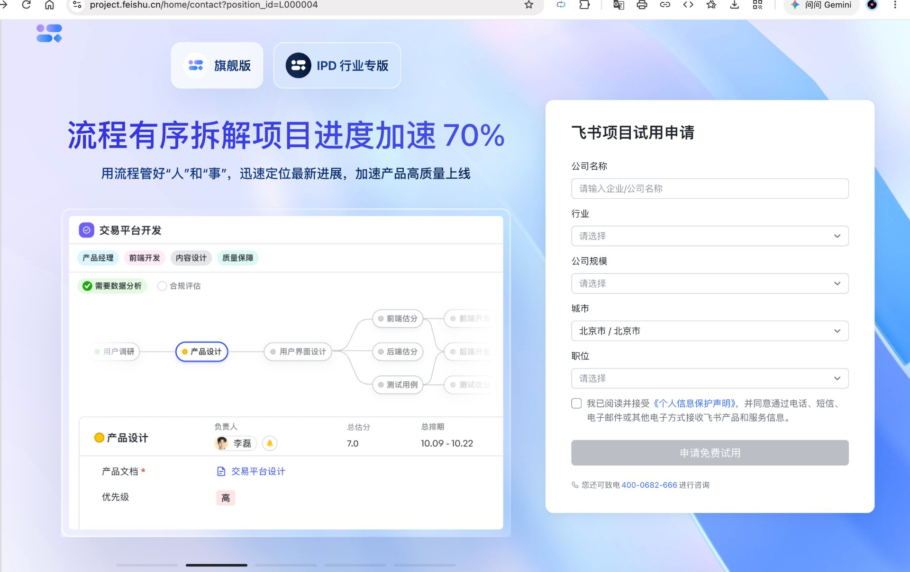

# 企业微信私有版智能助手技术架构解析（草稿 / 研究输入）

> 说明：本文件由 WorkBuddy 根据用户提供的企微私有版截图及公开技术文档整理，是调研输入稿。向导师汇报前请用户本人用自己的话改写，避免「AI 味」。

## 一、截图里看到的是什么

截图中是一个名为 **"test BOT"** 的企业微信智能助手，对话流程为：

1. 用户说「我要提报商机」
2. 助手反问商机类型（融资需求 / 资产出售 / 企业收购 / 控股权收购 / 控股权出售 / 投资机会 / 其他）
3. 用户回答「融资需求」
4. 助手映射为编码 `FINANCING`，并回复「我来帮您提报【融资需求】」

这不是只会发通知的 webhook 机器人，而是**能接收消息、理解意图、调用内部业务系统**的可交互 agent。从类型列表看，背后对接的很可能是长城证券内部的**商机广场 / 协同平台**。

## 二、企业微信私有版到底是什么

**企业微信私有版（私有化部署）** 是腾讯企业微信团队为金融、政务、大型集团提供的私有化方案：

- **服务器部署在企业自有环境**：聊天记录、通讯录、文件等数据存储在公司内网 / 私有云，物理上不出企业。
- **客户端仍是标准企微 App**：手机、PC、Mac、Linux 端的企业微信客户端，只是连接的是企业私有服务器而非腾讯公有云。
- **开放能力与企业微信公有版基本一致**：支持自建应用、机器人、消息推送、通讯录管理、文档/日程/会议等接口。
- **合规性强**：满足券商对数据主权、监管审计、内外网隔离的要求。

简言之：**底座是腾讯企微的代码，但跑在企业自己的机器上；聊天前端是标准企微客户端；上面的智能助手和业务系统是企业自己接的。**

## 三、这个智能助手是怎么建出来的

从技术路径看，最可能的实现方式如下（也是企微私有版的标准做法）：

### 1. 在企业微信私有版管理后台注册一个「自建应用」或「机器人」
- 获得三个核心凭证：
  - `CorpID`：企业唯一标识
  - `AgentID` / `BotID`：应用或机器人 ID
  - `Secret`：调用 API 的密钥
- 配置「接收消息」回调 URL，让企微把用户发的消息推给后端服务。
- 2026 年新增的「智能机器人」还支持 **WebSocket 长连接**接收回调，可能更适合这种对话式 bot。

### 2. 长城证券自研「智能助手后端服务」
后端一般包含以下模块：

| 模块 | 作用 |
|---|---|
| 消息接收与解密 | 接收企微推送的加密消息，验证签名，解密内容 |
| 意图识别 | 识别「我要提报商机」「融资需求」等意图；可用规则/关键词，也可接 LLM |
| 对话状态机 | 管理多轮对话：问类型 → 用户回答 → 确认 → 提交 |
| 业务 API 调用 | 调用商机广场 / 协同平台的内部接口，写入真实业务数据 |
| 消息封装与回复 | 把处理结果组织成文本/卡片，调用企微 API 发回给用户 |

### 3. 对接内部业务系统
- 截图中的「FINANCING」编码，说明后端把自然语言映射成了业务系统的标准枚举值。
- 后端随后调用商机广场 API，创建一条商机记录或启动提报审批流程。

## 四、一个完整请求的数据流（以截图为例）

```
用户在企业微信客户端输入
    ↓
企业微信私有版服务器（公司内网）
    ↓
自建应用 / BOT 的回调接口
    ↓
智能助手后端服务
    ├── 解密消息
    ├── 意图识别：提报商机
    ├── 反问商机类型
    └── 等待下一轮输入
    ↓（用户回复「融资需求」）
后端映射为 FINANCING，调用商机广场 API 创建商机
    ↓
返回确认消息给企业微信服务器
    ↓
用户在企业微信客户端看到回复
```

整个链路中，**聊天前端是标准企微，底座是企微私有版服务器，智能助手后端和业务 API 是长城证券自研**。

## 五、如果要在群聊里实现项目管理，该怎么做

把这个 BOT 加进群聊即可。企微私有版支持将自建应用 / 机器人加入群聊，接收群里的 `@` 消息。

群聊场景下的数据流：

```
群成员 @test-bot "下周要交付接口文档，@小李负责"
    ↓
企微私有版服务器推送群消息回调（含 chatid、from.userid、text.content）
    ↓
智能助手后端解析 @ 内容与任务语义
    ↓
写入项目管理系统 / 多维表格 / 内部数据库
    ↓
回复群里："已创建任务【接口文档】，负责人 @小李，截止 2026-08-11"
    ↓
定时主动提醒 / 汇总进度
```

要实现「能工作的智能体」，关键不是让 bot 会说话，而是让它**能写回项目状态、能定时主动推提醒、能把群聊内容变成结构化数据**。

## 六、与飞书的对比（承接上一篇调研）

| 维度 | 企业微信私有版 | 飞书 |
|---|---|---|
| 前端 | 标准企微客户端 | 标准飞书客户端 |
| 底座 | 企微私有版服务器（公司内网） | 飞书 SaaS 或私有部署 |
| 智能体构建 | 自建应用 / 智能机器人 + 自研后端 | 多维表格智能体 / aily（低代码）+ 开放平台机器人 |
| 数据底座 | 需自搭项目 DB / 协同平台 | 多维表格（天然项目表） |
| 出 demo 速度 | 需开发后端，依赖管理员开通 | 多维表格智能体可零代码快速出 demo |
| 金融合规 | 强，数据不出域 | 需评估私有部署 / 数据安全方案 |

## 七、关于截图的几点推断（需向导师确认）

1. **"test BOT" 名称** 暗示这是测试环境 / POC，不一定是生产环境。
2. **类型编码 FINANCING** 说明后端已经做了自然语言到业务枚举的映射，可能用了规则表或 LLM。
3. **该 bot 已经能调用真实业务系统**（商机广场），所以它是一个「工作型 agent」的雏形。
4. 杨一聪导师做这件事的路径，大概率是：**在企微私有版管理后台申请开通机器人/自建应用 → 金融科技团队自研后端 → 对接商机广场 / 协同平台 API**。

## 八、下一步建议

1. **向导师确认**：这个 test BOT 是自研后端还是基于企微「智能机器人」平台建的？后端接的是商机广场还是协同平台？能否拿到类似的测试权限？
2. **如果要快速出 demo**：优先用飞书多维表格智能体验证「群聊内 AI 做 PM」的协作方式，零代码、半天可跑。
3. **如果要贴合公司现状**：在企微私有版里复现类似 test BOT 的架构，自己搭一个后端，写回项目 DB，再拉进群做项目管理。这条路需要管理员开通 + 后端开发。

## 九、待你确认的问题

- 这个 test BOT 的后端是一聪哥自己搭的，还是团队有人负责？
- 它目前是在测试环境还是生产环境？
- 能不能拿到企微私有版的开发者权限或测试机器人账号？
- 你更想先走「飞书快速 demo」还是「企微私有版真实落地」？

## 十、概念澄清（用户追问，2026-08-04）

**Q1：飞书是已经实现「群里 Agent 当员工」了吗？**
- 是，但叫「低代码配置」而非「全自动」。飞书把 agent 框架和自己的文档/多维表格/任务打通，你配置一下（指向一张表、给工具）就能让 agent 进群干活。它也不是凭空操作，是基于你给的表 + 配置的工具。

**Q2：企微只给机器人接口，整个智能体要自己调？要么接 OpenClaw 要么全自研？**
- 基本对。企微私有版给的是「消息管道 + bot 账号壳」，不送「大脑」。两点要注意：① 订正（见 2026-08-04 15:03 追问）：OpenClaw 可作为**企微智能机器人的官方插件**快速接入——企微私有版 v3.4.0 更新日志明确写「智能机器人 新增官方插件，支持 OpenClaw 快速接入」，并非飞书独占；② 企微 2026 新出的「智能机器人」平台已提供 bot 壳 + 工作流 + MCP 插件框架（含 AI 自动生成），所以不是「非黑即白全自研」，但仍要你接业务 API。
- 一聪哥的 test BOT = 跑在服务器上的自研 agent（大脑 + 商机广场 API）。

**Q3：拉进群聊，它现在就能操作吗？**
- 拉群只是把消息通道从「单聊」变「群聊」（企微会带 chatid 推送群消息）。它会不会做项目管理，取决于后端有没有接「项目管理 + 文档」的 API。现在它只接了商机提报，拉进群也只会提报商机。要管项目，得再给它配 PM 工具（写项目表/建任务/改文档的接口）。

**Q4：「大后端」= 自己重新造一个 OpenClaw 似的智能体？**
- 是的。大后端就是你自研的 agent 服务：LLM 大脑 + 对话逻辑 + 业务 API + 数据库。补充（2026-08-04 15:03 订正）：OpenClaw 可作为企微智能机器人的官方插件接入（私有版 v3.4.0 已支持），所以企微也有「接近现成」的选项，不必完全从零搭；当然也可走企微智能机器人平台减少代码量。

**Q5：WorkBuddy / CodeX 接企微 MCP 或连接器，连上后不也能操作企微吗？**
- 能「操作」企微（读消息/发消息/建文档），但要分清两种角色：
  - 角色 A：agent 在企微**内**（注册成 bot，群里看得见）—— test BOT 这种。
  - 角色 B：agent 在企微**外**，把企微当成一个「工具」调用（MCP/连接器）—— WorkBuddy/CodeX 这种。
- 连接器/MCP 只是「运输层」，让外部 agent 拿到企微的 API 能力；要当 PM agent 仍需：① 管理员授权（你卡在那）；② 业务 API；③ 你给的 PM 指令。
- 另外 WorkBuddy 是你个人机器上的通用助手，不是群里的 bot 账号，想进群干活还得额外接。

## 十一、智能机器人是什么 + 私有版框架问答（用户追问，2026-08-04 15:03）

**什么是「智能机器人」？**
- 企微 5.0（2025.8）上线的官方 AI 功能，定位「AI 同事」。两种用法：
  - 低代码配置：管理员加知识库（制度/SOP/产品文档）+ 选模型，员工 @ 它即可问答，零代码。
  - API 模式 + 插件：开放 API 把你们业务系统接进去（如商机广场）；支持 OpenClaw 官方插件、WebSocket 长连接、主动发消息、收图片/文件/卡片。
- 它 = 企微官方给的「搭 agent 的脚手架」，介于纯 webhook 机器人和完全自研后端之间。配知识/接 API 即可，不用从零写消息通道。
- 私有版 v3.4.0 已支持：智能机器人 + OpenClaw 插件 + WebSocket + 主动消息。

**私有版的框架本质**
- 私有版 = 同一套企微产品，服务器跑在你们内网。客户端/IM/通讯录/开放 API 与 SaaS 基本一致。
- 你们拿到的「脚手架」= 企微开放平台：自建应用、机器人/智能机器人、消息 API、文档/会议/日程 API。你们在这上面搭业务系统，改不了企微底层代码。

**Q1：能在脚手架上开发任何东西吗？**
- 业务应用/集成层面：能。建自建应用、配智能机器人、接 API，做任何内部业务系统（提报商机、项目管理）。
- 不能：改企微自己的 IM 内核、客户端 UI、底层代码（闭源商业产品，只在开放接口范围内开发）。
- 类比：企微是操作系统，你们开发的是上面的 App（基于它的 SDK/API），不是改系统本身。

**Q2：SaaS 有智能总结，私有版怎么没有？SaaS 功能都能加到私有版吗？**
- 不是自动同步。私有版有独立版本号发布节奏（如 v3.4.0）。SaaS 上线的 AI 功能要等腾讯移植到私有部署版本 + 企业升级私有服务器才出现。
- 私有版 AI 功能清单（私有版官网）：智能机器人、记录面聊、会议·智能纪要、智能文档·AI字段、邮件·智能润色等。智能总结/智能搜索在 SaaS 宣传页有，但私有版清单未必同步——说明私有版 AI 是「子集 + 按版本灰度」。
- 部分 AI 依赖模型推理（智能总结要调大模型）。私有版要求数据不出域，需跑本地模型（如混元私有化）或混合部署 + 额外授权，不是开开关就有。
- 结论：SaaS 功能 ≠ 自动加到私有版，看版本是否含 + 能否本地合规运行。

**Q3：私有版也能自定义很多新功能吗？**
- 能，分两类：
  - A 类 自建（无限）：自建应用 + 智能机器人（知识/工具/工作流）+ API 对接业务。test BOT 属此类，自定义空间大。
  - B 类 原生产品功能（如智能总结）：腾讯给的，不能自己造，只能等升级或用自建应用去"模拟"（自己搭后端做群聊总结）。
- "自定义新功能"主要指 A 类；B 类看版本。

**补充**：企微 2026 开源 CLI，支持 Claude Code / Codex / WorkBuddy / QClaw 等外部 agent 调用企微（"企业超级连接器"）。即你之前问的"外部 agent 接企微 MCP"正是官方推进方向，但仍需管理员授权 + 业务 API。

## 十二、任务重定位（用户转述一聪哥原话，2026-08-04 15:19）

**关键转折：一聪哥已经试过企微，并基本判定「做不了」，把飞书探索交给你了。**

你转述一聪哥早上原话：「找不到企微私有版，或者企微团队中类似群聊项目管理的接口。」

这句话的真实含义（结合前面所有分析）：
- 一聪哥作为搭出 test BOT 的人，已经把企微开放能力翻过一遍了；
- 他的结论是：企微私有版当前版本**没有现成的「群聊内做项目管理」的接口 / 能力**（没有飞书多维表格智能体那种开箱即用的东西）；
- 所以他没有继续在企微上死磕，而是让你去飞书验证「这条路到底通不通」。

**你的技术直觉，部分是对的：**

1. 「提报商机 = 后端接了商机广场业务 API」—— 对。test BOT 不是简单接个 API 给 OpenClaw，而是自研后端 + 接业务系统，你的判断没错。
2. 「扩后端（加群文档权限 + 接生图 / 生语音模型）就能在群里干活」—— 技术上成立，路径也确实可行（把 BOT 拉进群 + 后端加 PM / 文档 API 即可）。

**但你误解了「为什么聪哥不自己扩后端」：**

- 他不是懒，也不是没想到。
- 他判定的是：**企微私有版当前版本没有「群聊 PM」的开箱接口**，意味着要做成，得自研一整套（对话状态机 + 项目表 + 权限 + 提醒 + 文档写回）—— 这正是他不想让你重复走的「重活」路。
- 换句话说：你的「扩后端」方案 = 一聪哥眼中「要自己造轮子」的路，所以他让你看飞书有没有更轻的方案。

**结论（任务定位更新）：**

- 你的真实任务 = 验证**飞书**能否在群聊内用 AI 做项目管理（它大概率能，靠多维表格智能体 / aily，零代码半天出 demo）。
- 交付物建议：① 飞书 demo（群内 AI 转任务 / 进度 / 文档）② 企微 vs 飞书对比，证明「群聊 PM 这条路走得通」，供一聪哥 / 导师拉人进来试协作方式。
- 企微路由仍是备选：若飞书 demo 验证可行、且公司要贴合企微私有版现状，再回来用自研后端路线复现（那时你已有飞书 demo 作参照）。

## 十三、用户追问：自己配 bot = Agent 开发吗，为何聪哥还说不能（2026-08-04 15:34）

**用户的逻辑是对的，需要订正前文语气：**
- 在企微私有版里「配一个 bot + 设计角色 + 给文档 / 生图权限 + 给提示词」—— 这**就是 Agent 开发**。Agent = LLM 大脑 + 工具（文档 API / 生图 / 业务 API）+ 权限 + 指令。无论低代码平台还是自研后端，本质都是 Agent 开发，只是脚手架多少不同。
- 该 bot 已能在单聊提报商机（自研后端接业务 API），拉进群 + 加群文档权限 + 接生图模型，**技术上完全可行**，没有根本性封锁。用户判断成立。

**那聪哥「找不到接口」到底指什么（更精确的解读）：**
- 不是「企微私有版绝对做不了群聊 PM」，而是**没有开箱即用的群聊 PM 功能 / 接口**（飞书有「多维表格智能体」这种近现成件，企微私有版没有）。
- 「接口」= 他翻的是「能不能直接打开一个群聊项目管理能力」，结论是：没有，得自己从底层消息 API 往上搭。
- 即他口中「不能」≈「不能开箱即用 / 不能零代码」，不是「技术 impossibility」。

**为什么他仍让你去飞书（真实考量）：**
- 企微路由 = 全自研：消息回调 + 对话状态机 + 项目表 / 存储 + 文档 API 授权（需管理员）+ 提醒 + 维护。能做成，但是「重活」。
- 飞书路由 = 多维表格智能体零代码半天出 demo，专为「快速拉人进来试协作方式」这种实验。
- 他不是否定企微可行性，是觉得为一个「先验证协作方式」的实验，企微要自己造轮子太重，飞书更快拿到可演示的东西。

**这类 Agent 在企微私有版实际能调用的（工具 / 权限清单）：**
- 消息：收群内 @ 消息回调、发回复、主动推送提醒
- 文档：企微文档 API 读写（需管理员授权，非「随便给」）
- 通讯录：读取群成员身份
- 业务系统：你们自己的 API / MCP（商机广场、协同平台、项目表）
- 外部工具：生图 / TTS / 大模型（从你们后端调用外部服务）
- 不能「天然知道」群上下文：需你显式授权聊天记录 / 文档访问；bot 默认只看到被 @ 的消息，除非额外配置。

**用户可能低估的真实成本（= 聪哥眼中的「重活」）：**
1. 文档 API 需管理员开通授权（用户自己就卡在没 bot 权限）；
2. 任务存哪（自建 DB / 协同平台 / 多维表格）要设计；
3. 群消息默认只推 @ 消息，全量感知要额外配置；
4. 后端服务要有人跑、监控、维护。
这些都是「做得到」但「要花精力搭」的事，正是飞书替你省掉的部分。

## 十四、群消息读取的真实机制（关键订正，2026-08-04 15:41）

**用户前提错误：「拉进群 = 能读群里所有消息、不用 @ 也能读」—— 这是错的，且正是聪哥说「找不到接口」的真正原因。**

**企微群消息读取的真实规则（已查官方社区 / 文档确认）：**
- 自建应用 / 智能机器人拉进群后，**默认只接收被 @ 的消息**（回调带 chatid）。不 @ 它，它收不到群内其他消息。
- 想「不 @ 也读全群所有消息」= 必须开通 **会话内容存档**（合规留痕模块），这是唯一官方路径。
- 会话内容存档的代价（重、且不适合当 bot 旁听接口）：
  1. 需管理员后台开通 + 企业微信认证 + 下载确认函盖章上传审核；
  2. 成员 / 客户**知情同意，且可拒绝**（拒绝后你拿不到他的内容，只剩 ID）；
  3. 付费：办公版 200 元 / 账号 / 年（仅内部，金融版）；服务版 450 / 账号 / 年（含外部）；企业版 900；
  4. 机制是「事件通知 + 主动拉取加密消息 + AES 解密」，非干净实时推送；需可信 IP 白名单、备案域名；
  5. 它是为**合规审计 / 风控**设计的（券商强监管，沟通记录需存证 ≥5 年），不是给 PM bot 实时旁听的轻量接口。

**所以「聪哥找不到接口」的精确含义：**
- 他要的是「轻量让 bot 旁听全群、自动总结 / 管理」的接口；企微没有这种轻量接口。
- 只有两条路：① @ 触发（免费简单，但体验差——大家得记得每次 @ 它）② 会话内容存档（重、合规、付费、需成员同意）。
- 这正解释了他为何判定企微不适合、让你去飞书看原生方案。他没说错。

**用户方案里对的部分（@ 触发模型完全可行）：**
- 采用「@ bot 才记录」的模型，bot 进群做 PM 完全可行：你 @ 它「记录：周五交方案，@小李」，它写共享表 + 回执。这就是 Agent 开发，权限 = 消息回调 + 文档 / 表 API。
- 文档 / 项目管理表读写：企微文档 / 智能表格 API 授权后可读写（读写是分开的权限，都给即可）。
- PM 文档形式：多维表格最 agent 友好（行 = 任务，字段 = 状态 / 负责人 / 截止，人看机读一体）；也有在线文档 / 看板。AI 能读 + 给写权限 = 能改。

**结论（最终定位）：**
- 企微私有版里「@ 触发式群 PM」你能自己做成（即 Agent 开发）；
- 但「bot 静默旁听全群自动管理」无轻量接口，需走会话存档（重 / 合规），故聪哥判企微不适合快速验证、让你去飞书。

## 十五、用户再追问：上下文管理 / 会话存档即上下文 / OpenClaw 是否默认（2026-08-04 15:59）

**用户两点都对，需进一步订正前文：**

**1. 私聊 BOT 确实有上下文管理（对话上下文）✅**
- 多轮任务（提报 → 反问类型 → 你答 → 提交）靠的就是后端维护「你 ↔ bot 的对话历史」。这是 Agent 标准能力（对话上下文 / memory），bot 默认就有。
- 关键区分：**对话上下文**（你与 bot 之间的来回）= bot 有；**群聊上下文**（群里其他人发的、你没发给 bot 的消息）= 默认没有，仅 @ 才进。

**2. 「会话内容存档 = 上下文，让 agent 读不就好了」—— 技术上成立 ✅**
- 用户说得对：会话存档里就是全量消息 = 群上下文。若企业开通会话存档 + 后端搭管道（拉取 → 解密 → 喂给 LLM），agent 确实能读群上下文。
- 所以「读不了上下文」表述过重；精确说法是：**企微没有轻量的原生群上下文接口**，唯一官方路径是会话存档（重 / 合规 / 付费 / 需成员同意）。
- 新查证实：企微新闻确认 **OpenClaw 接入后可对单聊 / 群聊聊天内容做总结**（2026.3 上线），说明「OpenClaw 接入 + 会话存档」组合下，群上下文总结是能做的。进一步印证用户判断。

**3. 飞书 agent 能读群上下文的根本原因（架构差异，非能力差距）**
- 飞书把 agent（aily / 多维表格智能体）**原生集成进平台**，平台拥有消息流，默认可授权 agent 读所在群消息 → 开箱即有群上下文。
- 企微把 agent 当**外部应用**，出于隐私 / 架构只向外部 app 推 @ 消息 → 群上下文需额外走会话存档。
- 差异是「原生集成 vs 外部应用」的架构选择，不是企微做不了。

**4. 小问题订正：一键开通的机器人默认都接 OpenClaw？❌**
- 企微智能机器人有 3 种创建方式：① AI 自动生成（一句话描述场景，AI 全自动配置，用**官方模型 / 企业自有模型**）② 手动创建 ③ API 模式（可对接自有模型与数据，**可接 OpenClaw**）。
- OpenClaw 是**可选集成之一**（API 模式 + MCP 插件，或 OpenClaw CLI「一键创建机器人」自动接入），**不是所有一键机器人的默认引擎**。默认「AI 自动生成」用的是企微自己的模型。
- 飞书 aily / 多维表格智能体用的是**飞书自有模型（字节系）**，与 OpenClaw 无关。
- 「能进行一些简单文档操作吗」✅：授权后可。OpenClaw 接入后支持通过 MCP 创建 / 写入企微文档与智能表格；安全边界是**机器人仅拥有其自身创建文档的编辑权限**。

**结论（最终定位 v3）：**
- 技术上：企微私有版 + 会话存档 + 自研 / OpenClaw 后端，完全能做「带群上下文的 PM Agent」。用户原方案成立。
- 真实摩擦：企微无轻量开箱群上下文（需会话存档：管理员开 + 认证 + 盖章 + 成员同意 + 付费），且企微把 agent 当外部应用只推 @ 消息；飞书原生集成故开箱即有。
- 聪哥「找不到接口」= 找不到轻量原生群上下文接口；重路径存在但他判为实验不值得，故让你去飞书验证。

## 十六、会话内容存档到底是什么，能实现吗（2026-08-04 16:21 调研）

**定义**：企微官方提供的合规留痕 API 能力。企业开通后，可实时保存员工 ↔ 员工、员工 ↔ 客户的聊天记录（文字 / 图片 / 文件 / 语音 / 视频 / 撤回消息），用于合规审计与风控。它是企微的增值产品，**支持私有化部署**（存档数据存企业自有服务器）。

**技术实现（事件驱动 + 主动拉取，非实时推送）**：
1. 管理员后台「管理工具 → 会话内容存档」申请，签《确认函》盖章，付费，审核 1-3 工作日；
2. 配置：存档成员范围、消息类型、客户授权、可信 IP、加密公钥、Secret；
3. 用户发消息 → 企微约 10 秒向企业接收服务器推送**事件通知**；
4. 企业需**主动调用 SDK** 拉取具体消息（GetChatData，一次上限 1000 条，≤4000 次/分）；
5. 用 RSA/AES 密钥**解密**后存储。官方只给 API，无现成查看页面，需自研或接第三方 SCRM。

**能不能读群聊**：
- 能。内部群 + 外部群都覆盖。
- **致命限制：成员可拒绝。** 进群时弹「本群会话可能被企业存档，不同意可点这里」；拒绝后**完全拿不到该用户内容，只剩 ID**。群聊中「须存档员工」为群主时该群为存档群，新成员默认同意但可改不同意。
- 即「全群上下文」不保证完整——只要有人拒存，agent 就缺那部分。

**费用（企业直购口径）**：
- 办公版 ~200 元/账号/年（仅内部，金融版）；服务版 450（含外部）；企业版 900（含语音通话）。服务商第三方接口价更低（100/150/300），但是转售。免费试用约 30 天。

**金融 / 券商合规（关键背景）**：
- 证券行业依法须保存客户沟通记录 ≥5 年（《证券法》147 条等）。会话存档正是为此设计。
- 需三重授权：后台开启 + 员工签劳动合同补充条款 + 客户协议告知。数据加密存储 ≥5 年，敏感信息脱敏。
- 即：券商环境里会话存档**很可能是已开通的**（客户沟通合规刚需），但用途限定在合规 / 风控，未必覆盖「内部群聊 PM agent」。

**能实现吗（可行性结论）**：
- 开通：能，但**管理员操作 + 付费 + 成员同意**，你个人开不了。
- 技术对接：能，但需自研接收 + 解密 + 存储服务（或买第三方 SCRM），标准对接 3-7 工作日。
- 喂 Agent：能。拉取解密后的消息 → 格式化 → 作上下文喂 LLM（市面「AI 总结聊天」产品即此法）。技术成立。
- 真实卡点：① 管理员开 + 付费 + 成员同意（个人不可为）② 成员可拒绝 → 数据不全 ③ pull 非 push，~10s 延迟，要自己维护服务 ④ 合规用途边界（用存档数据跑 PM agent 是否合规需评估）⑤ **企微私有版是否开通此能力需确认**。

**对你任务的判断**：
- 会话存档 = 让 agent 读群上下文的官方唯一路径，技术可行、且券商很可能已具备。
- 但「agent 静默旁听全群自动 PM」仍卡在：需管理员开通 + 付费 + 成员同意、有人拒存则数据缺、且合规上用于 PM（非审计）需评估。
- **决定性问题**：咱公司企微私有版里，会话存档开通了吗？覆盖内部群聊吗？—— 这决定整条企微重路径是否成立。建议加进「给一聪哥的对齐清单」第 8 条追问，或问 IT / 信息化。

## 十七、一聪哥意图的最终解读（2026-08-04 16:34 用户合成确认）

用户合成：「我们想实现什么功能，企微私有版都能实现；只不过具体做成什么样，去飞书参考一下。」

**这个合成基本正确，补一句精准化：**
- 「都能实现」= 能力上成立（企微私有版有开放 API，自研后端可搭任意 agent；会话存档提供群上下文路径）。但 ≠「轻松实现」：飞书开箱即用的（多维表格智能体等），在企微往往要全自研（消息回调 + 状态机 + 存储 + 文档 API + 维护）。
- 一聪哥的真实策略（据此推断）：**飞书 = 参考「群聊 AI 做 PM 该长什么样」+ 快速出 demo 验证协作方式；企微私有版 = 最终落地环境**（公司数据合规在企微）。即「飞书探路，企微落地」。
- 所以飞书不是终点，是沙盒 / 参照；公司实际跑在企微私有版，真要做成产品得回企微自研。这也解释了为何他让你「探索飞书」而非「在企微死磕」——他深知企微能造，只是想先借飞书把「长什么样、协作顺不顺」想清楚再动手。

## 十八、飞书的 AI 在群里能「随便改所有表格/文档」吗？它是天然的项目管理数字员工吗（2026-08-04 16:51 追问）

用户看到飞书有自己的一套文件形态（云文档 / 仪表盘 / **多维表格**），问：群里放的这些 AI 是不是能**随便**读这些表、改这些文档，并且天然就是一个管 PM 的数字员工？

**先给结论**：是的，飞书把「AI 数字员工」做成了开箱能力（尤其**多维表格智能体**与 **aily**）；但它**不是「随便」读改所有文档**——它的读写范围是**被严格边界约束**的，只是这个边界在飞书里配置极轻、体验上像「天生全能」。这正是企微私有版缺的那层「开箱拼图」，也正是聪哥让你来飞书看的东西。

### 1. 飞书的数据形态 = 一组可计算的「结构化载体」
飞书把文档、表格、任务、日程都做成**可被 API/AI 直接读写的结构化对象**：
- **多维表格（Bitable）**：本质是一张「行=记录、列=字段、视图=筛选」的数据库表，天然就是 PM 的任务看板（一行一个任务，字段=负责人/状态/截止/依赖）。
- **云文档**：可被 AI 读取、创建、改写。
- **任务 / 日历**：可被 AI 增删改，触发提醒。

这些对象有统一的权限体系和开放 API，所以「在群里让 AI 改表」在飞书是原生支持的，不用自己搭文档存储。

### 2. 飞书 AI 的读写边界（关键纠偏：不是「随便」）
飞书的群聊 AI 主要有两类，边界如下：

**（A）多维表格智能体（最贴合你的 PM 需求）**
- **绑定到「某一张具体多维表格」**，而非「所有文档」。它只拥有这张表的读写权，看不到公司其他表。
- **继承这张表的权限边界**：不同员工@它，因各自对表的权限不同，看到/能改的数据也不同（权限隔离）。
- **触发方式**：被@、记录被增改删、定时（最低每小时）、评论触发。
- **默认工具**：多维表格问数、飞书云文档能力、飞书日历、飞书任务（团队可开）。
- **可扩工具**：云文档读写、消息收发、多维表格记录管理（增删查改）、结构管理。
- **知识源**：最多挂 100 个（多维表格/云文档/知识库/PDF/Word/图），但**只限创建者本人有权限访问的内容**。
- **上下文隔离**：「每个人和智能体之间的对话上下文和记忆做物理隔离」——A 跟它聊的，B 看不到。
- **定位**：把一张表变成「团队 AI 同事」，进群就能@它查数/填表/催进度/写回。零代码，最像你要的「PM 数字员工」。

**（B）aily / 飞书 AI 伙伴（更通用的群内 AI）**
- 原生在群里的 AI 助手，能读群上下文（原生集成，不像企微只推@消息）。
- 能力取决于给它配的工具和知识源——同样**受权限约束**，不能越权读它无权访问的文档。

**一句话纠偏**：飞书 AI 不是「随便读改全公司文档」，而是「在**你授权绑定的那张表/那批文档 + 你的权限范围内**读写」。只是飞书的授权配置太顺滑，体感像「天生全能」。

### 3. 它「天然」是 PM 数字员工吗？
**在飞书语境下 = 是的，且开箱即用的程度远超企微：**
- 把一张多维表格建成「项目看板」（任务/负责人/状态/截止），上面挂一个多维表格智能体 → 群里@它「把 XX 任务标完成」「谁还没交周报」「汇总本周进度」→ 它直接改表、回话。
- 开发者零代码、半小时出原型；这就是聪哥眼中「企微私有版缺的开箱 PM 件」。

**但注意「天然」的边界（避免你 demo 时翻车）：**
- 它**只管你绑定的那张表**，不会自动接管你所有项目文档。
- 它不懂「项目目标/范围/依赖」这些 PM 语义，除非你在表结构和提示词里显式建模（任务分解、卡点字段、依赖字段要你先设计好）。
- 它**不会自发嗅任务**（不@不触发时默认不动），除非配「记录变更/定时」触发。主动感知 = 飞书的「定时+变更触发」能力，而非真的「静默旁听全群」。
- 即：飞书给你的是「**好用的工具骨架**」，PM 脑子（任务怎么拆、卡点怎么识别）仍要你/业务设计——这点和企微自研后端是同一种「难」，只是飞书把「读写表/文档」这件脏活全包了。

### 4. 与企微私有版对照（回到聪哥的判断）
| 维度 | 飞书 | 企微私有版 |
|---|---|---|
| 群内 AI 写表/文档 | 多维表格智能体开箱，绑定表即读写 | 需自研后端 + 申请文档 API 授权 + 自维护存储 |
| 群上下文感知 | 原生集成，默认可授权读群 | 默认只收@；全群感知需会话存档（重/合规/付费/可拒） |
| 权限边界 | 继承绑定表权限，自动隔离 | 自建应用权限自配，边界自己控 |
| 出 demo 成本 | 零代码，0.5–1 天 | 自研，数天~数周 |

**结论**：飞书让你看到的「AI 在群里当 PM 数字员工」，真实形态是「绑定一张表、在授权范围内读写、靠@或变更触发」——不是无边界随便改。但即便有边界，它已是「开箱即用」级别，这正是企微私有版要全自研的部分。所以你的任务 = 在飞书把这个形态跑出 demo，看清「PM 数字员工长什么样、协作顺不顺」，再把形态带回企微私有版自研落地（飞书探路，企微落地）。

## 十九、补充：飞书项目管理官方教程与独立产品「飞书项目」（2026-08-05 新增）

### 1. 官方教程：用多维表格做项目管理
用户在 2026-08-05 找到飞书帮助中心里专门讲「项目流程管理」的分类页，其中包含用**多维表格**做项目管理的教程：

- **链接**：[项目流程管理 - 飞书帮助中心](https://www.feishu.cn/hc/zh-CN/category/6933474572406620188-%E9%A1%B9%E7%9B%AE%E6%B5%81%E7%A8%8B%E7%AE%A1%E7%90%86)
- **价值**：这是飞书官方整理的一套方法论 + 配置指南，说明「多维表格 = 飞书主推的 PM 载体」不是边缘能力，而是官方认可的正经项目管理工作流。可以作为我们给聪哥汇报时的官方依据。

### 2. 飞书还有一个独立产品「飞书项目」
用户还发现飞书除了「多维表格 + 智能体」这种轻量组合外，还有一个**独立的产品线叫「飞书项目」**（project.feishu.cn），专门做项目流程管理：


*图 · 飞书项目官网：流程有序拆解项目进度加速 70%，用流程管好「人」和「事」*

从截图可见的几个关键信息：
- **它是独立产品，不是多维表格里的一个功能**。有单独的官网、试用申请入口，说明飞书在 PM 赛道是「重 + 轻」两条线并行：
  - **轻量线**：多维表格 + 智能体（零代码，适合小团队 / 敏捷项目）。
  - **重量线**：飞书项目（流程化、阶段化、甘特图 / 流程图驱动，适合复杂产品研发 / IPD 类项目）。
- 截图中展示了「交易平台开发」的流程拆解：需求分析 → 产品设计 → 用户界面设计 → 前端/后端/测试估分，以及负责人、总排期、交付物（产品文档）等字段。这是典型的**流程驱动型 PM**，和「群聊 AI 智能体」要解决的「从聊天记录里抽任务」是不同层的问题。
- 用户目前只打开了官网，**还没有申请试用**，所以具体能不能和群聊 AI 打通、能不能被智能体读写，还需要后续验证。

### 3. 对我们任务的启示
- **不要只盯着「多维表格智能体」**：飞书在 PM 上其实有完整产品线，除了轻量的「多维表格 + Agent」，还有重型的「飞书项目」。跟聪哥汇报时可以说「飞书至少提供了两条 PM 路径，我们目前重点看了轻的这条，因为它最接近您想验证的『群聊即项目管理系统』」。
- **区分「项目管理工具」和「群聊 AI 数字员工」**：「飞书项目」是正经 PM 工具（人手动维护进度）；「多维表格智能体」更接近聪哥要的「Agent 在群里自动帮忙管」。前者参考意义在于「PM 该管哪些字段、流程怎么拆」，后者参考意义在于「AI 怎么在群里读上下文、写回表、自动提醒」。
- **下一步可以追问**：① 飞书项目的 API 是否开放给智能体读写？② 它的流程模型（阶段/依赖/交付物）能不能被我们借鉴到企微私有版的自研 Agent 里？


