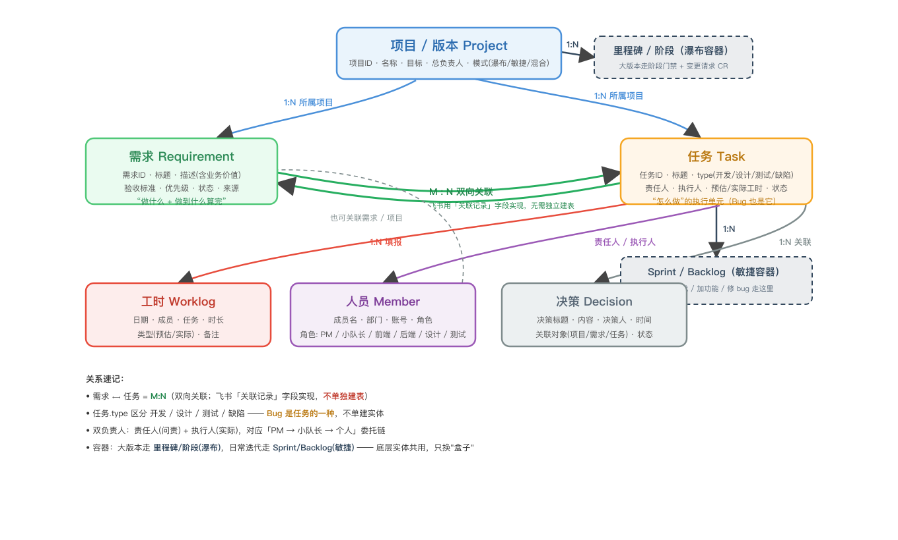

# 飞书项目管理 Agent · 产品需求文档（PRD）

> 版本：v4.0 ｜ 作者：杨锟 ｜ 日期：2026-08-11 ｜ 阶段：已部署飞书 Aily 平台（宝剑群），目标形态 = 群里原生完整项目管理
>
> 本文档是**产品规格（做什么 + 为什么）**，描述产品的完整目标形态。技术实现见附录 A，智能体可按飞书当前能力自行选择最优实现。状态标注：`✅ 已部署` / `⚠️ 已配置待验` / `🔲 规划实现`。

---

## 1. 背景与问题（Why）

### 1.1 现状（As-Is）

- **禅道是什么**：团队记录工时 / 任务的执行主数据系统。但每建一个需求 / 项目都要填一堆表单，团队觉得麻烦、不愿用。
- **需求怎么流转**：一骢哥（杨一骢）通常与成员私聊 / 口头分配需求（微信为主，因含外包），讨论与决策**无留存**；"当时为什么这么定"只能靠人脑回忆，新人接手很难理解背景。
- **我们已具备的能力**：已在飞书「宝剑群」跑通一个 Aily Agent——自动识别群聊需求写入任务表、记录决策、生成每日速递与每周周报，已具备"聊天即任务"的雏形。
- **底层数据已就位**：飞书多维表格已建好 项目表 / 任务表 / 决策日志 / 成员表 / 周报表，且任务表已有「开始时间」「截止时间」、项目表已有「任务完成度(公式·自动算完成率)」——排期与进度的底层字段已存在，待激活使用。

### 1.2 痛点

1. **禅道填表烦**：建需求要填表，团队抵触，导致该记的没记。
2. **讨论决策无留存**：需求靠私聊 / 口头对接，做完只在禅道记个工时，背景丢失。
3. **协调角色低价值搬运**：周仕兴（仕兴姐）原要把群聊讨论抄进禅道建卡，是重复劳动。
4. **项目状态看不清**：没有统一的进度、排期、工时视图，一骢哥难掌握"谁在做什么、卡在哪、何时交"。

### 1.3 我们要解决什么

把"建项目 / 建需求 / 派任务 / 记决策 / 填工时 / 排期 / 看进度 / 周报"**整条项目管理链路**，从"聊完靠人记、再登禅道填表"变成**在飞书群里一句话自动流转 + 多维表格自动计算**，让沟通即数据、决策可追溯、进度可量化。

---

## 2. 目标与非目标（Goals & Non-goals）

### 2.1 目标（完整产品形态）

- **G1 建项目**：群里一句话开新项目，Agent 自动在项目表建记录；也支持手动在项目表加行，Agent 自动关联需求。
- **G2 建需求 / 任务**：群里一句话建需求，替代禅道人工建卡与填表。
- **G3 派任务**：任务分配（责任人 / 协同人）在群里一句话完成，成员可便捷查看自己负责的任务。
- **G4 记决策**：决策与需求背景自动留痕，可追溯"谁拍板、为什么、何时"。
- **G5 填工时**：成员在群里 / 表格里填工时，系统自动汇总。
- **G6 排期与进度**：基于任务「开始 / 截止时间」做公式排期与日历视图；基于完成状态自动算项目完成率 / 燃尽，进度可量化。
- **G7 播报与自看**：定时播报（每日速递 / 周报）+ 成员自看，让负责人与一骢哥快速掌握项目状态。

### 2.2 非目标（仅以下边界，其余均为产品范围内）

- **不碰代码提交 / 提测 / 发布环节**（那是 DevOps，不在本产品职责内）。
- **不重复造飞书项目那种重型专业 PM 平台**：我们是基于"群聊 + 多维表格"的轻量原生方案。复杂资源负载、依赖关键路径等重型能力作为**后续增强**（见 §12 路线图），非本期必做，但**不禁止**。
- **禅道仅留壳**：若公司合规强制项目在禅道留痕，禅道保留一个"公共项目"做壳，核心管理仍在群里完成。
- **合规开关**：敏感会议 / 内容可关闭 AI 处理（脱敏或关闭），金融场景过审前置。

---

## 3. 用户与角色

| 角色        | 真实人物          | 在流程里的职责             | 与产品的关系              |
| --------- | ------------- | ------------------- | ------------------- |
| 决策者 / 分配者 | 杨一骢（一骢哥）/产品经理 | 聊定需求、开项目、拍板、派任务、看总览 | 主要用户：提需求、派任务、看全局    |
| 开发执行      | 作裕哥等成员        | 承接任务、开发、更新状态、填工时    | 用户：看自己任务与背景，群里一句话更新 |
| 维护者       | 杨锟（实习生）       | Agent 搭建、调优、工作流设计   | 产品负责人               |
| 观看 / 接手者  | 导师、新人         | 评估或接手项目             | 观看用户：查阅需求池与决策脉络     |

---

## 4. 核心业务流程（完整闭环）

以团队真实工作方式为例，一个项目从立项到周报，全程在飞书群里走完、多维表格自动计算。每步标注**状态**。

| 步骤      | 团队在做什么                        | Agent 自动做什么                                 | 状态                     |
| ------- | ----------------------------- | ------------------------------------------- | ---------------------- |
| 1. 开项目  | 群里说"开个新项目 XX，目标是…" / 手动在项目表加行 | 项目表新建记录（项目名称 / 目标 / 总负责人 / 状态），需求自动关联"所属项目" | 🔲 规划实现（字段与关联已就位，待接触发） |
| 2. 需求产生 | 群 / 私聊 / 会议讨论新需求              | 识别"要做…""加个…"，任务表新建记录                        | ✅ 已跑通多日                |
| 3. 决策拍板 | 群里说"就按 A 方案做"                 | 写决策日志，关联对应任务                                | ✅ 已跑通                  |
| 4. 任务分配 | 您说"@张三 负责 X"                  | 解析被指派人，**双写**「责任人」+「任务执行人」，成员表钻取立即可见        | ⚠️ 已配置（双写设计已定），待验证     |
| 5. 执行跟踪 | 开发说进度，或 @Agent 查 / 改状态        | 更新任务状态、返回信息                                 | ⚠️ 已配置，待实际验证           |
| 6. 工时填报 | 成员说"今天在 XX 花了 3h" / 表格填       | 写入工时记录，按任务 / 成员 / 周自动汇总                     | 🔲 规划实现（待建工时表与汇总公式）    |
| 7. 排期量化 | —                             | 基于任务「开始 / 截止时间」算剩余天数 / 逾期；日历视图看排期           | 🔲 规划实现（字段已就位，待加公式与视图） |
| 8. 进度量化 | —                             | 项目表「任务完成度(公式)」自动算完成率；任务级燃尽视图                | 项目级 ✅ 已有公式 / 任务级 🔲 规划 |
| 9. 主动播报 | —                             | 每日 16:35 速递（含缺失字段提醒）；周五 14:43 周报            | 速递 ✅ / 追问 ⚠️ 首跑待验；周报 ✅ |

**闭环结论**：步骤 1–9 串起来就是"开项目 → 聊需求 → 派任务 → 跟踪 → 工时 → 排期 → 看进度 → 周报"的**完整项目管理闭环**，全程在群里，不用登禅道填表。其中步骤 2–5、9 已具备，步骤 1、6、7、8 为规划实现（底层字段已就位，接触发 / 公式 / 视图即可）。

---

## 5. 功能需求（Functional Requirements）

> 以下为产品完整功能规格，是飞书智能体构建与自优化的核心依据。状态取自《项目管理 Agent 能力清单 2026-08-11》+ 多维表格实际字段。

### 5.1 需求自动识别（F1 · ✅ 已部署）

- **触发**：群内出现"要做…""加个…""能不能…"
- **行为**：任务表新建记录，填充 任务名 / 需求描述 / 状态=未开始 / 关联所属项目
- **规则**：仅项目相关群；不无差别监听

### 5.2 决策自动记录（F2 · ✅ 已部署）

- **触发**："确定了""就这么定了""先按这个做"
- **行为**：决策日志表写入 决策标题 / 内容 / 时间，关联任务与项目

### 5.3 每日项目速递 + 缺失追问（F3 · ✅ 速递 / ⚠️ 追问待验）

- **触发**：工作日 16:35 定时
- **行为**：扫描当天群消息生成摘要（新增待办 / 今日决策 / 风险 / 重要更新）；检查新建任务，责任人 / 截止 / 描述为空时标注"待补充"

### 5.4 每周项目周报（F4 · ✅ 已部署）

- **触发**：每周五 14:43 定时
- **行为**：汇总本周全部项目数据生成周报发群（规划：同时写入周报表，落地前先清理历史脏数据）

### 5.5 被 @ 查状态（F5 · ⚠️ 已配置待验）

- **触发**：@项目管理agent "查一下 XX 的状态"
- **行为**：读任务表，返回 状态 / 负责人 / 截止时间 / 所属项目

### 5.6 被 @ 改状态（F6 · ⚠️ 已配置待验）

- **触发**：@项目管理agent "把 XX 标记为已完成"
- **行为**：更新任务表状态字段，群内确认

### 5.7 收敛信号检测（极简）（F7 · ⚠️ 已配置待验）

- **触发**："确定了"/"排期"/"约个会"/"对齐一下"
- **行为**：记录决策 / 会议安排，群内回复 ≤ 1 句话（如"📌 已记录决策：将【XX】按【方案B】推进"）

### 5.8 人员分配（F8 · ⚠️ 已配置待验）

- **触发**："把 XX 派给张三" / "@张三 你负责 XX"
- **行为**：解析被指派人，**双写**两个负责人字段以保持一致：
  - 「责任人」(人员单选，新主字段) ← 被指派人；字段 ID `fldSblLChm`
  - 「任务执行人」(关联成员表，老字段，驱动成员表"我的任务"钻取) ← 同步关联同一人，保证成员表钻取立即生效
  - 「协同人」(人员多选) ← 如有协同人；字段 ID `fldgskMrCN`
- **设计决策（2026-08-11 对齐）**：采用双写，确保"群里派任务 → 成员表钻取立即看到"闭环成立；验证稳定后再评估是否统一为单字段。

### 5.9 合规开关（F9 · 🔲 规划实现）

- **触发**：管理员开启"敏感模式" / 指定会议或内容标记脱敏
- **行为**：对该范围关闭 AI 纪要 / 对话记录，或做脱敏处理后留存；与 §2.2 非目标一致
- **说明**：当前为手动合规约定，规划为 Agent 可配置开关

### 5.10 自动建项目（F10 · 🔲 规划实现）

- **触发**："开个新项目 XX，目标是…" / 手动在项目表加行
- **行为**：项目表新建记录（项目名称 / 目标 / 总负责人 / 状态=未启动）；后续需求通过"所属项目"字段自动关联
- **设计**：支持自动建 + 手动建两种，表格字段与关联已就位，待接触发

### 5.11 工时管理（F11 · 🔲 规划实现）

- **触发**："今天在 XX 花了 3h" / 表格填工时
- **行为**：写入工时记录（日期 / 成员 / 任务 / 时长）；按任务 / 成员 / 周自动汇总，纳入周报与进度视图

### 5.12 公式排期与里程碑（F12 · 🔲 规划实现）

- **依赖**：任务表已有「开始时间」「截止时间」字段
- **行为**：加公式算"剩余天数 / 是否逾期 / 里程碑达成"；提供日历视图看排期；逾期任务在每日速递高亮

### 5.13 进度量化（F13 · 项目级 ✅ 已有 / 任务级 🔲 规划）

- **行为**：项目表「任务完成度(公式·自动算完成率)」已自动算项目级完成率；任务级规划加"完成率 / 燃尽"字段与视图，支撑一骢哥看宏观进度

### 5.14 优先级（MoSCoW）

- **Must（本期核心，已部署或已配置）**：F1 需求识别、F2 决策记录、F3 每日速递、F4 周报、F7 收敛信号、F8 人员分配
- **Should（已配置待验即达标）**：F5 查状态、F6 改状态、F3 缺失追问、F10 自动建项目
- **Could（规划实现，本期目标）**：F9 合规开关、F11 工时管理、F12 公式排期、F13 任务级进度量化、成员自看视图（基于成员表钻取）、看板 / 日历视图
- **Won't（本期明确不做）**：代码提交 / 提测 / 发布（DevOps 职责）；重型资源负载 / 依赖关键路径（后续增强，见 §12）

---

## 6. 数据模型（目前多维表格结构）

> Base：`Z2rcbRElNauBTmsySI6c7S46ntE`，共 6 张表。真实字段如下，规划新增字段单独标注。

### 6.0 逻辑模型（骢哥要求 · 统一术语认知）

> 一骢哥反馈：需求 / 任务 / 人员 / 工时之间的关系要简单讲清楚，构建统一的逻辑模型，否则不同人理解不同。下图是产品的核心实体关系（ER）模型，**§6.1–6.7 的每张表都是它的落地**。

**核心实体与关系（大白话）：**

- **项目 1 : N 需求**：一个项目产生多条需求（业务方/PM 聊出来的"要做什么"），靠「所属项目」关联。
- **项目 1 : N 任务**：一个项目拆成多个任务；任务表的一条记录，对应项目表的一条记录（靠「所属项目」字段关联）。
- **需求 M : N 任务（关键修正）**：一个需求可拆成多个任务，一个任务也可服务多个需求。两者是**两个独立实体**，用「关联记录」字段（双向关联）表达多对多，**不再合并为同一张表**（旧版"需求任务同表"为概念错误，已废弃）。
- **任务自引用拆子任务**：任务表里一条任务可以挂它的子任务（仍是任务表里的记录），形成"父任务 → 子任务"的 1:N。
- **任务 1:1 责任人 + N 协同人**：一个任务有且只有一个「责任人」（问责方，初始=小队长），可带多个「协同人」；人挂在任务上，不直接挂项目。
- **任务 1 : N 工时 / 人员 1 : N 工时**：每次填报产生一条工时记录，既属于某个任务、也属于某个人；一个人有多条工时，一个任务也有多条工时。
- **决策日志**（虚线）：不独立成主实体，靠「关联任务 / 关联项目 / 关联需求」挂到任务、项目或需求上，专门留"谁拍板、为什么、何时"的痕。

**⚠️ 三处最容易理解错的地方（务必对齐）：**

1. **需求 ≠ 任务，是两个独立实体（M:N）**：需求="做什么/为什么"（含验收标准），任务="怎么做"（执行工作）。群里聊出来的"要做 X"要先识别是需求还是任务——业务方/PM 建**需求**，PM/小队长再从中提取**任务**。两者通过「关联记录」字段建立多对多（一个需求拆多任务、一个任务服务多需求）。**旧版"需求任务同表"为概念错误，已废弃**，详见《领域模型与业务逻辑》。
2. **人员是通过任务字段挂到项目的**：成员表本身不直接关联项目；一个人之所以"属于某项目"，是因为他作为责任人 / 协同人出现在该项目的任务上。看项目成员 = 看这个项目下所有任务挂的人。
3. **工时是"任务的明细"，不是"人员的属性"**：工时记录的归属主体是任务（这次填报花在哪项任务上），人只是填报者。不要把工时理解成人员表上的一个汇总字段——它是独立的事实记录，按任务 / 人 / 周分别汇总。

> **⚠️ 与当前 Aily 实现的差异（迁移说明）**：当前飞书 Base 仍按旧模型把"需求"折叠进任务表的「需求描述」字段，未建独立需求表，也未建需求↔任务的「关联记录」字段。本 PRD v5 描述的是**目标模型**（需求/任务分离 + M:N 关联）。Agent 需据此调整：① 新增「需求表」；② 在需求表与任务表间建立「关联记录」双向关联（替代原「需求描述」自由文本字段）；③ 群聊识别逻辑从"统一进任务表"改为"先判需求/任务，再分别落表"。迁移前，任务表的「需求描述」字段作为临时承载。

### 6.1 项目表（tblubema3wO4HBrp · 4 条）

项目名称 / 目标 / 对应任务(关联) / 总负责人 / 项目截止时间 / 成员(查找) / 项目情况概述 / 最后更新时间 / 任务数量(查找) / 项目进展(关联) / **任务完成度(公式·自动算完成率)** / 状态(未启动/推进中/已完成)

### 6.2 任务表（tblxY7V5NXfyiIkG · 10 条）

任务(文本) / **任务执行人(关联成员表·老字段·驱动成员表"我的任务"钻取·有数据)** / 开始时间 / 优先级(P0/P1) / 所属项目(关联) / **协同人(人员多选·新·空)** / 实际完成时间 / **责任人(人员单选·新·空，新分配主字段)** / 状态(已确认/未开始/进行中/已完成) / 需求描述 / 截止时间

> **规划新增（F11/F13）**：预估工时、实际工时、任务完成率 / 燃尽。  
> **设计决策**：双负责人字段本期双写（见 §5.8），验证稳定后评估统一为单字段。

### 6.3 决策日志表（tblNHufHr16mFV92 · 3 条）

决策标题 / 影响范围 / 备注 / 关联任务 / 决策时间 / 关联项目 / 决策内容 / 决策人(人员多选) / 状态(执行中/已完成)

### 6.4 成员表（tblOwKqkEWuKBCxu · 7 人）

成员名(公式) / 部门 / **任务(关联·该成员负责的任务·"我的任务"钻取来源)** / 账号(人员)

### 6.5 周报表（tblogWAMyrddH3r6 · 10+ 条，含 2022 历史）

汇报标题(公式) / 汇报人 / 所属项目 / 进度内容 / 日期

> 当前 Agent 周报**只发群、未写入此表**；规划落表前先清理 2022 历史脏数据。

### 6.6 快速上手（tblj740cKSkiquB3）

系统默认表，非业务数据。

### 6.7 工时表（🔲 规划新增 · F11）

日期 / 成员 / 任务 / 时长 / 备注（规划）

---

## 7. 用户故事

- **作为一骢哥**，我希望讨论结论与项目进度自动沉淀成可追溯记录，以便随时查"当时为什么这么定、谁拍的板、现在卡在哪"。
- **作为开发（作裕哥等）**，我希望群里一句话就能开项目、派任务、改状态、填工时，以便不用登禅道填表。
- **作为成员**，我希望点进自己就能看到负责的任务与排期，以便掌握"我在做什么、何时交"。
- **作为新人 / 接手者**，我希望有需求池、决策脉络与进度视图可查，以便快速理解背景。

---

## 8. 验收标准（Acceptance Criteria）

Demo / 真实群须满足（闭环全链路）：

1. 群内连续 5 条同一需求对话，Agent 只生成 1 条主记录；
2. 出现修改时，在原记录下追加新版本 / 新信息，不丢失原始内容；
3. @Agent 可把状态改为"已完成"，表格与群回复同步更新；
4. 收敛信号（"就这么定了""先按 A 方案做"）触发时，Agent 仅以极简 1 句话回复并记录决策；
5. 任何写入 / 更新操作都在群里给一句简短说明；
6. **人员分配**：@张三 负责 X → 任务表「责任人」= 张三 且「任务执行人」同步关联张三（双写一致），群内确认；成员表"我的任务"钻取能立即看到该任务；
7. **缺失追问**：每日速递中，责任人 / 截止为空的任务是被标注"待补充"；
8. **开项目（规划验收）**：群里说"开个新项目 XX" → 项目表新增一条，后续需求可关联；
9. **排期 / 进度（规划验收）**：任务表填写开始 / 截止后，项目表完成率与逾期标识自动更新。

---

## 9. 成功指标（Success Metrics）

| 指标           | 定义                       | 基线       | 目标    |
| ------------ | ------------------------ | -------- | ----- |
| 北极星：需求背景可追溯率 | 已收敛需求中，有完整决策记录 + 关联任务的比例 | 0%（原无留存） | ≥ 90% |
| 禅道人工建卡替代率    | 新需求中在群里完成建卡、未走禅道填表的比例    | 0%       | ≥ 80% |
| 责任人填充率       | 任务表中「责任人」非空比例            | 0%（字段新）  | ≥ 90% |
| 项目进度可量化率     | 进行中项目有自动完成率 / 排期视图的比例    | 0%       | ≥ 80% |
| 群响应可用性       | 被 @ 后返回有效信息              | —        | 100%  |
| 可演示性         | 10 分钟跑完一个需求全流程           | —        | 达标    |

---

## 10. 风险与合规

| 风险            | 影响                                           | 应对                         |
| ------------- | -------------------------------------------- | -------------------------- |
| LLM 分类 / 关联不准 | 需求错建漏建                                       | 提示词 + 小样本调优；规则兜底           |
| 双负责人字段不一致     | 成员钻取与报表对不上                                   | 统一权威字段（双写过渡，稳定后评估单字段）      |
| 数据可见性         | 表格 `tenant_readable`+群 `full_access`，全员可见可编辑 | "我的任务"是便捷入口非权限隔离；若需隔离要单独设计 |
| 外部访问 `open`   | 链接可被外部打开                                     | 建议关注，必要时收紧                 |
| 沟通数据合规（含会议录音） | 金融场景过审前置                                     | 知情同意 + 敏感可关（F9）            |

---

## 11. 实现状态（截至 2026-08-11，实际部署于飞书 Aily）

### 11.1 已上线 Auto 任务（宝剑群）

| 任务         | 类型    | 触发                | 状态    |
| ---------- | ----- | ----------------- | ----- |
| 宝剑群-被@交互响应 | event | 群内 @ 我            | ✅ 运行中 |
| 宝剑群-收敛信号检测 | event | "确定了"/"排期"/"约个会"等 | ✅ 运行中 |
| 宝剑群-每日项目巡检 | cron  | 工作日 16:35         | ✅ 运行中 |
| 宝剑群-每周项目周报 | cron  | 每周五 14:43         | ✅ 运行中 |
| 每周工作回顾     | cron  | 每周五 17:00         | ✅ 运行中 |

### 11.2 能力落地对照

| 能力                                             | 状态               |
| ---------------------------------------------- | ---------------- |
| F1 需求识别 / F2 决策记录 / F4 周报 / F3 速递              | ✅ 已部署            |
| F5 查状态 / F6 改状态 / F7 收敛信号 / F8 人员分配 / F3 追问    | ⚠️ 已配置，待实际验证     |
| F9 合规开关 / F10 自动建项目 / F11 工时 / F12 排期 / F13 进度 | 🔲 规划实现（字段部分已就位） |

### 11.3 双身份规则

读写表格 `--as user`（权限绑用户）；发群消息 / 读群消息 `--as bot`（自动化不冒用户）。

---

## 12. 路线图（Now / Next / Later）

- **Now（已部署 / 待验即达标）**：F1–F8 + F3 追问 —— 聊需求 → 派任务 → 跟踪 → 周报 的最小闭环。
- **Next（本期目标，规划实现）**：F10 自动建项目、F11 工时管理、F12 公式排期与里程碑、F13 任务级进度量化、F9 合规开关、周报落表（先清历史脏数据）。—— **即"公式排期、进度量化等项目管理必备能力"**，底层字段已就位，接触发 / 公式 / 视图即可。
- **Later（后续增强，非禁止）**：重型资源负载、依赖关键路径、禅道双向同步（若公司强制禅道留痕）、精细成本 / 工时核算。

---

## 13. 待一骢哥确认（不阻塞开发）

1. **禅道是否真强制**：若公司要求项目必在禅道留痕，禅道留什么字段的公共项目壳？（决定 Later 是否需要禅道同步）

---

## 附录 A：技术实现说明（供智能体 / 研发参考）

> 本附录为实现路径参考，**非产品规格**。智能体（Aily Agent）应按飞书当前可用能力自行选择最优实现，**以实际搭建为准**。

- **运行载体**：飞书 Aily 平台 Agent（agent_4kcxypswwg98ayw），常驻 Continuous 任务，运行于宝剑群（oc_e63829e8dd009fb398a380621d067d85）。
- **结构化存储**：飞书多维表格 Base `Z2rcbRElNauBTmsySI6c7S46ntE`（任务表 tblxY7V5NXfyiIkG / 决策日志 tblNHufHr16mFV92 / 项目 tblubema3wO4HBrp / 成员 tblOwKqkEWuKBCxu）。
- **消息入口**：飞书事件订阅监听项目群消息（被 @ + 收敛信号精准触发，早期"任意消息全量监听"已停用）。
- **双身份**：读写表 `--as user`、发言 `--as bot`；若 Aily 原生能力增强可平滑迁移。
- **自测**：可建轻量模拟 Bot 按脚本抛对话，仅用于无真实团队时自测。
