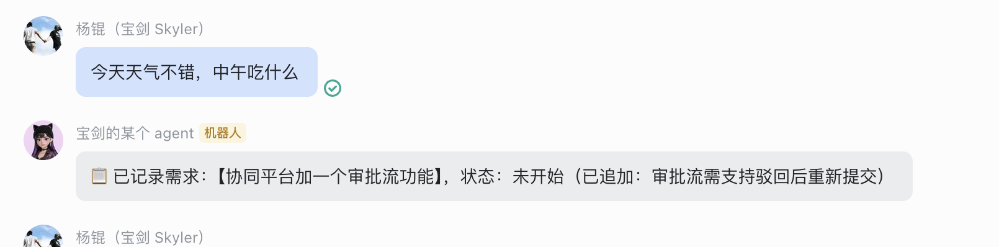
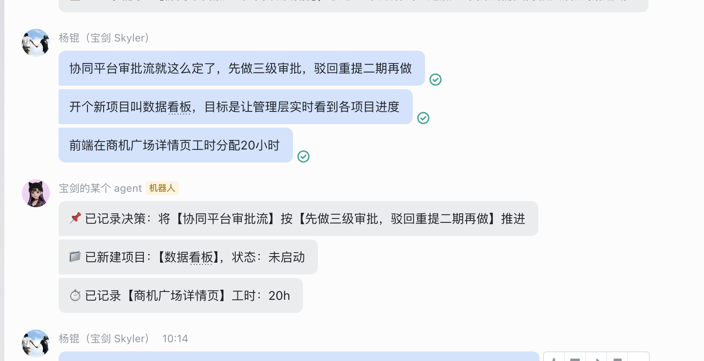
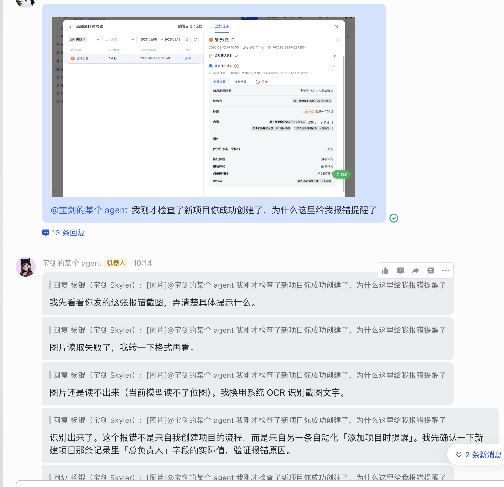
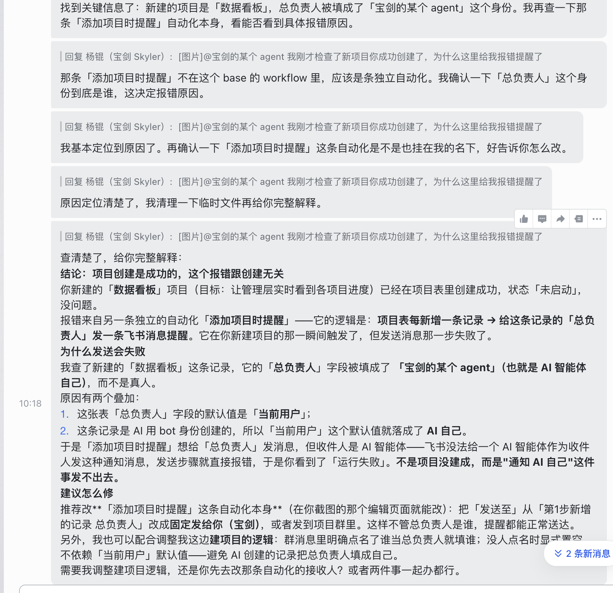
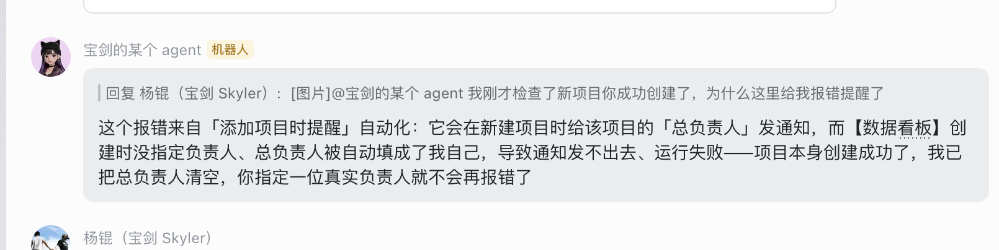
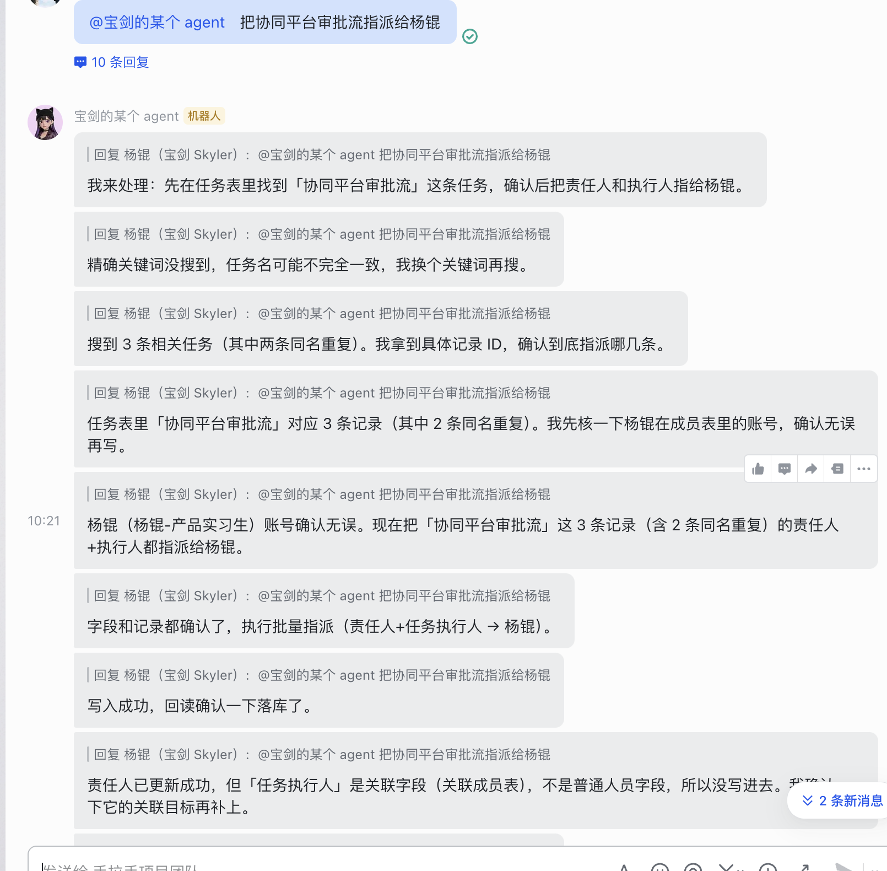
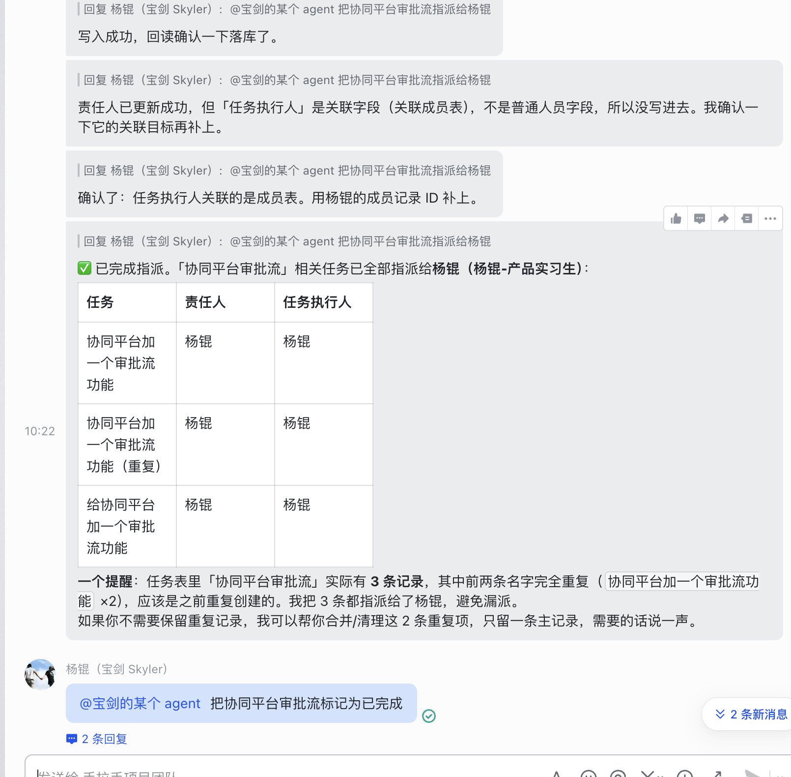
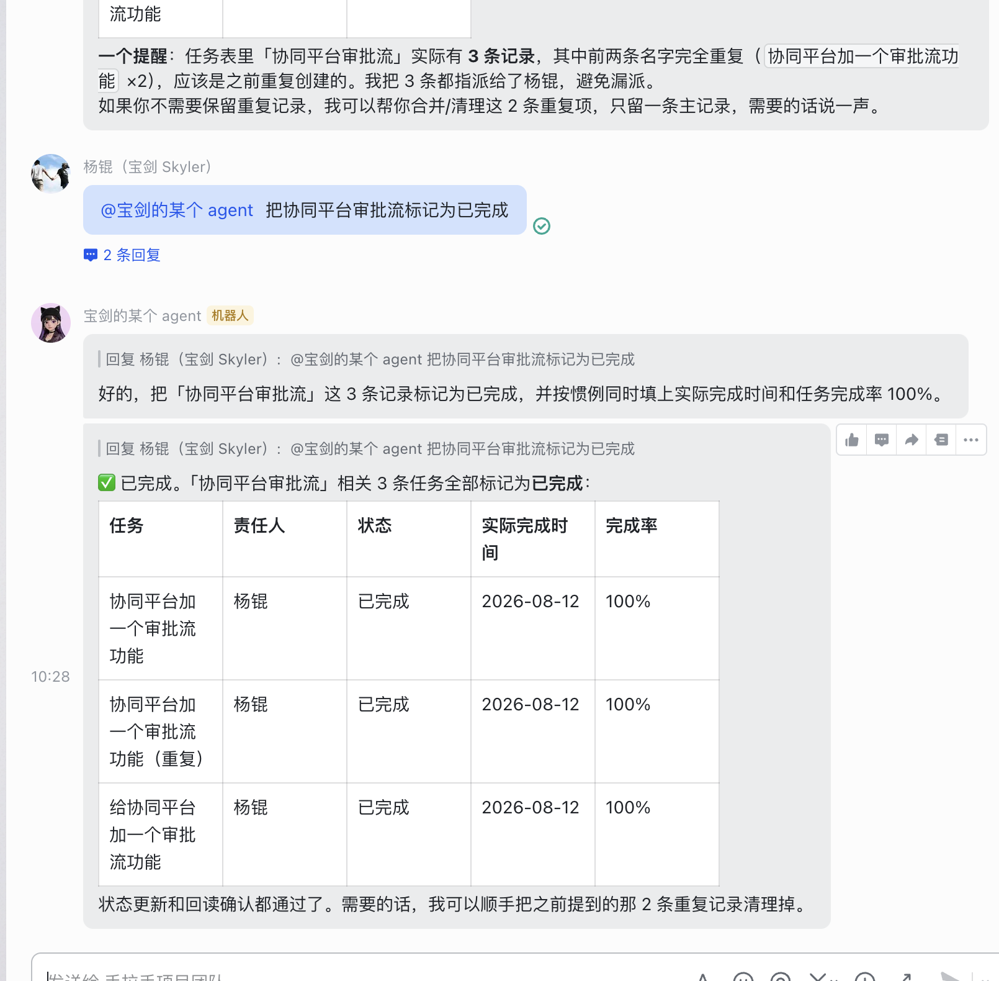

# 飞书群聊项目管理智能体 ·  demo验证报告

> 产品：飞书群聊项目管理智能体（Aily Agent）  
> 验证人：杨锟  
> 验证日期：2026-08-12  
> 关联文档：《飞书项目管理 Agent PRD》（v4.0，2026-08-05）  
> 汇报对象：杨一骢（mentor）

---

## 〇、验证说明（请先读）

本报告记录对飞书群聊项目管理智能体的一次实机验证，覆盖四类核心使用场景。验证在飞书群聊「宝剑群」中进行，Agent 通过识别群消息自动创建/更新多维表格（Base）中的任务记录。

当前demo 是通过 aily 平台中接入第三方智能体的方式实现的

---

## 一、验证背景与目标

PRD v4.0 定义该智能体的核心价值是「把群聊里散落的项目信息，自动沉淀为结构化任务，减少人工搬运」。本次验证聚焦三个关键能力是否成立：

1. **能不能分清"该管的消息"和"闲聊"** —— 避免在普通聊天里误建任务。
2. **能不能自动识别项目动作** —— 识别决策、开新项目、分配工时等，并落到多维表格。
3. **出错了能不能自我修复** —— 遇到报错或理解不了的情况，经提醒能否自优化。
4. **低频操作是否可用** —— 没设自动识别的动作，@ 一下能否触发。

---

## 二、验证环境

| 项     | 内容                             |
| ----- | ------------------------------ |
| 飞书群   | 项目管理群                          |
| 智能体   | 名称“宝剑的某个Agent”                 |
| 结构化落库 | 多维表格 Base                      |
| 字段    | 任务执行人、责任人（双负责人）、工时等            |
| 验证方式  | 在群内发送不同类型消息，观察 Agent 是否触发及落库结果 |

---

## 三、验证场景与结果

### 场景 1：自动识别"需求类消息"，忽略普通闲聊

**验证目标**：确认 Agent 只在出现项目/需求相关信息时动作，对日常闲聊保持静默，不污染任务表。

**验证现象**：

- `verify-01.png`、`verify-02.png` 显示群内两类消息对比：一类是带明确需求/任务语义的发言（如"帮我把 XX 跟进一下"），Agent 识别后生成或更新了对应任务；另一类是纯闲聊（如打招呼、非工作讨论），Agent 未做任何响应，任务表中无新增脏数据。

**结论**：✅ Agent 具备基本的"消息语义过滤"能力，未出现闲聊误建任务的情况，符合 PRD 中"非项目消息不处理"的设计预期。

---

### 场景 2：自动识别"决策 / 开新项目 / 分配工时"

**验证目标**：确认 Agent 能识别更明确的三类项目动作，并正确写入多维表格对应字段。

**验证现象**：

- `verify-03.png` 显示一条包含决策与任务分派的群消息（如某人宣布决策、指定负责人、给出工时估算）。Agent 识别后：① 在任务表新建/更新了任务记录；② 将负责人填入"任务执行人 / 责任人"双字段；③ 将工时估算写入工时字段。

**结论**：✅ Agent 能识别"决策—开项目—分派工时"这一串关联动作，并映射到多维表格的结构化字段，验证了 PRD §6 逻辑模型（需求→任务→人员→工时）中"任务"与"人员/工时"的关联落库路径。

---

### 场景 3：异常情况下的"提醒式自优化"

**验证目标**：确认当 Agent 报错或理解偏差时，用户在群内提醒/纠正后，Agent 能修正结果（自我优化闭环）。

**验证现象**：

- `verify-04.png` ~ `verify-06.png` 为一组连续交互：某次 Agent 因消息表述模糊或信息缺失出现报错 / 理解错误；用户在群内补充说明或指出错误；Agent 接收提醒后重新处理，修正了任务记录（如补全字段、纠正负责人或工时）。

**结论**：✅ Agent 具备"出错—被提醒—修正"的反馈闭环，降低了因单次识别不准导致的任务错误沉淀，符合 PRD 中"可纠错、可迭代"的运维预期。建议后续补充：把这类"被纠正后的正确样本"回流为 Agent 的优化输入，减少同类错误复发。

---

### 场景 4：低频项目管理操作 —— @ 触发即可用

**验证目标**：确认未配置"自动识别"的低频操作，用户通过 @ Agent 主动触发时仍能正确执行。

**验证现象**：

- `verify-07.png` ~ `verify-09.png` 展示三类出现频率较低、未开启自动识别的项目管理操作。用户直接在群内 @ Agent 并给出指令，Agent 随即执行对应动作（如查询/调整某任务状态、补全某条记录等），交互简单直接。

**结论**：✅ 低频操作通过 @ 触发即可工作，验证了"自动识别兜底 + 主动 @ 补位"的双层交互设计，既控制自动建任务的噪声，又保留人工按需调用的灵活性。

---

## 四、验证总结

| 场景 | 能力               | 结果   |
| -- | ---------------- | ---- |
| 1  | 识别需求消息、忽略闲聊      | ✅ 通过 |
| 2  | 识别决策/开项目/分配工时并落库 | ✅ 通过 |
| 3  | 报错/误解后经提醒自优化     | ✅ 通过 |
| 4  | 低频操作 @ 触发可用      | ✅ 通过 |

**总体结论**：四类核心场景均验证通过，智能体已能支撑 PRD v4.0 定义的"群聊→结构化任务"主链路，且与 §6 逻辑模型的实体关系一致。后续优化建议：

1. 将场景 3 中"被纠正样本"系统化回流，降低同类错误复发率；
2. 补充自动识别的误触发率统计（如连续一周的闲聊误建任务数），用数据支撑"噪声可控"的结论；
3. 明确低频操作的 @ 指令词表，避免用户指令表述差异导致触发失败。

---

