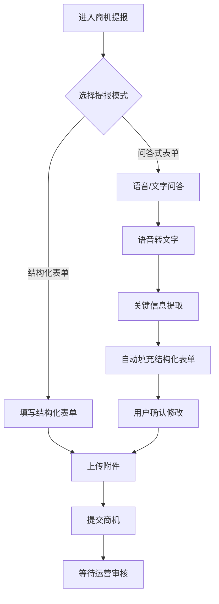
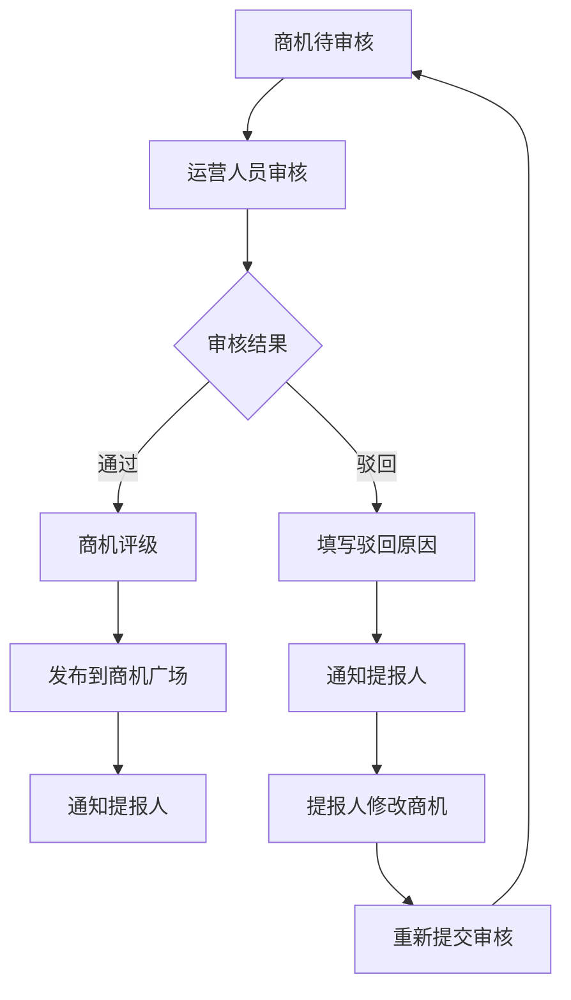
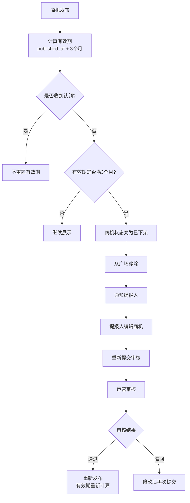
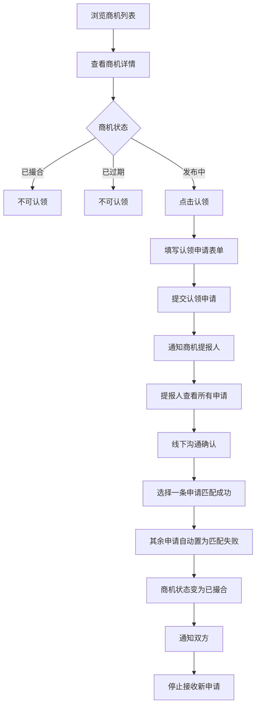

# 商机广场 - 产品需求文档 (PRD)

## 文档信息

| 项目 | 内容 |
|-----|------|
| 产品名称 | 商机广场 |
| 文档版本 | v1.2 |
| 创建日期 | 2026-03-16 |
| 更新日期 | 2026-04-02 |
| 更新内容 | 1. 合并目标用户（普通用户可提报、认领、审核自己商机的认领申请）<br>2. 简化认领申请表单（仅保留认领理由）<br>3. 添加联系方式脱敏显示机制<br>4. 支持多条认领申请和线下沟通确认<br>5. 已过期和已撮合商机继续展示但不可认领 |
| 产品类型 | 移动端应用 |

---

## 1. 产品概述

### 1.1 产品定位
商机广场是一个投行并购重组商机撮合移动端应用，连接商机提报方与潜在合作方，通过标准化流程提高商机匹配效率。

### 1.2 目标用户
- **普通用户**: 可提报商机、浏览商机、认领别人提报的商机、审核自己所提报商机的认领申请
- **运营人员**: 审核商机、商机评级、平台管理

### 1.3 核心价值
- 规范化商机提交流程
- 智能化商机信息提取
- 高效的商机审核与评级
- 便捷的商机认领与匹配

---

## 2. 功能模块说明

### 2.1 商机提报模块

#### 2.1.1 结构化表单提报
- **商机类型**: 并购、重组、股权转让、合资合作等
- **涉及行业**: 能源、金融、科技、医疗、制造业等（支持多选）
- **交易规模**: 金额区间选择（如 1亿以下、1-5亿、5-10亿、10亿以上）
- **标的企业信息**:
  - 企业名称
  - 所在地区
  - 企业简介
  - 主营业务
  - 成立时间
  - 员工规模
- **联系方式**: 联系人、联系电话、邮箱
- **补充说明**: 其他需要说明的信息
- **附件上传**: 支持上传项目计划书、财务报表等文件（PDF/Word/Excel格式，单文件不超过50MB）

#### 2.1.2 问答式表单提报
- 以对话形式引导用户输入商机信息
- 支持语音输入，自动转换为文字
- 问答完成后，自动提取关键信息填充到结构化表单
- 用户可对自动填充的信息进行确认和修改
- 支持保存草稿，随时继续编辑

#### 2.1.3 语音转文字与关键信息提取
- 集成语音转文字服务
- 使用NLP技术从语音内容中提取关键字段
- 提取字段包括：商机类型、行业、交易规模、企业名称、联系人、电话等
- 提取结果展示给用户确认

---

### 2.2 商机审核与评级模块

#### 2.2.1 审核工作流
| 状态 | 说明 |
|-----|------|
| 待审核 | 商机提报后，等待运营人员审核 |
| 审核中 | 运营人员正在审核 |
| 已通过 | 审核通过，商机发布到广场 |
| 已驳回 | 审核驳回，需用户修改后重新提交 |

#### 2.2.2 驳回规则
- 驳回时需填写驳回原因
- 用户可查看驳回原因并修改商机
- 修改后可重新提交审核

#### 2.2.3 商机评级体系
- **评级维度**:
  1. 交易规模（权重30%）
  2. 行业热度（权重20%）
  3. 信息完整度（权重25%）
  4. 提报人信用（权重15%）
  5. 项目可行性（权重10%）

- **优质商机标准**:
  - 综合评分 ≥ 80分
  - 交易规模 ≥ 1亿
  - 信息完整度 ≥ 90%
  - 无历史不良记录

- **展示标识**: 优质商机在列表页和详情页展示"优质"徽章

#### 2.2.4 审核结果通知
- 审核通过/驳回后，发送站内消息和推送通知
- 通知包含审核结果和相关说明

---

### 2.3 商机有效期与自动下架模块

#### 2.3.1 有效期规则
- **默认有效期**: 3个月
- **有效期起始时间**: 商机发布时间（`published_at`）
- **有效期截止时间**: `published_at + 3个月`
- **重置规则**: 认领申请提交时，不重置有效期；重新发布时，重新计算有效期

#### 2.3.2 自动下架机制
- **触发条件**: 商机状态为"已发布"且有效期满，且有效期内未收到任何认领申请
- **下架处理**:
  1. 商机状态变更为"已过期"
  2. 继续在商机广场列表中展示，但不可认领
  3. 停止接收新的认领申请
  4. 发送站内消息和推送通知给商机提报人

#### 2.3.3 已过期商机处理
- **提报人操作**:
  - 可在"我的商机"中查看已过期商机
  - 可编辑商机信息
  - 编辑完成后可重新提交审核
- **重新发布流程**:
  - 重新提交审核 → 运营审核通过 → 自动发布 → 有效期重新计算为3个月

#### 2.3.4 有效期展示
- **列表页**: 不展示有效期
- **详情页**: 展示"有效期至：YYYY-MM-DD"（发布中/已过期状态显示）
- **我的商机**: 展示有效期状态（有效期内/即将过期/已过期）
- **即将过期提醒**: 有效期剩余7天时，发送提醒通知给提报人

---

### 2.4 商机发布与展示模块

#### 2.4.1 商机列表页
- **顶部**: 搜索栏、筛选按钮
- **筛选条件**:
  - 商机类型
  - 涉及行业
  - 交易规模
  - 所在地区
  - 优质商机（开关）
- **列表项**:
  - 优质徽章（如适用）
  - 商机标题
  - 行业标签
  - 交易规模
  - 所在地区
  - 发布时间
  - 当前状态（发布中/已撮合/已过期）
- **排序**: 按发布时间倒序、按交易规模、按热度

#### 2.4.2 商机详情页
- **基本信息区**:
  - 商机标题
  - 优质徽章
  - 状态标签
  - 发布时间
- **商机详情区**:
  - 商机类型
  - 涉及行业
  - 交易规模
  - 所在地区
  - 标的企业信息
  - 补充说明
- **附件区**: 可下载附件列表
- **操作区**:
  - 认领商机按钮（仅发布中状态显示，可点击）
  - 已撮合/已过期按钮（已撮合/已过期状态显示，不可点击）
  - 联系提报人（如已认领）
- **提报人信息**: 提报人头像、昵称
- **联系方式脱敏显示**:
  - 未提交认领申请前：联系方式脱敏显示（如：手机号 138****1234）
  - 提交认领申请后：可查看完整的联系方式
- **有效期信息**: 展示"有效期至：YYYY-MM-DD"（仅发布中状态显示）

---

### 2.5 商机认领模块

#### 2.5.1 认领申请表单
- **认领理由**: 描述您为什么适合对接这个商机，以及您的合作意向
- **联系方式**: 系统通过登录信息自动记录

#### 2.5.2 认领申请处理流程
```
提交认领申请 → 待提报人审核 → 线下沟通确认 → 匹配成功/匹配失败
```

| 状态 | 说明 |
|-----|------|
| 待审核 | 认领申请已提交，等待提报人审核 |
| 线下沟通中 | 提报人已查看申请，双方正在线下沟通 |
| 匹配成功 | 提报人选择此申请确认匹配，双方建立联系 |
| 匹配失败 | 提报人未选择此申请，或驳回申请 |

#### 2.5.3 多条认领申请处理
- 一个商机可以收到多条认领申请
- 收到认领申请后，提报人可查看所有申请
- 提报人可与多个认领人进行线下沟通确认
- 最终提报人只能选择其中一条认领申请确认匹配成功
- 其余未被选中的认领申请默认置为匹配失败

#### 2.5.4 匹配成功后的处理
- 商机状态变为"已撮合"
- 停止接收新的认领申请
- 双方可查看对方联系方式
- 发送消息通知双方

#### 2.5.5 提报人审核认领
- 提报人可在个人中心查看所有待审核的认领申请
- 查看认领人的申请信息
- 选择其中一条申请确认匹配成功
- 其余申请自动置为匹配失败

---

### 2.6 用户权限管理与个人中心

#### 2.6.1 个人中心首页
- 用户头像、昵称
- 功能入口:
  - 我的商机（我提报的）
  - 我的认领（我申请的）
  - 待审核认领（我提报的商机的认领申请）
  - 消息通知
  - 账户设置

#### 2.6.2 我的商机
- 列表展示用户提报的所有商机
- 显示每个商机的状态（待审核/已通过/已驳回/已撮合/已过期）
- 显示有效期状态（有效期内/即将过期/已过期）
- 支持编辑、删除（未审核时）
- 已过期商机支持编辑和重新提交审核
- 点击进入商机详情

#### 2.6.3 我的认领
- 列表展示用户提交的所有认领申请
- 显示每个申请的状态（待审核/匹配成功/匹配失败）
- 点击查看申请详情

#### 2.6.4 待审核认领
- 仅商机提报人可见
- 列表展示自己提报的商机收到的认领申请
- 支持审核通过/驳回

#### 2.6.5 消息通知
- 站内消息列表
- 消息分类: 审核消息、认领消息、过期提醒
- 支持标记已读、全部已读
- 点击查看消息详情

---

## 3. 用户流程图

### 3.1 商机提报流程



### 3.2 商机审核流程



### 3.3 商机有效期与自动下架流程



### 3.4 商机认领流程



---

## 4. 核心界面设计建议

### 4.1 首页（商机列表）

| 区域 | 元素 | 说明 |
|-----|-----|-----|
| 顶部导航 | 标题 | "商机广场" |
| | 搜索框 | 支持关键词搜索 |
| | 筛选按钮 | 点击展开筛选面板 |
| 筛选面板 | 商机类型 | 单选 |
| | 涉及行业 | 多选 |
| | 交易规模 | 单选 |
| | 所在地区 | 级联选择 |
| | 优质商机 | 开关 |
| 列表 | 卡片 | 每个商机一个卡片 |
| | 优质徽章 | 右上角金色徽章 |
| | 标题 | 加粗显示 |
| | 标签 | 行业、规模等标签 |
| | 信息 | 地区、时间 |
| | 状态 | 右下角状态标签 |
| 底部Tab | 首页 | 选中状态 |
| | 提报 | 加号图标 |
| | 消息 | 消息图标 |
| | 我的 | 个人中心 |

### 4.2 商机详情页

| 区域 | 元素 | 说明 |
|-----|-----|-----|
| 顶部 | 返回按钮 | 返回列表 |
| | 分享按钮 | 分享商机 |
| 头部 | 标题 | 大标题 |
| | 优质徽章 | 如适用 |
| | 状态标签 | 发布中/已撮合 |
| | 发布时间 | 灰色小字 |
| 信息区 | 信息项 | 商机类型、行业、规模、地区 |
| | 企业信息 | 企业名称、简介等 |
| | 补充说明 | 展开/收起 |
| 附件区 | 附件列表 | 文件图标、名称、大小 |
| | 下载按钮 | 点击下载 |
| 提报人 | 头像 | 圆形头像 |
| | 昵称 | 提报人昵称 |
| | 发布时间 | |
| 底部操作 | 认领商机 | 主按钮（未撮合时） |
| | 已撮合 | 置灰不可点击 |

### 4.3 商机提报页（结构化表单）

| 区域 | 元素 | 说明 |
|-----|-----|-----|
| 顶部 | 返回按钮 | 保存草稿/取消 |
| | 下一步 | 或提交 |
| 表单区 | 表单分组 | 分组展示 |
| | 必填标识 | *号 |
| | 输入框 | 文字输入 |
| | 选择器 | 类型、行业等选择 |
| | 附件上传 | 点击选择文件 |
| | 已选文件 | 文件列表，可删除 |
| 底部 | 切换模式 | 问答式表单 |
| | 保存草稿 | |
| | 提交审核 | 主按钮 |

### 4.4 个人中心页

| 区域 | 元素 | 说明 |
|-----|-----|-----|
| 头部 | 头像 | 圆形大头像 |
| | 昵称 | 用户名 |
| | 编辑资料 | 小按钮 |
| 功能列表 | 我的商机 | 箭头图标 |
| | 我的认领 | 箭头图标 |
| | 待审核认领 | 带数字角标 |
| | 消息通知 | 带未读数角标 |
| | 账户设置 | |
| | 帮助与反馈 | |
| 底部Tab | 我的 | 选中状态 |

---

## 5. 关键技术实现要点

### 5.1 前端技术要点 (React Native)

#### 5.1.1 项目结构
```
src/
├── components/       # 公共组件
├── screens/          # 页面组件
├── navigation/       # 路由配置
├── services/         # API服务
├── store/            # 状态管理 (Redux/Zustand)
├── utils/            # 工具函数
└── types/            # TypeScript类型定义
```

#### 5.1.2 核心功能实现
- **表单管理**: 使用 Formik + Yup 处理表单验证
- **语音录制**: 使用 react-native-audio-recorder-player
- **文件上传**: 支持断点续传，上传进度显示
- **下拉刷新/上拉加载**: 使用 FlatList
- **推送通知**: 集成 Firebase Cloud Messaging / APNs

### 5.2 后端技术要点 (Java Spring Boot)

#### 5.2.1 项目结构
```
src/main/java/com/opportunity/
├── controller/       # 控制器层
├── service/          # 服务层
├── repository/       # 数据访问层
├── entity/           # 实体类
├── dto/              # 数据传输对象
├── config/           # 配置类
├── enums/            # 枚举类
└── util/             # 工具类
```

#### 5.2.2 核心功能实现

**状态机管理商机状态**
```java
public enum OpportunityStatus {
    DRAFT,          // 草稿
    PENDING_REVIEW, // 待审核
    UNDER_REVIEW,   // 审核中
    APPROVED,       // 已通过
    REJECTED,       // 已驳回
    PUBLISHED,      // 已发布
    EXPIRED,        // 已过期
    MATCHED         // 已撮合
}
```

**定时任务 - 检查商机有效期**
```java
@Service
public class OpportunityExpireTask {

    @Scheduled(cron = "0 0 2 * * ?") // 每天凌晨2点执行
    public void checkExpiredOpportunities() {
        List<Opportunity> expiredList = opportunityService
            .findExpiredPublishedOpportunities();
        
        for (Opportunity opp : expiredList) {
            if (!hasAnyClaimInPeriod(opp)) {
                opp.setStatus(OpportunityStatus.OFF_SHELF);
                opportunityService.save(opp);
                messageService.sendOffShelfNotification(opp);
            }
        }
    }
}
```

**即将过期提醒任务**
```java
@Scheduled(cron = "0 0 9 * * ?") // 每天早上9点执行
public void sendExpiringSoonNotifications() {
    List<Opportunity> expiringList = opportunityService
        .findExpiringInDays(7); // 7天内到期
    
    for (Opportunity opp : expiringList) {
        messageService.sendExpiringSoonNotification(opp);
    }
}
```

**商机评级算法**
```java
public class OpportunityRatingService {
    public int calculateRating(Opportunity opportunity) {
        int score = 0;
        score += calculateDealSizeScore(opportunity.getDealSize()) * 0.3;
        score += calculateIndustryScore(opportunity.getIndustry()) * 0.2;
        score += calculateCompletenessScore(opportunity) * 0.25;
        score += calculateReputationScore(opportunity.getSubmitter()) * 0.15;
        score += calculateFeasibilityScore(opportunity) * 0.1;
        return Math.min(score, 100);
    }
}
```

**关键信息提取 (NLP)**
- 使用正则表达式或NLP库提取关键信息
- 预留接口，支持后续接入大模型

### 5.3 数据库设计要点

#### 核心数据表

| 表名                     | 说明                                 |
| ---------------------- | ---------------------------------- |
| user                   | 用户信息                               |
| opportunity            | 商机信息（含 published_at, expire_at 字段） |
| opportunity_attachment | 商机附件                               |
| audit_record           | 审核记录                               |
| claim_application      | 认领申请                               |
| message                | 消息通知                               |

**opportunity 表新增字段**:
| 字段 | 类型 | 说明 |
|-----|-----|-----|
| published_at | datetime | 发布时间 |
| expire_at | datetime | 有效期截止时间 |

---

## 6. 非功能性需求

### 6.1 性能要求
- 页面加载时间 < 2秒
- 列表页支持无限滚动，每页20条
- API响应时间 < 500ms（P95）

### 6.2 安全要求
- 用户认证通过现有IM系统
- 敏感数据加密存储
- API接口鉴权
- 文件上传类型和大小限制

### 6.3 兼容性要求
- iOS 12.0+
- Android 6.0+
- 适配主流屏幕尺寸

### 6.4 可用性要求
- 支持离线保存草稿
- 网络错误友好提示
- 操作反馈及时

---

## 7. 附录

### 7.1 术语表
| 术语 | 说明 |
|-----|------|
| 商机 | 并购重组相关的商业机会 |
| 提报人 | 提交商机的用户 |
| 认领 | 用户申请对接某个商机 |
| 撮合 | 认领申请通过，双方建立联系 |
| 有效期 | 商机发布后可被认领的期限（默认3个月） |
| 已过期 | 商机有效期满且未收到认领，仍在广场展示但不可认领的状态 |

### 7.2 参考文档
- [ALIGNMENT_商机广场.md](./ALIGNMENT_商机广场.md)
- [CONSENSUS_商机广场.md](./CONSENSUS_商机广场.md)
- [DESIGN_商机广场.md](./DESIGN_商机广场.md)
- [TASK_商机广场.md](./TASK_商机广场.md)
