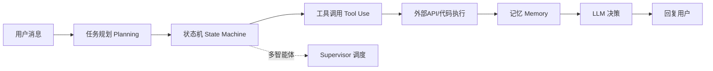

# AI Agent 架构与 Harness 实战（面试核心）

> JD 的核心是"用 Python 把 Agent 落地成服务"。这是你差异化最大的部分，也是**对冲本科学历硬伤的武器**。本篇从"Agent 是什么"讲到市面上主流框架/产品的独家实现，并落到"光伏业务智能体怎么用 Python 自研"。

## 0. 一句话定位
- **Agent = Model + Harness**（2026 下半年行业共识）。
  - **Model** = 大脑（LLM，负责理解和决策）
  - **Harness** = 让模型"动手干活"的运行时底座：文件访问、工具调用、记忆、沙箱、错误重试、任务拆解、结果回传。
- 行业趋势：2026 下半年 LLM 竞争从"模型竞赛"转向 **"Agent Harness 竞赛"**——模型能力在拉齐，但 Agent 能否在生产环境稳定交付，**70% 看 Harness 的工程打磨**（沙箱隔离、状态机容错、上下文裁剪）。

## 1. Agent 五大核心机制（必背，面试高频）



1. **状态机（State Machine）**：任务流转 + 上下文状态管理。比如"踏勘→设计→审核→并网"四状态。
2. **记忆机制（Memory）**：短期（当前 session 上下文）+ 长期（持久化到数据库/向量库）。
3. **任务规划（Planning）**：ReAct（最常用）/ Plan-and-Execute / Tree of Thoughts。
4. **工具调用 Tool Use / Function Calling**：LLM 输出"调哪个工具 + 参数"，运行时执行，结果喂回模型。核心是给工具写清晰的 schema。
5. **多智能体协同（Multi-Agent）**：Supervisor 模式（总管分配子任务）/ Peer 模式（平等协作）。

## 2. RAG 完整流程（必问）

```
文档 → 切分(Chunk) → Embedding向量化 → 存入向量库
                                    │
用户问题 → 向量化 → 召回 Top-k → 重排(Rerank) → 拼进 Prompt → LLM 生成
```
- 切分 / Embedding（bge、text-embedding-3）/ 向量库（FAISS 本地、Milvus 大规模、Chroma 开发友好）/ 召回（Top-k + 混合检索 BM25）/ 重排（Cross-Encoder）。
- 连回 TCL：光伏"AI 智能数据分析"本质就是 RAG——把业务文档/报表向量化，用自然语言提问。

---

## 3. 主流 Agent 框架 / 产品的独家实现对比（你最该搞清楚的部分）

> 你问"codex、claude code、workbuddy、deepseek harness 这些区别，就是在 agent 框架上的独家详细实现？这些编码智能体总不是 python 写的吧，langchain 又是什么"——这一节直接回答。

### 3.0 先分清三类（面试别混）
- **框架（Framework）**：LangChain / LangGraph —— 给你搭 agent 的"积木库"，你自己写业务。
- **产品 / Agent（Product）**：Claude Code / Codex / WorkBuddy —— 直接能用的 agent，开箱即跑。
- **运行时 / 底座（Harness / Runtime）**：DeepSeek Harness / Codex Harness —— 让模型"动手"的引擎，**产品通常建在它之上**。

### 3.1 LangChain —— 最早给"简单智能体"搭框架的库
- **是什么**：Python / JS 的 LLM 应用开发框架，提供 chains / agents / tools / memory / retrievers 抽象。2023–2024 年"给简单智能体搭框架"几乎是标准答案。
- **核心思想**：把"调 LLM → 调工具 → 拼结果"封装成可组合组件，几行代码串起 RAG、Agent。
- **现状 / 争议**：被批评**过度抽象**（封装太深、debug 难、版本乱）。2025 后很多人回归"裸 SDK"——直接调 OpenAI/DeepSeek API + 自己写 ReAct 循环，更简单可控。
- **你面试怎么讲**："LangChain 是 agent 框架层的早期代表，用 chains/agents 抽象降门槛；但实际落地我倾向更轻的方案（直接写 ReAct 循环，或用 DeepSeek Harness 这类运行时），避免抽象带来的 debug 成本。"

### 3.2 Claude Code（Anthropic）—— 终端 coding agent 产品
- **是什么**：Anthropic 出的**命令行 AI 编程助手**，直接在终端 / IDE 跑。
- **独家实现**：
  - **真实工具集**：读文件、写文件、跑 bash、搜代码——都是"能改你项目"的工具。
  - **权限系统**：默认要你批准危险操作（写文件 / 跑命令），可配 auto-accept。
  - **Hooks**：在 PreToolUse / PostToolUse / Stop 等节点触发脚本——**这正是 Workisland 监控它的方式**。
  - **Sub-agents**：派子 agent 并行干不同任务；自动读 CLAUDE.md、压缩历史。
- **和 JD 关系**：TCL 要的"Agent 开发"若用这类工具，重点是**写清晰指令 + 接企业系统**。

### 3.3 Codex（OpenAI）—— 云端 sandbox + CLI 的 coding agent
- **是什么**：OpenAI 的 coding agent，有**云端版**（隔离 sandbox 里跑、可并行多任务）和 **CLI 版**。
- **独家实现**：见 3.5（Codex Harness 是它的引擎）——Rust 核心、系统级硬沙箱、保留推理。

> ⚠️ **命名提醒（别和你的项目搞混）**：本节的 **Codex 指 OpenAI 的 coding agent 产品**，不是你自己开发的 macOS 桌面 App（你那个项目也叫 Codex，是独立个人产品，跑在本机、操作本机文件，和 OpenAI 的没关系）。
> ⚠️ **Codex 有两种模式，别只记"云端"**：①**本地 CLI 版（你下载装的就是这个）**= 在你本机沙箱里跑、默认断网、模型连云端 API、直接改你本地文件——**执行模型和 Claude Code 基本一样**；②**云端 agent 版（ChatGPT 侧栏）**= 派任务后代码在 OpenAI 云上的隔离容器里跑（预载仓库副本、可多任务并行）、跑完你把 diff 拉回本地。"云端隔离沙箱 + 并行"是 Codex **独有、Claude Code 没有**的云端模式，**不是本地版的行为**。之前写成"Codex 默认改云上副本"是只讲了云端模式，已纠正。

- **和 Claude Code 区别（纠正：本地模式两者执行模型基本一致）**：你本地装的 Codex（CLI 版）= 本机沙箱跑 + 模型连云端，这点和 Claude Code **一样**。真正的差别是 **Codex 还独有"云端并行 agent 模式"**（ChatGPT 里派任务→每个任务在远端隔离沙箱跑、可多任务并行、跑完拉回 diff），而 Claude Code 是纯本地终端智能体（深度集成 + Hooks + 子 agent）。所以不是"云端 vs 桌面"的二分，而是"Codex 多一个云端并行选项"。

### 3.4 DeepSeek Harness vs Codex Harness（你研究过，面试加分项）

**DeepSeek Harness (dsh)** —— 微内核 + 一切皆插件
- 没有特权核心：LLM 接入、Prompt 拼装、沙箱、甚至 **Agent Loop 本身**都只是挂在 `ctx` 上的普通插件。换沙箱/换循环 = 改配置，不碰主体代码。
- 运行时热更新（HMR）+ Fiber 生命周期：改配置/工具不用重启。
- **事件溯源（Event Sourcing）**：会话历史是仅追加事件日志，上下文由事件流动态投影 → 天生支持高保真回放 / 分支克隆（Fork），多 Agent 不互相污染状态。
- 模型无关：可接多家 LLM。

**Codex Harness** —— Rust 引擎 + 系统级硬隔离
- 纯 Rust 核心（codex-rs/core）：状态机流转、系统调用拦截、Token 预算、高并发 I/O。
- **系统级硬隔离沙箱**：Linux 用 bubblewrap (bwrap) 轻量容器，Windows 用原生沙箱；`execpolicy` 对文件/网络做白名单 + 人工审批——防恶意命令。
- **保留推理（Retained Reasoning）+ 上下文压缩**：多轮工具调用间智能保留关键推理状态。
- 强契约协议服务：JSON-RPC / WebSocket 暴露接口给 VS Code/Web/CI。

| 维度 | Codex Harness（OpenAI） | DeepSeek Harness (dsh) |
|---|---|---|
| 设计哲学 | 引擎驱动 + 强契约协议 | 微内核 + 一切皆插件 |
| 技术底座 | Rust（性能/安全） | TypeScript + Cordis（灵活/动态） |
| 沙箱 | 原生深度集成（bwrap/Windows） | 抽象策略层（Local/Remote 可换） |
| 扩展 | 标准协议（MCP/JSON-RPC） | 运行时动态编排（YAML Patch/HMR） |
| 状态管理 | 保留推理 + 上下文压缩 | 事件溯源 + 状态流动态投影 |
| 适用 | 企业生产/CI-CD/不可信代码审查 | 前沿探索/深度定制/多 Agent 协同 |

### 3.5 WorkBuddy（平台级 agent —— 就是当前你用的这个）
- **是什么**：**平台级 AI 助手 / agent**，不是单一 coding 工具，而是能调用多种工具、MCP、skill 的通用工作体。
- **独家实现**：
  - **MCP（Model Context Protocol）**：通过标准协议接外部系统（和飞书 Aily 用 MCP 接企业系统思路一致）。
  - **Skills（技能）**：可加载的领域能力包，让 agent 获得专项技能。
  - **多工具 + 自主循环**：读文件 / 跑命令 / 调 API / 生成内容，按任务自主编排。
  - 和 coding agent 区别：WorkBuddy 是**通用工作台**，coding 只是其中一种能力；Claude Code / Codex 是**专精 coding** 的 agent。

### 3.6 智能体框架都是 Python 写的吗？（直接回答你的疑问）
**不是。** 框架/产品的实现语言各异：
- LangChain：Python / JS
- DeepSeek Harness：**TypeScript**（Cordis）
- Codex Harness：**Rust**
- Claude Code / Codex 产品：混合，核心是 agent 逻辑而非某种"必须用 Python"
- **但结论**：你作为**使用者**，用 Python 调它们的 API、在它们之上写**业务 Agent 服务（FastAPI）**是最常见的——所以"Python 后端"仍是你的主战场，**框架是工具不是目的**。你的飞书智能体正是 Python 写的后端 + DeepSeek Harness（TS）编排，两者配合。

### 3.7 一张表看懂它们（框架 / 产品 / 运行时 三维）

| 名字 | 类别 | 实现语言 | 独家实现要点 |
|---|---|---|---|
| LangChain | 框架 | Python/JS | chains/agents/tools 抽象，入门快但偏重 |
| Claude Code | 产品(coding) | 混合 | 终端深度集成 + 权限 + Hooks + Sub-agents |
| Codex | 产品(coding) | Rust harness | 云端并行 sandbox + 硬隔离 |
| DeepSeek Harness | 运行时 | TS + Cordis | 一切皆插件 + 事件溯源 + HMR |
| Codex Harness | 运行时 | Rust | 系统级沙箱 + 保留推理 |
| WorkBuddy | 产品(通用) | 平台 | MCP 接系统 + Skills + 多工具自主循环 |

### 3.8 行业启示 + 你怎么用到 TCL 面试里（⭐核心话术）
- **为什么 Harness 重要**：大模型能力在拉齐，真正决定 Agent 能否落地的，是 Harness 在**沙箱隔离、状态机容错、上下文裁剪**上的工程打磨。
- **连回 TCL 业务**：光伏"项目高度分散、审核/设计/运维长期依赖人工判断，一个项目上百项确认"——正是 Agent + 好 Harness 的用武之地：状态机管流程、硬沙箱保证调外部 API 安全、长期记忆/事件溯源积累区域屋顶结构差异。
- **你能讲的差异化**：*"我研究过 DeepSeek Harness 和 Codex Harness 两种路线——前者插件化适合频繁迭代业务规则，后者 Rust 硬沙箱适合审不可信外部输入。落地光伏 Agent 我会优先考虑状态机 + 沙箱隔离，而不是只调 API。"*

### 3.9 光伏业务智能体，怎么用 Python 自研（重点落地）
结合你飞书智能体的经验，直接迁移到 TCL 光伏：

**① 业务映射**（把"项目管理"换成"光伏业务"）
- 踏勘 Agent：读屋顶照片/地址 → 初判可装容量
- 设计 Agent：调设计 API 生成电站图
- 审核 Agent：按规则清单逐项核验资质/材料
- 运维 Agent：监控发电数据异常告警

**② 技术架构（Python 自研，复用你飞书项目的模式）**
1. **接入层**：TCL 内部系统（类似飞书 Bitable 的企业 API / 内部中台）走鉴权 + REST 适配器——你飞书项目 `bitable.py` 那套。
2. **Agent 循环**：用 FastAPI 起服务（你 `04` 学的），`Agent.handle()` 多轮 ReAct，最多 N 步。
3. **Harness / 白名单**：要么直接用 **DeepSeek Harness（dsh）**当编排层 + 白名单工具，要么自研 bridge 限制模型只能调"光伏业务工具"——你飞书项目 `harness_bridge` 那套（模型零裸权限、只走白名单）。
4. **状态机**：踏勘→设计→审核→并网 用 FSM 管流程——你长城证券项目的 RTM/FSM 经验。
5. **安全**：硬沙箱保证调外部设计/并网 API 安全（Codex Harness 思路）。

**③ 为什么不用纯 LangChain**：业务规则频繁变（政策 / 区域差异），插件化 harness（DeepSeek Harness）或自研白名单比 LangChain 抽象更可控、易迭代。

**面试话术**："我做过飞书项目管理智能体，模式可以直接迁移到光伏：Python 后端接企业系统 + Agent 循环 + 白名单 harness + 状态机管流程。区别只是把'飞书多维表格'换成'光伏业务系统'，把'需求/任务'换成'踏勘/设计/审核'。"

---

## 4. 面试怎么讲（逐字稿要点，配合 `02-项目讲述`）
1. **被问"Agent 和单纯调 LLM 的区别"**：LLM 只生成文本；Agent = LLM + 能调工具/有记忆/会规划。举飞书智能体：状态机管任务流、Function Calling 拉数据、长期记忆存上下文。
2. **被问"你怎么学 Agent 的"**：*"我研究过 DeepSeek Harness 的插件化架构和事件溯源，也看了 Codex Harness 的 Rust 沙箱，理解到 Agent 落地的关键在 Harness 工程化而不只是 prompt。"*
3. **被问"LangChain 了解吗"**：*"知道，是早期 agent 框架，抽象好但偏重；实际落地我更倾向轻量方案或直接用 harness。"*
4. **被问"RAG 流程"**：按第 2 节背，顺带连 TCL 的 AI 数据分析。
5. **被问"对最新技术了解吗"**：抛 harness 对比 + 光伏业务结合（第 3.8/3.9 节）。

## 5. 自测题（能答出要点 = 过关）
1. 用一句话解释 Agent = Model + Harness；框架 / 产品 / 运行时 三类各举一个。
2. 画/说 Agent 五大核心机制。
3. RAG 的 6 个步骤，向量库举 2 个例子。
4. DeepSeek Harness 和 Codex Harness 最大的设计差异？各适合什么场景？
5. 为什么"事件溯源"对多 Agent 协作有用？
6. LangChain 是什么、有什么争议？
7. 这些框架/产品都是 Python 写的吗？（答：不是，但用 Python 在它们之上写业务 Agent 服务最常见）
8. 把 harness 知识 + 你的飞书项目经验，说一段"光伏业务智能体怎么用 Python 自研"的 1 分钟回答。

## 5.1 自测题参考答案（背这个）

**Q1｜Agent = Model + Harness**
- Agent = 大模型（大脑，理解+决策）+ Harness（底座，让模型"动手"：文件访问、工具调用、记忆、沙箱、重试、回传）。
- 框架：LangChain ｜ 产品：Claude Code / Codex / WorkBuddy ｜ 运行时：DeepSeek Harness / Codex Harness。

**Q2｜五大核心机制**
1. 状态机（任务流转 + 上下文管理）
2. 记忆（短期 session + 长期持久化）
3. 规划（ReAct / Plan-and-Execute / ToT）
4. 工具调用 Function Calling（模型选工具+参数 → 运行时执行 → 结果回灌）
5. 多智能体（Supervisor 总管 / Peer 平等协作）

**Q3｜RAG 六步 + 向量库**
切分 Chunk → Embedding 向量化 → 存入向量库 → 问题向量化 → 召回 Top-k（混合 BM25）+ 重排 Rerank → 拼 Prompt 送 LLM。向量库：FAISS（本地）、Milvus（大规模）、Chroma（开发友好），举 2 个即可。

**Q4｜DeepSeek Harness vs Codex Harness 最大差异**
- 最大差异＝设计哲学：DSH 是"微内核 + 一切皆插件"（TS+Cordis，Agent Loop 本身也是插件，事件溯源，HMR 热更新，模型无关）→ 适合频繁迭代业务规则 / 多 Agent 协同 / 深度定制；
- Codex Harness 是"Rust 引擎 + 系统级硬沙箱"（bwrap/Windows 白名单，保留推理+上下文压缩，JSON-RPC/WebSocket 强契约）→ 适合企业生产 / CI-CD / 审不可信外部输入。

**Q5｜为什么"事件溯源"对多 Agent 协作有用**
会话历史是仅追加事件日志，上下文由事件流动态投影：① 支持高保真回放 / 分支克隆（Fork）；② 多 Agent 各自投影自己视图、不共享可变状态、互不污染；③ 出错可回放定位。所以是多 Agent 协作的安全基础。

**Q6｜LangChain 是什么 / 争议**
- 是什么：Python/JS 的 LLM 应用框架，chains/agents/tools/memory 抽象，2023–24 给简单智能体搭框架近乎标准。
- 争议：过度抽象（封装深、debug 难、版本乱）；2025 后很多人回归裸 SDK（直接调 API + 自写 ReAct）。
- 话术："知道，但落地我倾向轻量方案或 harness，避免抽象带来的 debug 成本。"

**Q7｜都是 Python 写的吗**
不是。LangChain=Py/JS；DSH=TS；Codex Harness=Rust；Claude Code/Codex=混合。但作为使用者，用 Python 在它们之上写业务 Agent 服务（FastAPI）最常见 → Python 后端仍是主战场。

**Q8｜1 分钟话术（光伏业务智能体怎么用 Python 自研）**
"我做过飞书项目管理智能体，模式可直接迁移到光伏：Python 后端接企业系统（鉴权+REST 适配器）+ Agent 循环（FastAPI+多轮 ReAct）+ 白名单 Harness（模型零裸权限，只走业务工具）+ 状态机（踏勘→设计→审核→并网）。区别只是把'飞书多维表格'换成'光伏业务系统'，把'需求/任务'换成'踏勘/设计/审核'。落地时优先状态机+沙箱隔离，而不是只调 API。"

---

## 6. 补充资料（自己快速过）
- LangChain / LangGraph 官方文档（理解框架层抽象）
- DeepSeek Harness 仓库 README（看 Cordis 插件结构 + 事件溯源）
- Codex Harness 仓库（看 codex-rs/core 与 sandboxing）
- Claude Code / Codex 官方文档（看 Hooks、Sub-agents、权限模型）
- 飞书 Aily 开放文档（MCP 接企业系统的平台方案）
